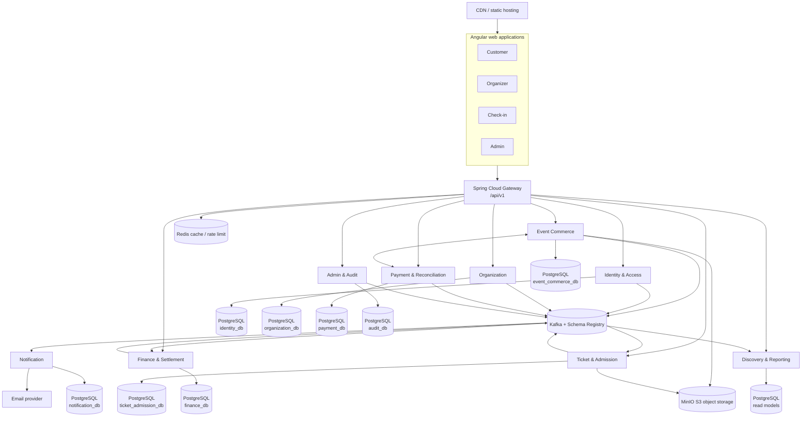
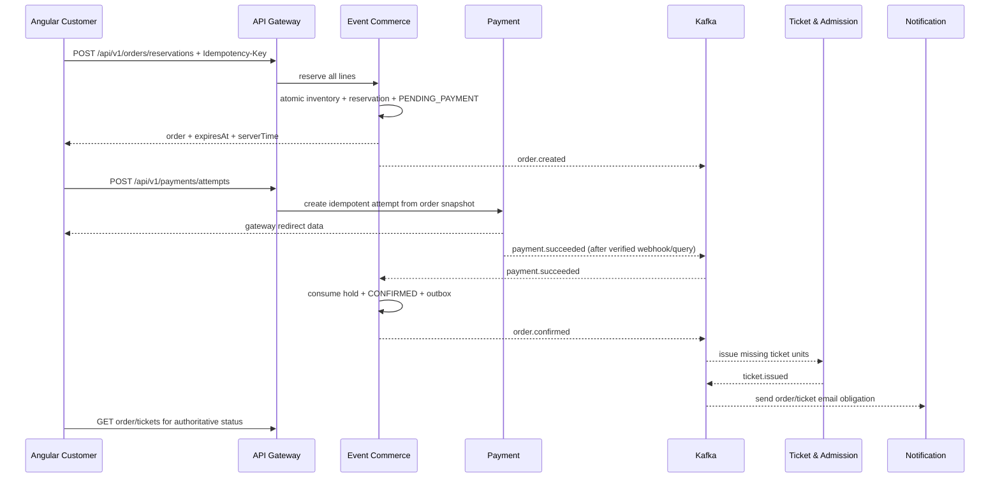
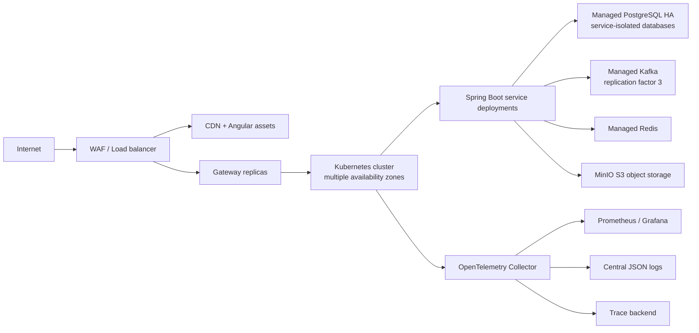

# Event Ticketing Platform

**System Design Document (SDD) | v0.1.0 | MVP 1.0**

## 1. Document control

| Attribute | Value |
| --- | --- |
| Product | Event Ticketing Platform |
| Document | `04-system-design.md` |
| Version | 0.1.0 |
| Status | Technical proposal for review |
| Scope | 13 MVP modules |
| Target market | Vietnam |
| Currency | VND |
| Primary stack | Angular 17+, Spring Boot 3.x, PostgreSQL, Kafka |
| Source documents | `01-product-requirements.md`, `02-business-rules.md`, `03-ui-ux-design.md` |

This document turns the product requirements, business rules and UI/UX contracts into a deployable system design. It owns technical boundaries, communication patterns, data ownership, consistency mechanisms, deployment topology and operational controls. It does not replace the API, database, security or test specifications that follow it.

`01-product-requirements.md` is the product authority. `02-business-rules.md` is the authority for invariants, guards, state transitions and acceptance scenarios. `03-ui-ux-design.md` is the authority for routes, screen states and interaction contracts. Any item marked **PROPOSED** or **OPEN** requires review before it becomes production policy.

## 2. Design goals and constraints

### 2.1. Goals

- Deliver four responsive web experiences: Customer, Organizer, Check-in and Admin.
- Preserve strong consistency for inventory allocation, order confirmation and check-in.
- Process payment callbacks, ticket issuance, email and reporting asynchronously without losing recoverable obligations.
- Allow each bounded context to own and evolve its data independently.
- Support horizontal scaling for the read path and event-driven workloads.
- Make every financial and admission decision auditable and idempotent.

### 2.2. Product constraints carried into the design

- MVP uses general admission tickets; there is no seat map, transfer, resale, queue, discount or native mobile application.
- A customer order belongs to exactly one event and can contain multiple ticket types from that event.
- The default hold duration is 10 minutes; the backend server clock is authoritative.
- A confirmed order cannot be cancelled by the customer in MVP.
- A paid order is confirmed only from verified gateway evidence. A browser return page is never proof of payment.
- A successful payment received after the hold expires is a financial exception and does not create a usable ticket.
- A ticket is checked in online, atomically and at most once.
- Email failure does not roll back a successful order, payment, ticket or settlement.
- Organizer access is restricted by organization membership and event assignment; UI guards never replace backend authorization.

### 2.3. Non-functional targets

The following targets come from the PRD and remain targets to validate with load and failure tests:

| Concern | Target |
| --- | --- |
| Availability | 99.9% |
| Concurrent users | 5,000 |
| Read API | P95 ≤ 500 ms |
| Booking API | P95 ≤ 1,000 ms |
| Check-in API | P95 ≤ 1,000 ms |
| Ticket issuance | P95 ≤ 30 seconds |
| Accessibility | WCAG 2.2 AA target |
| Recovery point | RPO ≤ 5 minutes |
| Recovery time | RTO ≤ 60 minutes |
| Success invariants | 0 overselling, duplicate ticket issuance, duplicate successful check-in or duplicate settlement |

Performance numbers are acceptance targets, not guarantees from this document. Capacity tests must use the production-like traffic profile and the concurrency scenarios in BRS-T09, T14, T20, T28 and T36–38.

## 3. Architecture overview

The platform uses a domain-oriented microservice architecture behind one public API Gateway. Synchronous REST is used for user-facing commands and small queries. Kafka carries integration events and recoverable background work. Each service owns its database; no service reads another service's tables.



The diagram shows logical ownership. A production deployment may place several databases on one managed PostgreSQL cluster, but the schemas and credentials remain isolated. Redis is an optimization and abuse-control layer; it is never the source of truth for inventory, payment, ticket validity or check-in.

## 4. Bounded contexts and service boundaries

### 4.1. Service catalogue

| Service | Owns | Does not own | Primary consistency |
| --- | --- | --- | --- |
| **Identity & Access** | User identity, credentials, roles, refresh sessions, account status, email verification | Organization membership details, event data, payment data | Strong within identity |
| **Organization** | Organizations, verification applications, members, event-staff assignments, payout destination versions | Authentication secrets, event lifecycle, settlement amounts | Strong within organization |
| **Event Commerce** | Event lifecycle, categories, venue metadata, ticket types, quota, reservations, orders, price/commission snapshots | Gateway evidence, issued ticket credentials, check-in records, payout transfer | Strong for event + inventory + reservation + order |
| **Payment & Reconciliation** | Payment attempts, verified gateway transactions, provider adapter, reconciliation and payment exceptions | Order state, inventory, ticket issuance, manual bank transfer | Strong within payment ledger; eventual to consumers |
| **Ticket & Admission** | Ticket unit identities, QR credentials, ticket status, check-in records and admission validation | Order pricing, gateway state, organizer verification | Strong for ticket + check-in decision |
| **Finance & Settlement** | Commission snapshots consumed from confirmed sales, settlement claims, manual transfer evidence | Raw payment gateway callbacks, ticket inventory | Strong within settlement claim |
| **Discovery & Reporting** | Search index, public event read model, dashboards, CSV projections and aggregate metrics | Canonical event, order, payment or inventory writes | Eventual, with freshness shown |
| **Notification** | Email delivery obligations, templates, attempts and retry state | Business state transitions and financial authority | Recoverable asynchronous processing |
| **Admin & Audit** | Moderation commands, system configuration, append-oriented audit records and exception review workflow | Direct unrestricted writes to other services' data | Strong for audit and command acceptance |

The service boundaries intentionally keep event configuration, inventory, reservation and order in **Event Commerce**. BRS requires reservation plus pending-order creation to be all-or-nothing and requires the reservation/expiry/confirmation race to conserve inventory. Splitting those records into separate services in MVP would require a distributed transaction or a compensating design that adds risk without product value. The boundary can be split later only after a measured scale problem and an explicit migration design.

### 4.2. Frontend boundary

The frontend is one Angular workspace with four deployable applications and shared libraries:

```text
frontend/
  apps/
    customer/
    organizer/
    check-in/
    admin/
  libs/
    app-shell/       route layouts, auth/session, workspace context
    ui/              design tokens and accessible components
    api-client/      generated REST clients and Problem Details mapping
    domain-models/   DTOs, enums, status labels, date/money formatting
    i18n/             Vietnamese and English dictionaries
    testing/         shared fixtures and contract helpers
```

Angular applications use standalone components, strict TypeScript, `OnPush` change detection, signals for local view state, NgRx only for cross-route/session state, lazy-loaded routes and `takeUntilDestroyed`/`async` pipe for subscription lifetime. The route guards improve navigation only; every mutation is authorized again by the backend.

The four applications share the design tokens from `03-ui-ux-design.md`: indigo primary `#4338CA`, responsive 4/8/12-column layouts, minimum 44px touch targets, visible focus, keyboard operation, screen-reader labels and WCAG 2.2 AA verification.

## 5. Request and communication model

### 5.1. Public edge

1. Browser calls `/api/v1` through the API Gateway.
2. Gateway terminates TLS, applies CORS, request-size and coarse rate limits, propagates `X-Request-ID`/`traceparent`, and routes to a service.
3. The target service validates the access token, current account status, role and resource scope. Gateway claims are not sufficient for authorization.
4. The service returns a consistent JSON contract and `application/problem+json` for errors.

The public API uses resource-oriented REST and URL versioning (`/api/v1`). Collection responses use a stable cursor and `hasMore`; administrative tables may use a documented page cursor. JSON property names use `camelCase`. Timestamps are ISO-8601 instants in UTC; the event timezone is returned separately for display. Money is an integer VND amount and is never represented as a floating-point value.

### 5.2. Synchronous calls

Synchronous calls are limited to an immediate user decision or a read that requires current authority:

| Caller | Target | Purpose | Failure behavior |
| --- | --- | --- | --- |
| Gateway | Any service | Public REST routing | Timeout, `503`, correlation ID |
| Event Commerce | Organization | Verify organization membership/status at command time | Deny command; short timeout and circuit breaker |
| Event Commerce | Payment | Create an idempotent payment attempt and receive redirect data | Keep order pending; no blind retry |
| Ticket & Admission | Event Commerce read endpoint | Optional current event cancellation/version check for scan edge cases | Deny/unknown safely; never admit from stale client data |
| Admin | Domain service | Submit a moderation/configuration command | Optimistic version conflict; reload before retry |

Internal HTTP calls have an explicit connect/read/overall timeout, bounded retry only for safe transient failures, circuit breakers and bulkheads. No request chain should exceed two synchronous service hops on the booking or check-in critical path.

### 5.3. Asynchronous calls

Kafka is used when work is long-running, fan-out, replayable or not required to complete before the HTTP response:

- payment webhook processing and reconciliation;
- ticket issuance, QR/PDF generation and email delivery;
- event cancellation fan-out and ticket invalidation;
- dashboard/search projections;
- audit publication and operational metrics.

Each event has an immutable envelope:

```json
{
  "eventId": "uuid",
  "eventType": "order.confirmed",
  "eventVersion": 1,
  "occurredAt": "2026-11-19T10:00:00Z",
  "producer": "event-commerce",
  "aggregateType": "order",
  "aggregateId": "uuid",
  "correlationId": "uuid",
  "causationId": "uuid",
  "payload": {}
}
```

Kafka headers carry `traceparent`, `correlationId`, `eventType`, `eventVersion` and `idempotencyKey`. Integration payloads use Avro with Schema Registry **PROPOSED**; compatibility is `BACKWARD` or `FULL` per subject, never `NONE` for production. Producers use `acks=all`, idempotence and bounded retries. Consumers use manual acknowledgement, an inbox/deduplication record and a dead-letter topic.

### 5.4. Core topic catalogue

Topic names use `<domain>.<aggregate>.<past-tense-event>.v1`.

| Topic | Producer | Main consumers |
| --- | --- | --- |
| `identity.user.email-verified.v1` | Identity | Organization, Notification, Reporting |
| `organization.organizer.verified.v1` | Organization | Event Commerce, Notification, Reporting |
| `organization.membership.changed.v1` | Organization | Event Commerce, Ticket & Admission, Reporting |
| `event.event.approved.v1` | Event Commerce | Notification, Discovery, Audit |
| `event.event.published.v1` | Event Commerce | Discovery, Notification |
| `event.event.cancelled.v1` | Event Commerce | Ticket & Admission, Payment, Finance, Notification, Discovery |
| `event.order.created.v1` | Event Commerce | Payment, Reporting, Audit |
| `event.order.confirmed.v1` | Event Commerce | Ticket & Admission, Finance, Notification, Reporting |
| `event.order.expired.v1` | Event Commerce | Payment, Notification, Reporting |
| `event.reservation.released.v1` | Event Commerce | Reporting, Audit |
| `payment.payment.succeeded.v1` | Payment | Event Commerce, Finance, Notification, Reporting |
| `payment.payment.failed.v1` | Payment | Event Commerce, Notification, Reporting |
| `payment.payment.exception-opened.v1` | Payment | Finance, Admin, Notification, Reporting |
| `ticket.ticket.issued.v1` | Ticket & Admission | Notification, Reporting |
| `ticket.ticket.voided.v1` | Ticket & Admission | Notification, Finance, Reporting |
| `ticket.admission.checked-in.v1` | Ticket & Admission | Reporting, Audit |
| `finance.settlement.settled.v1` | Finance | Notification, Reporting, Audit |
| `notification.email.failed.v1` | Notification | Admin, Reporting |

Events are facts, not remote database updates. A consumer must tolerate duplicates, out-of-order delivery and replay. Consumers record the event identity and processing result before acknowledging it. A poison message is moved to `<topic>.dlt` after bounded retries and remains observable and replayable.

## 6. Transaction and consistency design

### 6.1. Event Commerce transaction

Event Commerce is the authoritative consistency boundary for event, ticket type, inventory, reservation and order decisions.

For `POST /api/v1/orders/reservations`:

1. Authenticate the customer and validate that all lines belong to one event.
2. Load the current event and ticket type versions; validate sale window, event state and per-order limits.
3. Within one PostgreSQL transaction, lock the affected inventory rows in deterministic ticket-type order or use a conditional update that proves `reserved + sold + quantity ≤ quota`.
4. Capture server `createdAt`, immutable unit-price snapshots and `expiresAt = createdAt + 10 minutes`.
5. Create all reservation lines and the `PENDING_PAYMENT` order, or create none.
6. Insert an outbox row for `event.order.created.v1` and commit.
7. Return the order, server time and `expiresAt`.

The client countdown is display-only. An expired hold is not consumable even if a cleanup job has not run. Expiry, cancellation and payment confirmation use the same transaction and state guards. A cleanup worker may release expired reservations, but it cannot release an allocation already consumed by a confirmed order.

Inventory invariants are preserved for every ticket type:

```text
Q = quota
R = active allocated reservations
S = confirmed allocation
A = Q - R - S

Q, R, S, A >= 0
R + S <= Q
sum(Q for ticket types) <= event.capacity
```

The service records allocation transitions (`RESERVE`, `CONSUME`, `EXPIRE`, `RELEASE`) in an append-oriented ledger. Admin forms cannot edit `reserved` or `sold` counters directly.

### 6.2. Payment confirmation

Payment Service stores the provider transaction identity, signature evidence, amount, currency and raw payload only in a protected/retained form that does not expose secrets or card data. It verifies the gateway contract before publishing `payment.payment.succeeded.v1`.

Event Commerce consumes the success event idempotently. In one transaction it re-evaluates order state, reservation expiry, event cancellation, amount and currency:

- valid hold + first verified collection → consume reservation, set order `CONFIRMED`, freeze financial snapshot and publish `event.order.confirmed.v1`;
- already confirmed with the same payment identity → return/replay the prior result;
- expired/cancelled/invalid hold → do not issue or reopen the order; retain the collection as a payment exception;
- failure after success → preserve `SUCCESS` and record the conflicting evidence.

The browser return route only queries authoritative payment/order state. An unknown or timed-out request never triggers a blind second charge.

### 6.3. Ticket issuance and admission

Ticket & Admission consumes `event.order.confirmed.v1`. It creates one stable ticket unit per confirmed quantity using a unique key `(orderId, orderItemId, ordinal)`. Retries issue only missing units. QR credentials are random, opaque and stored hashed or encrypted according to the Security Design; they do not contain PII or payment data.

The same service owns the atomic admission decision:

1. Authenticate staff and verify active event assignment.
2. Resolve the ticket credential or permitted manual lookup.
3. Verify event match, event cancellation, ticket state and check-in window.
4. In one transaction, conditionally change `ISSUED` to `CHECKED_IN` and insert the admission record.
5. Return `SUCCESS`, `ALREADY_USED`, `WRONG_EVENT`, `VOIDED`, `OUTSIDE_CHECK_IN_WINDOW` or another semantic result.

Two concurrent scans can therefore produce only one fresh success. A timeout is `UNKNOWN` until the client queries or replays the same request identity. There is no offline success queue.

Event cancellation uses an admission fence to preserve the BRS-T50 ordering guarantee across service databases. Event Commerce first records the cancellation request and rejects new reservations, then sends an idempotent `freeze-event` command to Ticket & Admission. Ticket & Admission commits the fence under the event gate row and rejects scans after that fence. Event Commerce then commits the public `CANCELLED` state and publishes `event.event.cancelled.v1`. If either step fails, a reconciler keeps the fence or cancellation request visible until the pair is reconciled; it never silently reopens admission. The user-visible state remains the PRD enum `CANCELLED`; the fence is an internal consistency record, not a new product status.

### 6.4. Finance and reporting consistency

Finance consumes confirmed orders, verified payment/reconciliation and event completion facts. A commission snapshot is immutable after it is applied. Ordinary settlement requires `COMPLETED`, reconciled payment data and no unresolved financial obligation. A settlement claim uses a unique entitlement key and is rechecked before manual transfer and before `SETTLED`.

Discovery and Reporting are read models. They may be briefly stale, display `dataUpdatedAt`, and never authorize booking, payment, check-in or payout. They calculate metrics server-side from confirmed and reconciled facts, never from the current page of a frontend table.

## 7. Data architecture

### 7.1. Database ownership

| Database | Key aggregates | Notes |
| --- | --- | --- |
| `identity_db` | users, roles, refresh sessions, verification tokens | Passwords hashed; secrets excluded from logs |
| `organization_db` | organizations, memberships, applications, event assignments, payout destination versions | Sensitive documents and payout data masked/restricted |
| `event_commerce_db` | events, categories, venues, ticket types, inventory, allocation ledger, reservations, orders, outbox | Core strong-consistency boundary |
| `payment_db` | attempts, provider transactions, receipts, exceptions, reconciliation runs, inbox/outbox | No PAN/CVV; provider adapter isolates gateway choice |
| `ticket_admission_db` | tickets, QR credential material, issuance units, admissions, inbox/outbox | Unique ticket unit and admission constraints |
| `finance_db` | commission configuration, snapshots, settlement claims, transfer evidence | Append-oriented financial history |
| `discovery_reporting_db` | public event index, dashboard projections, aggregate snapshots | Rebuildable from Kafka; not authoritative |
| `notification_db` | notification obligations, templates, delivery attempts, dedup identities | Bounded retry and final failure visibility |
| `admin_audit_db` | moderation commands, system config versions, audit records, exception work references | Append-oriented audit; restricted reads |

For local development, these can be separate schemas on one PostgreSQL container with separate application roles. Production should use managed PostgreSQL HA and separate databases or clusters as load and isolation require. No cross-service foreign keys, joins or direct SQL access are allowed.

### 7.2. Persistence patterns

- PostgreSQL transactions and row-level/conditional locking protect inventory, order, payment application, admission and settlement claims.
- UUIDs are used for public identities; monetary values use integer VND; time is stored as UTC instants.
- Every service has `created_at`, `updated_at`, optimistic `version` where stale moderation matters, and an outbox table.
- The transactional outbox writes the domain change and event record together. A publisher retries until Kafka acknowledges; publishing twice is safe because `eventId` is stable.
- Consumers use an inbox table keyed by `(consumerName, eventId)` and commit the inbox result with the local projection/side effect.
- PostgreSQL read replicas may serve discovery/reporting queries only. Inventory, payment confirmation and check-in decisions use the primary authoritative store.
- PgBouncer or equivalent connection pooling is used. Autovacuum, `ANALYZE`, replication lag, backup and PITR are monitored.

### 7.3. Cache and MinIO object storage

- Redis stores short-lived public event cache, rate-limit counters and non-authoritative session support data. Cache misses and Redis outages fall back safely to services; Redis cannot decide whether a ticket is available or valid.
- MinIO is the canonical S3-compatible object store for media in MVP. It stores event images, organizer verification documents and generated ticket/PDF artifacts. Metadata and access ownership remain in the owning service database; services store a media ID/object key and checksum, never a public URL as authority.
- MinIO buckets are private by default and separated by environment and data class (`public-media`, `private-verification`, `private-ticket-artifacts` are **PROPOSED** names). Services use scoped MinIO policies; browser clients receive only short-lived presigned upload/download URLs after authorization.
- A media upload is an intent → direct presigned upload → server-side completion/validation flow. The owning service verifies size, content type, checksum and malware-scan result before attaching the media to an event, application or ticket. MinIO is not a source of business state.
- CDN caches only public immutable images and public discovery responses with explicit invalidation/versioning. Private order, ticket and financial responses are never shared-cached.

## 8. Service responsibilities and critical flows

### 8.1. Customer purchase



Free orders skip Payment Service and are confirmed by Event Commerce while the active reservation is still valid. Paid and free orders both publish the same `event.order.confirmed.v1` contract after confirmation.

### 8.2. Event cancellation

The cancellation command is accepted by the owning service with authorization, version and reason. Event Commerce rejects new reservations, establishes the admission fence described in §6.3, then commits `CANCELLED` and publishes `event.event.cancelled.v1`. Ticket & Admission voids usable tickets and blocks check-in; Payment opens return obligations for actual collections; Finance blocks ordinary settlement; Notification sends recoverable notices. Each consumer is idempotent and independently retryable. The system does not add an automated refund module.

### 8.3. Reporting and discovery

Services publish facts after committing their local state. Discovery & Reporting consumes those facts into independently rebuildable projections. Search results, featured/popular labels and dashboard KPIs include scope, timezone/date basis and `dataUpdatedAt`. A stale projection can be refreshed, but it cannot be used as the booking or financial authority.

## 9. API surface outline

The complete OpenAPI contract belongs in `06-api-specification.md`. The following resource groups define the boundary without committing every field:

| Service | Resource groups | Representative operations |
| --- | --- | --- |
| Identity | `/auth`, `/users`, `/sessions` | register, login, refresh, verify email, reset password, profile |
| Organization | `/organizations`, `/organizer-applications`, `/members`, `/event-staff` | apply, verify, manage membership, assign staff |
| Event Commerce | `/events`, `/categories`, `/ticket-types`, `/inventory`, `/reservations`, `/orders` | draft, submit, approve, publish, reserve, cancel pending, query order |
| Payment | `/payment-attempts`, `/payments`, `/payment-webhooks`, `/payment-exceptions` | initiate, provider callback, query, reconcile |
| Ticket & Admission | `/tickets`, `/tickets/{id}/pdf`, `/check-in/events`, `/check-ins` | list, download, validate, scan, lookup, history |
| Finance | `/commission-config`, `/settlements`, `/settlement-exceptions` | configure, request, process, record transfer, resolve |
| Discovery/Reporting | `/discover/events`, `/reports/organizer`, `/reports/admin` | search, filter, KPI, chart, CSV export |
| Admin | `/admin/moderation`, `/admin/users`, `/admin/audit-logs`, `/admin/settings` | approve/reject, lock, feature, inspect audit |

Mutation endpoints use an idempotency key where replay could duplicate a business effect: reservation, payment attempt, webhook application, ticket issuance, check-in and settlement confirmation. The same key with a different payload returns `IDEMPOTENCY_CONFLICT`.

Semantic errors follow the BRS candidates, including `EVENT_NOT_BOOKABLE`, `INSUFFICIENT_INVENTORY`, `PRICE_CHANGED`, `ORDER_EXPIRED`, `PAYMENT_UNKNOWN`, `PAYMENT_EXCEPTION_OPEN`, `TICKET_ALREADY_USED`, `WRONG_EVENT`, `SETTLEMENT_NOT_ELIGIBLE` and `FORBIDDEN`. Error responses include the safe current state and next action but never stack traces, secrets or cross-organization data.

## 10. Security architecture baseline

Detailed controls belong in `07-security-design.md`; this SDD establishes the minimum boundary:

- All browser, gateway and service traffic uses TLS. Internal service credentials and provider secrets are stored in a secret manager, not source control or logs.
- Spring Security 6 resource servers validate JWT signature, issuer, audience, expiry and account status. Access-token/refresh-token storage, lifetimes and revocation policy remain **OPEN** for the Security Design; the proposed web default is an in-memory access token with a Secure, HttpOnly, SameSite refresh cookie.
- Every protected command evaluates current role, organization membership, event assignment and resource ownership server-side. `ADMIN` does not grant direct SQL or counter edits.
- Payment adapters verify signature, merchant identity, reference, amount, currency and provider state. The system never stores card PAN/CVV.
- QR credentials are opaque, high-entropy, access-controlled and absent from logs, URLs, analytics and ordinary admin lists. Old PDFs cannot bypass server validation.
- Rate limits cover login/reset, public search, reserve, payment initiation, webhook, QR lookup and CSV export. Exact thresholds are **OPEN** and must be set with abuse/security owners.
- PII, verification documents, payout data and payment evidence are masked in logs and scoped by least privilege. Audit records preserve actor, action, resource, result, correlation ID, reason and before/after financial values without secrets.
- CORS allows only configured frontend origins. Uploads enforce backend MIME/size/content checks and private object access.

## 11. Resilience and failure handling

Every external call has a timeout, bounded retry with jitter only for safe transient failures, circuit breaker and a graceful failure path. Kafka consumers use backoff, DLT and replay procedures. The following table is the minimum operational behavior:

| Failure | Safe behavior | Recovery evidence |
| --- | --- | --- |
| Event Commerce database unavailable | Booking/mutation fails closed; public read may use Discovery projection | DB health, readiness and error rate |
| Inventory conflict | One request commits; others get a semantic inventory error; no negative stock | Allocation ledger and BRS-T09 |
| Cleanup job delayed | Expired holds remain conservatively allocated until atomic release; no double release | Reservation expiry/release metrics |
| Payment provider timeout | Attempt is `PENDING/UNKNOWN`; query/reconcile before retry; no second charge | Provider reference and reconciliation case |
| Late/duplicate/wrong payment | Preserve actual collection as exception; do not issue extra tickets | Payment exception with evidence |
| Kafka unavailable | Local transaction commits with outbox; async effects wait and recover | Outbox age, broker health |
| Duplicate event delivery | Inbox/idempotency check returns prior result | Consumer duplicate counter |
| Poison event | Bounded retry then DLT; alert owner; replay only after diagnosis | DLT count and replay record |
| Ticket issuance crash | Resume from stable order-item ordinal; no duplicate ticket | Issuance obligation and ticket uniqueness |
| Email provider unavailable | Keep notification obligation and retry; order/ticket unchanged | Delivery attempts and final failure |
| Concurrent check-in | One atomic admission success; other receives already-used/replay result | Admission unique constraint and trace |
| Event cancellation race | Commit ordering determines outcome; post-cancel requests fail; collected money remains tracked | Event version, audit and exception links |
| Settlement transfer timeout | Keep `PROCESSING`/investigation; verify external reference before retry | Transfer evidence and reconciliation |
| Reporting projection lag | Show `dataUpdatedAt`; never use projection to authorize a mutation | Consumer lag dashboard |

Kubernetes workloads expose liveness, readiness and startup probes through Spring Boot Actuator. Readiness includes only dependencies required for the service's current responsibility; a reporting projection lag must not remove Event Commerce from the booking load balancer.

## 12. Deployment topology

### 12.1. MVP environment



For local development, Docker Compose runs the four Angular apps or a shared dev server, the Spring Boot services, one PostgreSQL instance with isolated schemas, one Kafka broker, Schema Registry, Redis, MinIO and a mail catcher. Production starts in one region with multi-zone application replicas and managed HA data services. A second region is not required for MVP, but database PITR, Kafka retention, MinIO backup and restore rehearsal must satisfy the RPO/RTO targets.

### 12.2. Kubernetes workload baseline

- One Deployment per service; independent horizontal scaling based on CPU, request latency, Kafka lag or domain throughput.
- Liveness, readiness and startup probes; graceful shutdown waits for in-flight requests and consumer acknowledgements.
- Separate worker Deployments for outbox publishing, reservation expiry, reconciliation, ticket issuance, email and reporting projection where workload isolation is needed.
- NetworkPolicies restrict service-to-service and database access. Service accounts have least privilege.
- ConfigMaps hold non-secret configuration; secrets come from a secret manager or sealed secret mechanism.
- Rolling updates require backward-compatible API and event schemas. Kafka compatibility checks and database migrations run in CI before deployment.

## 13. Observability and operations

OpenTelemetry propagates traces from Angular request headers through Gateway, Spring Boot, PostgreSQL calls and Kafka headers. Logs are structured JSON and include `traceId`, `spanId`, `correlationId`, service, environment, operation, outcome and safe entity IDs. They never include passwords, tokens, QR secrets, card data, full bank details or raw private documents.

### 13.1. Technical signals

- HTTP request rate, error rate and latency by route/service.
- PostgreSQL connection pool saturation, lock waits, slow queries, vacuum health, replication/PITR status and backup age.
- Kafka producer errors, consumer lag, DLT count, outbox age and inbox duplicate count.
- Payment webhook verification failures, unknown attempts and reconciliation age.
- Ticket issuance backlog, retry age and duplicate-unit conflicts.
- Check-in latency, success/denial/unknown outcomes and scanner connectivity.
- Settlement processing age and ambiguous transfer count.

### 13.2. Business signals and alerts

- Overselling or negative inventory invariant violation: critical, page immediately.
- Duplicate ticket unit, duplicate fresh admission or duplicate settlement entitlement: critical.
- Payment exception age, DLT growth, outbox backlog and consumer lag: owner-routed alert.
- Ticket issuance success rate below 99.9%, payment success rate below target or check-in P95 above target: investigate against traffic and provider health.
- No-data dashboards are distinct from zero; every report carries scope, date basis, timezone and `dataUpdatedAt`.

## 14. Architecture decisions

### ADR-001: Use domain-oriented services with database ownership

**Status:** Proposed for review
**Decision:** Each service owns its data and public contract. Other services use REST or Kafka, never shared tables.
**Rationale:** Preserves bounded-context autonomy and prevents a distributed monolith. Separate schemas are allowed only as a local/development cost optimization.
**Trade-off:** Requires projections, event versioning and eventual consistency for discovery/reporting.

### ADR-002: Keep event, inventory, reservation and order in Event Commerce for MVP

**Status:** Proposed for review
**Decision:** These records share one PostgreSQL transaction boundary.
**Rationale:** BRS requires all-or-nothing reservation + pending order and conservation across reserve/expire/confirm/cancel races.
**Trade-off:** Event Commerce is larger than a narrowly split inventory service. Split only with a measured need and a replacement consistency design.

### ADR-003: Use PostgreSQL transactions for critical invariants

**Status:** Proposed for review
**Decision:** Use conditional updates/row locks, unique constraints, optimistic versions and append-only ledgers in PostgreSQL; never Redis locks for correctness.
**Rationale:** Inventory, payment application, admission and settlement need durable atomic decisions.
**Trade-off:** Hot ticket types may need partitioning or serialized access after load testing.

### ADR-004: Use Kafka with transactional outbox/inbox

**Status:** Proposed for review
**Decision:** Commit local state and an outbox record together; publish versioned events with a Schema Registry; consumers deduplicate through inbox records and DLT poison messages.
**Rationale:** Covers crash recovery, fan-out, replay, email/ticket obligations and eventual read models without pretending distributed exactly-once delivery.
**Trade-off:** Requires operational ownership of schemas, lag, replay and retention.

### ADR-005: Use REST at the public edge and for MVP internal commands

**Status:** Proposed for review
**Decision:** Versioned REST/JSON for browser and low-hop service commands; Kafka for asynchronous facts. Do not introduce gRPC or a service mesh before a measured need.
**Rationale:** Angular tooling, debuggability and a small MVP team benefit from one request contract.
**Trade-off:** Internal JSON has more overhead than gRPC; migrate only the measured hot path.

### ADR-006: Angular workspace with four applications

**Status:** Proposed for review
**Decision:** Use Angular standalone components and shared libraries with independent customer, organizer, check-in and admin application shells.
**Rationale:** Matches the UI/UX sitemap while sharing accessibility, auth, status and money formatting.
**Trade-off:** Four builds and deployment artifacts require coordinated versioning of shared libraries.

### ADR-007: Model payment, fulfillment and notification as recoverable obligations

**Status:** Proposed for review
**Decision:** Order confirmation is the committed business fact; ticket issuance, email and reconciliation resume from durable obligations and do not roll back the fact.
**Rationale:** Directly satisfies late callbacks, crash recovery, email failure and retry rules.
**Trade-off:** UI must display `ISSUING`, `PENDING` or exception states instead of promising immediate completion.

## 15. Security, commercial and product decisions still open

The following are intentionally not silently finalized by this document:

| ID | Decision owner | Required before |
| --- | --- | --- |
| D-01 | Product/Security | Access/refresh token storage, lifetime, revocation and verified-email gate |
| D-02 | Product/Finance | VNPay, MoMo or another gateway; signature/query/refund contract and sandbox evidence |
| D-03 | Finance | Fee rate/mode, rounding, cap, gateway fee treatment, adjustments and negative-net policy |
| D-04 | Finance/Operations | Manual return SLA/evidence for late success, duplicate collection, cancellation and chargeback |
| D-05 | Product/Organizer | Verification documents, membership permissions, suspend/restore and payout re-verification |
| D-06 | Product/Operations | Event edit/cancel authorization, reschedule policy and behavior of existing staff/check-ins |
| D-07 | Product/Security | Buyer vs attendee data, QR distribution/PDF policy and check-in window (proposed two hours before start) |
| D-08 | Product/Analytics | Popular-event lookback, KPI date basis, adjustments and reporting denominators |
| D-09 | Operations | Email provider, retry schedule, reminder timing and locale fallback |
| D-10 | Security/Compliance | Audit retention, PII retention, privacy rights, rate limits and dual approval for finance actions |

Technical defaults in this document may support development and integration tests, but unresolved payment, financial, privacy or legal decisions are launch blockers.

## 16. Implementation sequence and validation

### 16.1. Delivery waves

| Wave | Services/features | Exit evidence |
| --- | --- | --- |
| 1. Foundation | Identity, Gateway, Angular shells, Organization, audit skeleton, CI/CD and observability | Auth/role/membership tests; four shells; trace propagation |
| 2. Event platform | Event Commerce, categories, ticket types, inventory, moderation, Discovery projection | Publish workflow, quota/capacity invariants, public search |
| 3. Purchase | Reservation/order, Payment adapter, webhook verification and reconciliation | Free/paid/expiry/late-payment and concurrent reserve tests |
| 4. Fulfillment | Ticket & Admission, QR/PDF, online check-in, staff assignment | Issuance retry, concurrent scan and cancellation race tests |
| 5. Operations | Finance, settlement, dashboards, exception handling, Notification | Snapshot/settlement idempotency, email retry and reporting scope tests |
| 6. Release hardening | Load, security, accessibility, backup/restore and failure rehearsal | PRD acceptance, BRS-T01–T50 and NFR evidence |

Admin and email slices are delivered with the domain they govern; they are not deferred until the final wave.

### 16.2. Required proof

- **Inventory:** BRS-T07–T15, T43 and property tests for `R + S ≤ Q`; run concurrency barriers against the same final ticket type.
- **Payment:** BRS-T18–T25, T33, T42, T45 and provider sandbox/webhook signature fixtures; verify duplicate and late evidence in persisted state.
- **Fulfillment:** BRS-T26–T32 and T48; restart workers during issuance and notification publication.
- **Check-in:** BRS-T28–T31 and T50; two devices must race the same QR and event cancellation.
- **Finance:** BRS-T34–T39, T46–47; prove no duplicate entitlement or ambiguous transfer retry.
- **Authorization:** BRS-T01–T06, T17, T30 and T42; test resource-ID tampering and revoked membership.
- **Frontend:** UX-01–UX-22; test 320px/200% zoom, keyboard/screen reader, loading/empty/error/stale/unknown states and server-authoritative timer.
- **Operations:** outbox crash recovery, Kafka replay/DLT, PostgreSQL restore, readiness behavior, trace continuity and alert routing.

## 17. Traceability

| Product module | Owning service | Main source references |
| --- | --- | --- |
| Authentication & Authorization | Identity & Access | PRD AUTH-01–11; BRS §3; UI C-05–07, C-15, X-01–02 |
| Organizer Management | Organization + Admin & Audit | PRD ORG-01–09; BRS §4; UI O-01, O-11, O-14, A-03–04 |
| Event Management | Event Commerce + Admin & Audit | PRD EVT-01–14; BRS §5; UI O-03–06, A-05–06 |
| Ticket Type & Inventory | Event Commerce | PRD INV-01–13; BRS §6; UI O-07, C-04, C-08 |
| Event Discovery | Discovery & Reporting | PRD DSC-01–11; BRS §7/§13; UI C-01–04 |
| Booking & Order | Event Commerce | PRD ORD-01–15; BRS §8; UI C-08–12 |
| Online Payment | Payment & Reconciliation | PRD PAY-01–13; BRS §9; UI C-09–12, A-09–10 |
| QR E-Ticket | Ticket & Admission | PRD ETK-01–10; BRS §10; UI C-10, C-12–14 |
| Check-in | Ticket & Admission | PRD CHK-01–10; BRS §11; UI S-01–06, O-10 |
| Commission & Settlement | Finance & Settlement | PRD STL-01–12; BRS §12; UI O-12–14, A-11–12 |
| Reporting & Dashboard | Discovery & Reporting | PRD §6.11; BRS §13; UI O-02, O-12, S-06, A-01 |
| Admin Portal | Admin & Audit + domain commands | PRD ADM-01–15; BRS §14; UI A-01–14 |
| Email Notification | Notification | PRD §6.13; BRS §15; UI C-10, C-13–14, O-01, O-06, O-13 |

## 18. Next documents

1. `05-database-design.md` — physical tables, constraints, indexes, migrations and outbox/inbox schemas.
2. `06-api-specification.md` — OpenAPI 3.1 resources, schemas, error codes, pagination and idempotency headers.
3. `07-security-design.md` — token lifecycle, threat model, secrets, privacy, rate limits, QR protection and audit retention.
4. `08-test-strategy.md` — unit, integration, contract, concurrency, E2E, performance, security and recovery proof.
5. `09-product-backlog.md` — vertical slices mapped to PRD, BRS and UI/UX IDs.
6. `10-deployment-guide.md` — environments, Kubernetes manifests, migrations, observability, backup/restore and runbooks.
