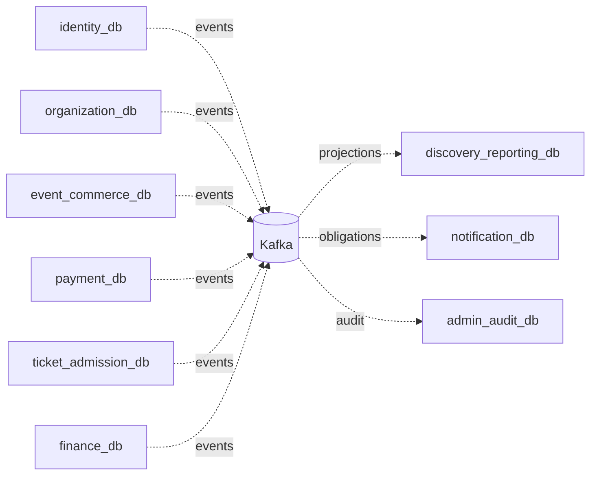

# Event Ticketing Platform

**Database Design Document (DBD) | v0.1.0 | MVP 1.0**

## 1. Document control and authority

| Attribute | Value |
| --- | --- |
| Product | Event Ticketing Platform |
| Document | `05-database-design.md` |
| Version | 0.1.0 |
| Status | Physical design proposal for review |
| Parent design | `04-system-design.md` |
| Product authority | `01-product-requirements.md` |
| Business authority | `02-business-rules.md` |
| UI authority | `03-ui-ux-design.md` |
| Database | PostgreSQL 15+ (managed production target) |
| Migration owner | Each Spring Boot service owns its database migrations |

This document defines physical tables, columns, constraints, indexes, transaction boundaries, migration rules and durable messaging tables. It does not authorize new product scope. `MUST` rules are carried from the PRD/BRS; `PROPOSED` choices are implementation defaults; `OPEN` items require product, finance, security or operations review.

## 2. Physical database topology

The production topology follows the service ownership in `04-system-design.md`:

| Database | Owning service | Production isolation | Local development |
| --- | --- | --- | --- |
| `identity_db` | Identity & Access | Database and role | Schema on one PostgreSQL container |
| `organization_db` | Organization | Database and role | Schema on one PostgreSQL container |
| `event_commerce_db` | Event Commerce | Database and role | Schema on one PostgreSQL container |
| `payment_db` | Payment & Reconciliation | Database and role | Schema on one PostgreSQL container |
| `ticket_admission_db` | Ticket & Admission | Database and role | Schema on one PostgreSQL container |
| `finance_db` | Finance & Settlement | Database and role | Schema on one PostgreSQL container |
| `discovery_reporting_db` | Discovery & Reporting | Database and role | Schema on one PostgreSQL container |
| `notification_db` | Notification | Database and role | Schema on one PostgreSQL container |
| `admin_audit_db` | Admin & Audit | Database and role | Schema on one PostgreSQL container |

Services never use another service's credentials, tables, views or database links. Cross-service IDs are UUID values without foreign keys. A single PostgreSQL cluster is acceptable for MVP cost control only if roles, schemas, connection pools and backups remain isolated.



## 3. PostgreSQL conventions

### 3.1. Extensions and schemas

Each database is initialized by its own `V001__extensions_and_schemas.sql` migration:

```sql
CREATE EXTENSION IF NOT EXISTS pgcrypto;       -- gen_random_uuid()
CREATE EXTENSION IF NOT EXISTS citext;         -- case-insensitive email
CREATE EXTENSION IF NOT EXISTS pg_stat_statements;

CREATE SCHEMA IF NOT EXISTS app;
CREATE SCHEMA IF NOT EXISTS platform;

REVOKE ALL ON SCHEMA public FROM PUBLIC;
GRANT USAGE ON SCHEMA app, platform TO app_runtime;
```

`pg_trgm` is enabled only in `discovery_reporting_db` when trigram search is required. MinIO is the canonical S3-compatible object store for large media files; PostgreSQL stores only object keys, hashes, ownership references and lifecycle metadata.

### 3.2. Type and naming rules

- Public identifiers use `uuid` with `gen_random_uuid()` defaults. Internal high-volume append IDs may use `bigint generated always as identity` where the ID never leaves its service.
- Time uses `timestamptz`. Business comparisons use server/database time in UTC. Display timezone is stored separately on events and reports.
- VND amounts use `bigint` whole units with `CHECK (amount_vnd >= 0)`. Signed adjustments use a separate signed `bigint` column and are never mixed with positive amount columns. No `float` or unconstrained `numeric` is used for money.
- Statuses are `text` with `CHECK` constraints rather than PostgreSQL enums. This keeps backward-compatible migrations possible when a reviewed status is added.
- Text identifiers use `text`/`citext`; codes and slugs have explicit length limits in application validation and database checks where useful.
- All mutable tables have `created_at timestamptz NOT NULL DEFAULT now()` and `updated_at timestamptz NOT NULL DEFAULT now()`. The service updates `updated_at` in the same transaction.
- `version bigint NOT NULL DEFAULT 0` is used for stale moderation/configuration checks. Increment it only in the owning transaction.
- JSONB is used for versioned provider payload metadata, snapshots and projection documents, not for fields required by constraints or high-selectivity queries.
- Foreign keys are allowed only inside one service database. Cross-service references are UUIDs plus application-level existence/permission checks.

### 3.4. MinIO media metadata

Each service that owns a media relationship keeps its own `app.media_objects`
table. The table is metadata only; binary content is stored in MinIO. There is
no cross-service media table and no database foreign key to another service.

```sql
CREATE TABLE app.media_objects (
  id                 uuid PRIMARY KEY DEFAULT gen_random_uuid(),
  bucket_name        text NOT NULL,
  object_key         text NOT NULL,
  media_kind         text NOT NULL CHECK (media_kind IN (
    'EVENT_IMAGE', 'VERIFICATION_DOCUMENT', 'TICKET_ARTIFACT'
  )),
  owner_type         text NOT NULL,
  owner_id           uuid NOT NULL,
  content_type       text NOT NULL,
  byte_size          bigint NOT NULL CHECK (byte_size > 0),
  sha256             bytea NOT NULL CHECK (octet_length(sha256) = 32),
  minio_version_id   text,
  status             text NOT NULL DEFAULT 'UPLOADING'
    CHECK (status IN ('UPLOADING', 'QUARANTINED', 'AVAILABLE', 'REJECTED', 'DELETED')),
  created_by_user_id uuid,
  created_at         timestamptz NOT NULL DEFAULT now(),
  updated_at         timestamptz NOT NULL DEFAULT now(),
  deleted_at         timestamptz,
  metadata           jsonb NOT NULL DEFAULT '{}'::jsonb,
  UNIQUE (bucket_name, object_key)
);

CREATE INDEX media_owner_idx
  ON app.media_objects (owner_type, owner_id, created_at DESC);
CREATE INDEX media_available_idx
  ON app.media_objects (media_kind, status, created_at DESC)
  WHERE status = 'AVAILABLE';
```

`bucket_name` and `object_key` are internal storage coordinates and are not
trusted as authorization input. The service checks `owner_type/owner_id` and
current state before creating a presigned URL. Presigned URLs, MinIO access
keys and raw object content are never stored in PostgreSQL or emitted in audit
logs. The exact bucket names, retention and malware-scanning implementation are
**PROPOSED/OPEN** operational choices.

### 3.3. Common safety constraints

```sql
-- Used in every service database where an updated_at column exists.
CREATE OR REPLACE FUNCTION platform.touch_updated_at()
RETURNS trigger LANGUAGE plpgsql AS $$
BEGIN
  NEW.updated_at = now();
  RETURN NEW;
END;
$$;

-- All application roles are denied direct DDL and cross-service access.
REVOKE CREATE ON SCHEMA app, platform FROM app_runtime;
GRANT SELECT, INSERT, UPDATE, DELETE ON ALL TABLES IN SCHEMA app, platform TO app_runtime;
```

The runtime role does not receive `TRUNCATE`, `REFERENCES`, `TRIGGER` or ownership privileges. Migration roles are separate and are used only by the deployment job.

## 4. Shared platform tables

Every service database has its own copy of these tables in the `platform` schema. They are never shared physically between services.

### 4.1. Transactional outbox

The owning transaction inserts an outbox row with the domain change. A publisher claims rows using `FOR UPDATE SKIP LOCKED`, publishes to Kafka and records the result. Publishing twice is safe because `event_id` is stable.

```sql
CREATE TABLE platform.outbox_events (
  event_id             uuid PRIMARY KEY DEFAULT gen_random_uuid(),
  aggregate_type       text NOT NULL,
  aggregate_id         uuid NOT NULL,
  event_type           text NOT NULL,
  event_version        integer NOT NULL CHECK (event_version > 0),
  topic                text NOT NULL,
  partition_key        text NOT NULL,
  occurred_at          timestamptz NOT NULL DEFAULT now(),
  payload              jsonb NOT NULL,
  headers              jsonb NOT NULL DEFAULT '{}'::jsonb,
  attempt_count        integer NOT NULL DEFAULT 0 CHECK (attempt_count >= 0),
  available_at         timestamptz NOT NULL DEFAULT now(),
  locked_at            timestamptz,
  locked_by            text,
  published_at         timestamptz,
  last_error           text,
  created_at           timestamptz NOT NULL DEFAULT now(),
  CHECK (published_at IS NULL OR locked_at IS NOT NULL)
);

CREATE INDEX outbox_ready_idx
  ON platform.outbox_events (available_at, created_at)
  WHERE published_at IS NULL;
CREATE INDEX outbox_aggregate_idx
  ON platform.outbox_events (aggregate_type, aggregate_id, occurred_at);
CREATE INDEX outbox_published_cleanup_idx
  ON platform.outbox_events (published_at)
  WHERE published_at IS NOT NULL;
```

The publisher must not delete an unpublished row. Retention/archival of published rows is a controlled operational job after the Kafka retention and replay policy is satisfied.

### 4.2. Inbox and consumer deduplication

The inbox row is committed with the consumer's local side effect. A crash before commit causes redelivery; a crash after commit returns the previous outcome.

```sql
CREATE TABLE platform.inbox_events (
  consumer_name        text NOT NULL,
  event_id             uuid NOT NULL,
  event_type           text NOT NULL,
  event_version        integer NOT NULL CHECK (event_version > 0),
  aggregate_id         uuid,
  payload_hash         bytea NOT NULL,
  received_at          timestamptz NOT NULL DEFAULT now(),
  processed_at         timestamptz,
  status               text NOT NULL DEFAULT 'RECEIVED'
    CHECK (status IN ('RECEIVED', 'PROCESSED', 'FAILED')),
  attempt_count        integer NOT NULL DEFAULT 0 CHECK (attempt_count >= 0),
  last_error           text,
  PRIMARY KEY (consumer_name, event_id)
);

CREATE INDEX inbox_unprocessed_idx
  ON platform.inbox_events (consumer_name, received_at)
  WHERE status <> 'PROCESSED';
```

An event with the same `event_id` but a different `payload_hash` is a schema/integrity incident and is rejected, not silently overwritten.

### 4.3. Idempotency keys

Mutation endpoints that can allocate, charge, issue, admit or settle use this table in the owning database.

```sql
CREATE TABLE platform.idempotency_keys (
  scope                text NOT NULL,
  idempotency_key      text NOT NULL,
  request_hash         bytea NOT NULL,
  state                text NOT NULL DEFAULT 'IN_PROGRESS'
    CHECK (state IN ('IN_PROGRESS', 'COMPLETED', 'FAILED')),
  response_status      integer,
  response_body        jsonb,
  resource_type        text,
  resource_id          uuid,
  created_at           timestamptz NOT NULL DEFAULT now(),
  expires_at           timestamptz NOT NULL,
  PRIMARY KEY (scope, idempotency_key),
  CHECK (expires_at > created_at),
  CHECK (state = 'IN_PROGRESS' OR response_status IS NOT NULL)
);

CREATE INDEX idempotency_expiry_idx
  ON platform.idempotency_keys (expires_at);
```

The same key plus the same hash returns the stored result. The same key with a different hash returns `IDEMPOTENCY_CONFLICT`.

## 5. Identity database (`identity_db`)

### 5.1. Tables

```sql
CREATE TABLE app.users (
  id                   uuid PRIMARY KEY DEFAULT gen_random_uuid(),
  email                citext NOT NULL UNIQUE,
  password_hash        text NOT NULL,
  status               text NOT NULL DEFAULT 'ACTIVE'
    CHECK (status IN ('ACTIVE', 'LOCKED', 'DISABLED')),
  email_verified_at    timestamptz,
  preferred_locale     varchar(5) NOT NULL DEFAULT 'vi'
    CHECK (preferred_locale IN ('vi', 'en')),
  display_name         text NOT NULL CHECK (length(trim(display_name)) > 0),
  created_at           timestamptz NOT NULL DEFAULT now(),
  updated_at           timestamptz NOT NULL DEFAULT now()
);

CREATE TABLE app.roles (
  code                 text PRIMARY KEY
    CHECK (code IN ('GUEST', 'CUSTOMER', 'ORGANIZER', 'CHECK_IN_STAFF', 'ADMIN')),
  description          text NOT NULL
);

CREATE TABLE app.user_roles (
  user_id              uuid NOT NULL REFERENCES app.users(id),
  role_code            text NOT NULL REFERENCES app.roles(code),
  granted_at           timestamptz NOT NULL DEFAULT now(),
  granted_by_user_id   uuid,
  PRIMARY KEY (user_id, role_code)
);

CREATE TABLE app.refresh_sessions (
  id                   uuid PRIMARY KEY DEFAULT gen_random_uuid(),
  user_id              uuid NOT NULL REFERENCES app.users(id),
  token_hash           bytea NOT NULL UNIQUE,
  issued_at            timestamptz NOT NULL DEFAULT now(),
  expires_at           timestamptz NOT NULL,
  revoked_at           timestamptz,
  last_seen_at         timestamptz,
  user_agent_hash      bytea,
  CHECK (expires_at > issued_at),
  CHECK (revoked_at IS NULL OR revoked_at >= issued_at)
);

CREATE TABLE app.email_tokens (
  id                   uuid PRIMARY KEY DEFAULT gen_random_uuid(),
  user_id              uuid NOT NULL REFERENCES app.users(id),
  token_type           text NOT NULL CHECK (token_type IN ('VERIFY_EMAIL', 'RESET_PASSWORD')),
  token_hash           bytea NOT NULL UNIQUE,
  expires_at           timestamptz NOT NULL,
  used_at              timestamptz,
  created_at           timestamptz NOT NULL DEFAULT now(),
  CHECK (expires_at > created_at)
);

CREATE INDEX refresh_sessions_active_idx
  ON app.refresh_sessions (user_id, expires_at)
  WHERE revoked_at IS NULL;
CREATE INDEX email_tokens_pending_idx
  ON app.email_tokens (user_id, token_type, expires_at)
  WHERE used_at IS NULL;
CREATE TRIGGER users_touch_updated_at
  BEFORE UPDATE ON app.users
  FOR EACH ROW EXECUTE FUNCTION platform.touch_updated_at();
```

Email addresses are normalized by `citext`; the application still trims and validates them. Passwords and token values are never stored in clear text.

## 6. Organization database (`organization_db`)

Cross-service `user_id` and `event_id` values are UUIDs without foreign keys. Organization membership and assignment checks are performed in this service and are revalidated by callers for protected mutations.

```sql
CREATE TABLE app.organizations (
  id                   uuid PRIMARY KEY DEFAULT gen_random_uuid(),
  legal_name           text NOT NULL,
  display_name         text NOT NULL,
  status               text NOT NULL DEFAULT 'PENDING_VERIFICATION'
    CHECK (status IN ('PENDING_VERIFICATION', 'VERIFIED', 'REJECTED', 'SUSPENDED')),
  owner_user_id        uuid NOT NULL,
  created_at           timestamptz NOT NULL DEFAULT now(),
  updated_at           timestamptz NOT NULL DEFAULT now(),
  version              bigint NOT NULL DEFAULT 0 CHECK (version >= 0)
);

CREATE TABLE app.organizer_applications (
  id                   uuid PRIMARY KEY DEFAULT gen_random_uuid(),
  organization_id      uuid NOT NULL REFERENCES app.organizations(id),
  applicant_user_id    uuid NOT NULL,
  status               text NOT NULL DEFAULT 'PENDING_VERIFICATION'
    CHECK (status IN ('PENDING_VERIFICATION', 'VERIFIED', 'REJECTED', 'SUSPENDED')),
  revision             bigint NOT NULL DEFAULT 1 CHECK (revision > 0),
  verification_data    jsonb NOT NULL DEFAULT '{}'::jsonb,
  rejection_reason     text,
  reviewed_by_user_id  uuid,
  submitted_at         timestamptz,
  reviewed_at          timestamptz,
  created_at           timestamptz NOT NULL DEFAULT now(),
  updated_at           timestamptz NOT NULL DEFAULT now()
);

CREATE TABLE app.organization_members (
  organization_id      uuid NOT NULL REFERENCES app.organizations(id),
  user_id              uuid NOT NULL,
  membership_status    text NOT NULL DEFAULT 'ACTIVE'
    CHECK (membership_status IN ('ACTIVE', 'REVOKED')),
  permissions          jsonb NOT NULL DEFAULT '{}'::jsonb,
  created_at           timestamptz NOT NULL DEFAULT now(),
  updated_at           timestamptz NOT NULL DEFAULT now(),
  PRIMARY KEY (organization_id, user_id)
);

CREATE TABLE app.event_staff_assignments (
  id                   uuid PRIMARY KEY DEFAULT gen_random_uuid(),
  organization_id      uuid NOT NULL REFERENCES app.organizations(id),
  event_id             uuid NOT NULL,
  user_id              uuid NOT NULL,
  status               text NOT NULL DEFAULT 'ACTIVE'
    CHECK (status IN ('ACTIVE', 'REVOKED')),
  assigned_by_user_id  uuid NOT NULL,
  assigned_at          timestamptz NOT NULL DEFAULT now(),
  revoked_at           timestamptz,
  UNIQUE (event_id, user_id)
);

CREATE TABLE app.payout_destinations (
  id                   uuid PRIMARY KEY DEFAULT gen_random_uuid(),
  organization_id      uuid NOT NULL REFERENCES app.organizations(id),
  destination_version  bigint NOT NULL CHECK (destination_version > 0),
  status               text NOT NULL DEFAULT 'ACTIVE'
    CHECK (status IN ('ACTIVE', 'REVOKED', 'PENDING_REVERIFY')),
  provider_account_ref text,
  masked_display      text NOT NULL,
  encrypted_details   bytea,
  verified_at         timestamptz,
  created_at          timestamptz NOT NULL DEFAULT now(),
  UNIQUE (organization_id, destination_version)
);

CREATE UNIQUE INDEX org_active_application_idx
  ON app.organizer_applications (organization_id)
  WHERE status = 'PENDING_VERIFICATION';
CREATE INDEX org_members_active_idx
  ON app.organization_members (user_id, organization_id)
  WHERE membership_status = 'ACTIVE';
CREATE INDEX staff_event_active_idx
  ON app.event_staff_assignments (event_id, user_id)
  WHERE status = 'ACTIVE';
CREATE INDEX staff_user_active_idx
  ON app.event_staff_assignments (user_id, event_id)
  WHERE status = 'ACTIVE';
```

Full verification documents are MinIO objects referenced by `media_objects` (and
the application-level `verification_data` relationship); the table does not
store unrestricted document blobs.

## 7. Event Commerce database (`event_commerce_db`)

This database owns the strong consistency boundary for event lifecycle, ticket types, inventory, reservations and orders. It is the only database allowed to change allocation counters.

### 7.1. Reference and event tables

```sql
CREATE TABLE app.categories (
  id                   uuid PRIMARY KEY DEFAULT gen_random_uuid(),
  code                 text NOT NULL UNIQUE,
  display_name         text NOT NULL,
  status               text NOT NULL DEFAULT 'ACTIVE'
    CHECK (status IN ('ACTIVE', 'INACTIVE')),
  created_at           timestamptz NOT NULL DEFAULT now(),
  updated_at           timestamptz NOT NULL DEFAULT now()
);

CREATE TABLE app.venues (
  id                   uuid PRIMARY KEY DEFAULT gen_random_uuid(),
  organization_id      uuid NOT NULL,
  name                 text NOT NULL,
  address_line         text NOT NULL,
  city                 text NOT NULL,
  country_code         char(2) NOT NULL DEFAULT 'VN',
  timezone             text NOT NULL DEFAULT 'Asia/Ho_Chi_Minh',
  created_at           timestamptz NOT NULL DEFAULT now(),
  updated_at           timestamptz NOT NULL DEFAULT now()
);

CREATE TABLE app.events (
  id                   uuid PRIMARY KEY DEFAULT gen_random_uuid(),
  organization_id      uuid NOT NULL,
  category_id          uuid NOT NULL REFERENCES app.categories(id),
  venue_id             uuid NOT NULL REFERENCES app.venues(id),
  status               text NOT NULL DEFAULT 'DRAFT'
    CHECK (status IN ('DRAFT', 'PENDING_REVIEW', 'APPROVED', 'REJECTED', 'PUBLISHED', 'ONGOING', 'COMPLETED', 'CANCELLED')),
  title                text NOT NULL CHECK (length(trim(title)) > 0),
  slug                 text NOT NULL UNIQUE,
  description          text NOT NULL,
  banner_object_key    text,
  terms                text NOT NULL,
  start_at             timestamptz NOT NULL,
  end_at               timestamptz NOT NULL,
  event_timezone       text NOT NULL DEFAULT 'Asia/Ho_Chi_Minh',
  capacity             bigint NOT NULL CHECK (capacity > 0),
  current_revision     bigint NOT NULL DEFAULT 1 CHECK (current_revision > 0),
  approved_revision    bigint,
  published_revision   bigint,
  cancelled_at         timestamptz,
  cancelled_reason     text,
  created_by_user_id   uuid NOT NULL,
  created_at           timestamptz NOT NULL DEFAULT now(),
  updated_at           timestamptz NOT NULL DEFAULT now(),
  version              bigint NOT NULL DEFAULT 0 CHECK (version >= 0),
  CHECK (start_at < end_at),
  CHECK (approved_revision IS NULL OR approved_revision <= current_revision),
  CHECK (published_revision IS NULL OR published_revision <= current_revision),
  CHECK ((status = 'CANCELLED') = (cancelled_at IS NOT NULL))
);

CREATE INDEX events_public_discovery_idx
  ON app.events (start_at, id)
  WHERE status IN ('PUBLISHED', 'ONGOING', 'COMPLETED');
CREATE INDEX events_organization_status_idx
  ON app.events (organization_id, status, start_at DESC);
CREATE INDEX events_review_queue_idx
  ON app.events (status, updated_at, id)
  WHERE status IN ('PENDING_REVIEW', 'REJECTED');
```

`events.capacity` and the sum of ticket quotas are a cross-row invariant. A `CHECK` constraint cannot safely query another row, so the owning service must lock the event row (`SELECT ... FOR UPDATE`) before changing a ticket quota and validate the sum in the same transaction. Direct write privileges are not granted to operators.

### 7.2. Ticket types and inventory

```sql
CREATE TABLE app.ticket_types (
  id                   uuid PRIMARY KEY DEFAULT gen_random_uuid(),
  event_id             uuid NOT NULL REFERENCES app.events(id),
  code                 text NOT NULL,
  name                 text NOT NULL,
  description          text,
  price_vnd            bigint NOT NULL CHECK (price_vnd >= 0),
  quota                bigint NOT NULL CHECK (quota >= 0),
  max_per_order        integer NOT NULL CHECK (max_per_order > 0),
  sale_start_at        timestamptz NOT NULL,
  sale_end_at          timestamptz NOT NULL,
  paused               boolean NOT NULL DEFAULT false,
  version              bigint NOT NULL DEFAULT 0 CHECK (version >= 0),
  created_at           timestamptz NOT NULL DEFAULT now(),
  updated_at           timestamptz NOT NULL DEFAULT now(),
  UNIQUE (event_id, code),
  CHECK (sale_start_at < sale_end_at)
);

CREATE TABLE app.ticket_inventory (
  ticket_type_id       uuid PRIMARY KEY REFERENCES app.ticket_types(id),
  event_id             uuid NOT NULL REFERENCES app.events(id),
  quota                bigint NOT NULL CHECK (quota >= 0),
  reserved_quantity    bigint NOT NULL DEFAULT 0 CHECK (reserved_quantity >= 0),
  sold_quantity        bigint NOT NULL DEFAULT 0 CHECK (sold_quantity >= 0),
  version              bigint NOT NULL DEFAULT 0 CHECK (version >= 0),
  created_at           timestamptz NOT NULL DEFAULT now(),
  updated_at           timestamptz NOT NULL DEFAULT now(),
  CHECK (reserved_quantity + sold_quantity <= quota)
);

CREATE INDEX ticket_types_sale_window_idx
  ON app.ticket_types (event_id, sale_start_at, sale_end_at, id);
CREATE INDEX ticket_types_event_idx
  ON app.ticket_types (event_id, id);
CREATE INDEX inventory_event_idx
  ON app.ticket_inventory (event_id, ticket_type_id);
```

The service transaction separately validates `sale_end_at <= events.start_at` while holding the event row lock; PostgreSQL `CHECK` constraints cannot safely query another row. `ticket_inventory.quota` is initialized from `ticket_types.quota` and changed together with it under the event lock. If direct table access is ever introduced, a local trigger may reject a mismatched event/ticket-type pair, but it must not make network calls.

### 7.3. Reservations, orders and allocation ledger

```sql
CREATE TABLE app.reservations (
  id                   uuid PRIMARY KEY DEFAULT gen_random_uuid(),
  customer_id          uuid NOT NULL,
  event_id             uuid NOT NULL REFERENCES app.events(id),
  status               text NOT NULL DEFAULT 'ACTIVE'
    CHECK (status IN ('ACTIVE', 'CONSUMED', 'EXPIRED', 'RELEASED')),
  expires_at           timestamptz NOT NULL,
  consumed_at          timestamptz,
  released_at          timestamptz,
  created_at           timestamptz NOT NULL DEFAULT now(),
  updated_at           timestamptz NOT NULL DEFAULT now(),
  version              bigint NOT NULL DEFAULT 0 CHECK (version >= 0)
);

CREATE TABLE app.reservation_items (
  id                   uuid PRIMARY KEY DEFAULT gen_random_uuid(),
  reservation_id       uuid NOT NULL REFERENCES app.reservations(id),
  ticket_type_id       uuid NOT NULL REFERENCES app.ticket_types(id),
  quantity             integer NOT NULL CHECK (quantity > 0),
  unit_price_vnd       bigint NOT NULL CHECK (unit_price_vnd >= 0),
  line_total_vnd       bigint NOT NULL CHECK (line_total_vnd = unit_price_vnd * quantity),
  UNIQUE (reservation_id, ticket_type_id)
);

CREATE TABLE app.orders (
  id                   uuid PRIMARY KEY DEFAULT gen_random_uuid(),
  customer_id          uuid NOT NULL,
  event_id             uuid NOT NULL REFERENCES app.events(id),
  reservation_id       uuid NOT NULL UNIQUE REFERENCES app.reservations(id),
  status               text NOT NULL DEFAULT 'PENDING_PAYMENT'
    CHECK (status IN ('PENDING_PAYMENT', 'CONFIRMED', 'EXPIRED', 'CANCELLED')),
  currency             char(3) NOT NULL DEFAULT 'VND' CHECK (currency = 'VND'),
  subtotal_vnd         bigint NOT NULL CHECK (subtotal_vnd >= 0),
  total_vnd            bigint NOT NULL CHECK (total_vnd = subtotal_vnd),
  commission_snapshot  jsonb NOT NULL DEFAULT '{}'::jsonb,
  expires_at           timestamptz NOT NULL,
  confirmed_at         timestamptz,
  expired_at           timestamptz,
  cancelled_at         timestamptz,
  created_at           timestamptz NOT NULL DEFAULT now(),
  updated_at           timestamptz NOT NULL DEFAULT now(),
  version              bigint NOT NULL DEFAULT 0 CHECK (version >= 0)
);

CREATE TABLE app.order_items (
  id                   uuid PRIMARY KEY DEFAULT gen_random_uuid(),
  order_id             uuid NOT NULL REFERENCES app.orders(id),
  ticket_type_id       uuid NOT NULL REFERENCES app.ticket_types(id),
  quantity             integer NOT NULL CHECK (quantity > 0),
  unit_price_vnd       bigint NOT NULL CHECK (unit_price_vnd >= 0),
  line_total_vnd       bigint NOT NULL CHECK (line_total_vnd = unit_price_vnd * quantity),
  UNIQUE (order_id, ticket_type_id)
);

CREATE TABLE app.inventory_ledger (
  id                   bigint GENERATED ALWAYS AS IDENTITY PRIMARY KEY,
  event_id             uuid NOT NULL REFERENCES app.events(id),
  ticket_type_id       uuid NOT NULL REFERENCES app.ticket_types(id),
  reservation_id       uuid REFERENCES app.reservations(id),
  order_id             uuid REFERENCES app.orders(id),
  operation            text NOT NULL
    CHECK (operation IN ('RESERVE', 'CONSUME', 'EXPIRE', 'RELEASE')),
  reserved_delta       bigint NOT NULL,
  sold_delta           bigint NOT NULL,
  operation_key        text NOT NULL UNIQUE,
  occurred_at          timestamptz NOT NULL DEFAULT now(),
  CHECK (reserved_delta <> 0 OR sold_delta <> 0),
  CHECK (
    (operation = 'RESERVE' AND reserved_delta > 0 AND sold_delta = 0)
    OR (operation = 'CONSUME' AND reserved_delta < 0 AND sold_delta > 0)
    OR (operation IN ('EXPIRE', 'RELEASE') AND reserved_delta < 0 AND sold_delta = 0)
  )
);

CREATE INDEX reservations_expiry_idx
  ON app.reservations (expires_at, id)
  WHERE status = 'ACTIVE';
CREATE INDEX reservations_customer_idx
  ON app.reservations (customer_id, created_at DESC);
CREATE INDEX orders_customer_created_idx
  ON app.orders (customer_id, created_at DESC, id);
CREATE INDEX orders_event_status_idx
  ON app.orders (event_id, status, created_at DESC);
CREATE INDEX orders_pending_expiry_idx
  ON app.orders (expires_at, id)
  WHERE status = 'PENDING_PAYMENT';
CREATE INDEX allocation_ledger_ticket_time_idx
  ON app.inventory_ledger (ticket_type_id, occurred_at DESC, id);
```

The reservation/order pair is created in one database transaction. `orders.reservation_id` is unique and the reservation cannot be left orphaned because the transaction rolls back together. The application must also enforce `orders.event_id = reservations.event_id` and `order_items.ticket_type_id` belonging to the same event while holding the event/inventory locks; those cross-row conditions cannot be expressed by a simple row `CHECK`.

### 7.4. Critical inventory transaction

The following is an implementation shape, not an API contract. All selected ticket types are sorted by UUID before locking to avoid deadlocks.

```sql
BEGIN;

SELECT id, status, start_at, end_at, version
FROM app.events
WHERE id = :event_id
FOR UPDATE;

SELECT tt.id, tt.price_vnd, tt.quota, tt.max_per_order,
       tt.sale_start_at, tt.sale_end_at, tt.paused,
       ti.reserved_quantity, ti.sold_quantity
FROM app.ticket_types tt
JOIN app.ticket_inventory ti ON ti.ticket_type_id = tt.id
WHERE tt.event_id = :event_id
  AND tt.id = ANY(:ticket_type_ids)
ORDER BY tt.id
FOR UPDATE OF tt, ti;

-- Application checks sale window, pause, limits, capacity and each
-- reserved_quantity + sold_quantity + requested_quantity <= quota.

UPDATE app.ticket_inventory
SET reserved_quantity = reserved_quantity + :quantity,
    version = version + 1,
    updated_at = now()
WHERE ticket_type_id = :ticket_type_id
  AND reserved_quantity + sold_quantity + :quantity <= quota;

INSERT INTO app.reservations (..., expires_at) VALUES (..., now() + interval '10 minutes');
INSERT INTO app.reservation_items (...);       -- one row per ticket type
INSERT INTO app.orders (..., status) VALUES (..., 'PENDING_PAYMENT');
INSERT INTO app.order_items (...);
INSERT INTO app.inventory_ledger (..., operation, reserved_delta, sold_delta)
VALUES (..., 'RESERVE', :quantity, 0);
INSERT INTO platform.outbox_events (..., event_type, payload)
VALUES (..., 'order.created', :order_event);

COMMIT;
```

The real implementation must check the affected-row count of every conditional update. A zero-row update is an inventory conflict and rolls back all lines; there is no partial multi-ticket reservation.

## 8. Payment database (`payment_db`)

Payment data is authoritative for provider evidence, not for order status or inventory. Provider adapters map gateway-specific states into the stable payment states from the BRS.

```sql
CREATE TABLE app.payment_attempts (
  id                   uuid PRIMARY KEY DEFAULT gen_random_uuid(),
  order_id             uuid NOT NULL,
  event_id             uuid NOT NULL,
  customer_id          uuid NOT NULL,
  provider_code        text NOT NULL,
  merchant_reference   text NOT NULL UNIQUE,
  status               text NOT NULL DEFAULT 'PENDING'
    CHECK (status IN ('PENDING', 'SUCCESS', 'FAILED', 'EXPIRED', 'REFUNDED')),
  amount_vnd           bigint NOT NULL CHECK (amount_vnd > 0),
  currency             char(3) NOT NULL DEFAULT 'VND' CHECK (currency = 'VND'),
  idempotency_scope    text NOT NULL,
  idempotency_key      text NOT NULL,
  initiated_at         timestamptz NOT NULL DEFAULT now(),
  resolved_at          timestamptz,
  version              bigint NOT NULL DEFAULT 0 CHECK (version >= 0),
  UNIQUE (idempotency_scope, idempotency_key)
);

CREATE TABLE app.payment_transactions (
  id                   uuid PRIMARY KEY DEFAULT gen_random_uuid(),
  payment_attempt_id   uuid NOT NULL REFERENCES app.payment_attempts(id),
  provider_code        text NOT NULL,
  merchant_reference   text NOT NULL,
  provider_transaction_ref text NOT NULL,
  status               text NOT NULL CHECK (status IN ('SUCCESS', 'FAILED', 'REFUNDED')),
  amount_vnd           bigint NOT NULL CHECK (amount_vnd > 0),
  currency             char(3) NOT NULL CHECK (currency = 'VND'),
  signature_verified   boolean NOT NULL,
  provider_occurred_at timestamptz,
  received_at          timestamptz NOT NULL DEFAULT now(),
  payload_hash         bytea NOT NULL,
  UNIQUE (provider_code, merchant_reference, provider_transaction_ref)
);

CREATE TABLE app.webhook_receipts (
  id                   uuid PRIMARY KEY DEFAULT gen_random_uuid(),
  provider_code        text NOT NULL,
  delivery_id          text,
  payload_hash         bytea NOT NULL,
  signature_valid      boolean NOT NULL,
  processing_status    text NOT NULL DEFAULT 'RECEIVED'
    CHECK (processing_status IN ('RECEIVED', 'APPLIED', 'REJECTED', 'QUARANTINED')),
  received_at          timestamptz NOT NULL DEFAULT now(),
  processed_at         timestamptz,
  UNIQUE (provider_code, delivery_id),
  UNIQUE (provider_code, payload_hash)
);

CREATE TABLE app.payment_exceptions (
  id                   uuid PRIMARY KEY DEFAULT gen_random_uuid(),
  category             text NOT NULL
    CHECK (category IN ('LATE_SUCCESS', 'DUPLICATE_COLLECTION', 'AMOUNT_MISMATCH', 'UNMATCHED_TRANSACTION', 'EVENT_CANCELLED', 'RECONCILIATION_MISMATCH', 'OTHER')),
  status               text NOT NULL DEFAULT 'OPEN'
    CHECK (status IN ('OPEN', 'IN_REVIEW', 'RESOLVED')),
  order_id             uuid,
  event_id             uuid,
  payment_transaction_id uuid REFERENCES app.payment_transactions(id),
  expected_amount_vnd  bigint CHECK (expected_amount_vnd >= 0),
  received_amount_vnd  bigint CHECK (received_amount_vnd >= 0),
  outstanding_amount_vnd bigint CHECK (outstanding_amount_vnd >= 0),
  currency             char(3) NOT NULL DEFAULT 'VND' CHECK (currency = 'VND'),
  external_reference   text,
  reason               text NOT NULL,
  evidence_object_key  text,
  resolved_by_user_id  uuid,
  resolved_at          timestamptz,
  created_at           timestamptz NOT NULL DEFAULT now(),
  updated_at           timestamptz NOT NULL DEFAULT now(),
  CHECK (status <> 'RESOLVED' OR resolved_at IS NOT NULL)
);

CREATE TABLE app.reconciliation_runs (
  id                   uuid PRIMARY KEY DEFAULT gen_random_uuid(),
  provider_code        text NOT NULL,
  period_start         timestamptz NOT NULL,
  period_end           timestamptz NOT NULL,
  status               text NOT NULL DEFAULT 'RUNNING'
    CHECK (status IN ('RUNNING', 'COMPLETED', 'FAILED')),
  matched_count        integer NOT NULL DEFAULT 0 CHECK (matched_count >= 0),
  exception_count      integer NOT NULL DEFAULT 0 CHECK (exception_count >= 0),
  started_at           timestamptz NOT NULL DEFAULT now(),
  completed_at         timestamptz,
  CHECK (period_start < period_end)
);

CREATE INDEX payment_attempts_order_idx
  ON app.payment_attempts (order_id, initiated_at DESC);
CREATE INDEX payment_attempts_pending_idx
  ON app.payment_attempts (status, initiated_at)
  WHERE status = 'PENDING';
CREATE INDEX payment_transactions_attempt_idx
  ON app.payment_transactions (payment_attempt_id, received_at DESC);
CREATE INDEX payment_exceptions_open_idx
  ON app.payment_exceptions (event_id, created_at)
  WHERE status <> 'RESOLVED';
CREATE INDEX webhook_receipts_status_idx
  ON app.webhook_receipts (processing_status, received_at);
```

`delivery_id` may be absent from a provider callback; transaction identity and payload hash still prevent duplicate application. A successful transaction is never downgraded by a later failed callback. Raw provider payloads are retained only under the security/retention policy; the database stores a hash and the minimum evidence needed for reconciliation.

## 9. Ticket & Admission database (`ticket_admission_db`)

This service owns ticket identity, ticket status and the atomic admission operation. Event and organization IDs are projections/references, not foreign keys.

```sql
CREATE TABLE app.event_admission_gates (
  event_id             uuid PRIMARY KEY,
  state                text NOT NULL DEFAULT 'OPEN'
    CHECK (state IN ('OPEN', 'FROZEN')),
  fence_at             timestamptz,
  fence_version        bigint NOT NULL DEFAULT 0 CHECK (fence_version >= 0),
  reason               text,
  updated_at           timestamptz NOT NULL DEFAULT now(),
  CHECK (state = 'OPEN' OR fence_at IS NOT NULL)
);

CREATE TABLE app.issuance_units (
  id                   uuid PRIMARY KEY DEFAULT gen_random_uuid(),
  order_id             uuid NOT NULL,
  order_item_id        uuid NOT NULL,
  event_id             uuid NOT NULL,
  ordinal              integer NOT NULL CHECK (ordinal > 0),
  status               text NOT NULL DEFAULT 'PENDING'
    CHECK (status IN ('PENDING', 'ISSUED', 'VOIDED')),
  ticket_id            uuid,
  attempt_count        integer NOT NULL DEFAULT 0 CHECK (attempt_count >= 0),
  next_attempt_at      timestamptz NOT NULL DEFAULT now(),
  last_error           text,
  created_at           timestamptz NOT NULL DEFAULT now(),
  UNIQUE (order_item_id, ordinal),
  UNIQUE (ticket_id)
);

CREATE TABLE app.tickets (
  id                   uuid PRIMARY KEY DEFAULT gen_random_uuid(),
  issuance_unit_id     uuid NOT NULL UNIQUE REFERENCES app.issuance_units(id),
  order_id             uuid NOT NULL,
  order_item_id        uuid NOT NULL,
  event_id             uuid NOT NULL,
  ticket_type_id       uuid NOT NULL,
  unit_ordinal         integer NOT NULL CHECK (unit_ordinal > 0),
  status               text NOT NULL DEFAULT 'ISSUED'
    CHECK (status IN ('ISSUED', 'CHECKED_IN', 'VOIDED')),
  attendee_name        text,
  attendee_email       citext,
  issued_at            timestamptz NOT NULL DEFAULT now(),
  voided_at            timestamptz,
  UNIQUE (order_item_id, unit_ordinal),
  CHECK (status <> 'VOIDED' OR voided_at IS NOT NULL)
);

CREATE TABLE app.ticket_credentials (
  ticket_id            uuid PRIMARY KEY REFERENCES app.tickets(id),
  credential_hash      bytea NOT NULL UNIQUE,
  key_version          integer NOT NULL CHECK (key_version > 0),
  created_at           timestamptz NOT NULL DEFAULT now(),
  revoked_at           timestamptz
);

CREATE TABLE app.admissions (
  id                   uuid PRIMARY KEY DEFAULT gen_random_uuid(),
  ticket_id            uuid NOT NULL UNIQUE REFERENCES app.tickets(id),
  event_id             uuid NOT NULL,
  staff_user_id        uuid NOT NULL,
  method               text NOT NULL CHECK (method IN ('QR', 'MANUAL')),
  request_id            text NOT NULL UNIQUE,
  checked_in_at        timestamptz NOT NULL DEFAULT now(),
  correlation_id       uuid,
  metadata             jsonb NOT NULL DEFAULT '{}'::jsonb
);

CREATE INDEX issuance_pending_idx
  ON app.issuance_units (next_attempt_at, created_at, id)
  WHERE status = 'PENDING';
CREATE INDEX tickets_customer_order_idx
  ON app.tickets (order_id, issued_at);
CREATE INDEX tickets_event_status_idx
  ON app.tickets (event_id, status, issued_at);
CREATE INDEX admissions_event_time_idx
  ON app.admissions (event_id, checked_in_at DESC);
```

`ticket_credentials.credential_hash` is queried by a fixed-length hash, not by a raw QR token. The QR payload is generated outside the database, carries only an opaque credential and is never written to logs.

### 9.1. Atomic check-in and cancellation fence

Both scan and cancellation fence operations lock the same event gate row. This makes the local admission order explicit and prevents a scan from committing after a committed fence.

```sql
BEGIN;

SELECT state, fence_at
FROM app.event_admission_gates
WHERE event_id = :event_id
FOR UPDATE;

-- Reject if state = 'FROZEN' or current time is outside the check-in window.
SELECT t.id, t.status, t.event_id
FROM app.tickets t
JOIN app.ticket_credentials c ON c.ticket_id = t.id
WHERE c.credential_hash = :credential_hash
FOR UPDATE;

UPDATE app.tickets
SET status = 'CHECKED_IN'
WHERE id = :ticket_id AND status = 'ISSUED';

INSERT INTO app.admissions (ticket_id, event_id, staff_user_id, method, request_id)
VALUES (:ticket_id, :event_id, :staff_user_id, :method, :request_id);

COMMIT;
```

The cancellation worker locks the gate first, changes it to `FROZEN`, increments `fence_version`, commits and only then lets Event Commerce commit the public `CANCELLED` state. A reconciler handles a crash between these steps; it never silently clears a committed fence.

## 10. Finance database (`finance_db`)

Finance consumes confirmed-order, payment-reconciliation and event-completed events. It keeps immutable monetary snapshots and never recomputes historical amounts from current configuration.

```sql
CREATE TABLE app.commission_configs (
  id                   uuid PRIMARY KEY DEFAULT gen_random_uuid(),
  mode                 text NOT NULL CHECK (mode IN ('PERCENTAGE', 'FIXED_AMOUNT')),
  rate_bps             integer CHECK (rate_bps BETWEEN 0 AND 10000),
  fixed_fee_vnd        bigint CHECK (fixed_fee_vnd >= 0),
  effective_from       timestamptz NOT NULL,
  effective_to         timestamptz,
  status               text NOT NULL DEFAULT 'ACTIVE'
    CHECK (status IN ('ACTIVE', 'INACTIVE')),
  created_by_user_id   uuid NOT NULL,
  created_at           timestamptz NOT NULL DEFAULT now(),
  CHECK ((mode = 'PERCENTAGE' AND rate_bps IS NOT NULL AND fixed_fee_vnd IS NULL)
      OR (mode = 'FIXED_AMOUNT' AND fixed_fee_vnd IS NOT NULL AND rate_bps IS NULL)),
  CHECK (effective_to IS NULL OR effective_to > effective_from)
);

CREATE TABLE app.financial_entitlements (
  id                   uuid PRIMARY KEY DEFAULT gen_random_uuid(),
  organization_id      uuid NOT NULL,
  event_id             uuid NOT NULL,
  order_id             uuid NOT NULL UNIQUE,
  payment_transaction_id uuid,
  currency             char(3) NOT NULL DEFAULT 'VND' CHECK (currency = 'VND'),
  gross_vnd             bigint NOT NULL CHECK (gross_vnd >= 0),
  platform_fee_vnd      bigint NOT NULL CHECK (platform_fee_vnd >= 0),
  gateway_fee_vnd       bigint CHECK (gateway_fee_vnd >= 0),
  adjustments_vnd       bigint NOT NULL DEFAULT 0,
  net_vnd               bigint NOT NULL,
  status                text NOT NULL DEFAULT 'ELIGIBLE'
    CHECK (status IN ('ELIGIBLE', 'ON_HOLD', 'CLAIMED', 'SETTLED', 'RELEASED')),
  commission_snapshot   jsonb NOT NULL,
  confirmed_at          timestamptz NOT NULL,
  created_at            timestamptz NOT NULL DEFAULT now()
);

CREATE TABLE app.settlements (
  id                   uuid PRIMARY KEY DEFAULT gen_random_uuid(),
  organization_id      uuid NOT NULL,
  event_id             uuid NOT NULL,
  status               text NOT NULL DEFAULT 'PENDING'
    CHECK (status IN ('PENDING', 'PROCESSING', 'SETTLED', 'FAILED')),
  currency             char(3) NOT NULL DEFAULT 'VND' CHECK (currency = 'VND'),
  gross_vnd             bigint NOT NULL CHECK (gross_vnd >= 0),
  platform_fee_vnd      bigint NOT NULL CHECK (platform_fee_vnd >= 0),
  gateway_fee_vnd       bigint NOT NULL CHECK (gateway_fee_vnd >= 0),
  adjustments_vnd       bigint NOT NULL DEFAULT 0,
  net_vnd               bigint NOT NULL,
  payout_destination_version bigint NOT NULL CHECK (payout_destination_version > 0),
  requested_by_user_id  uuid NOT NULL,
  requested_at          timestamptz NOT NULL DEFAULT now(),
  processed_at          timestamptz,
  version               bigint NOT NULL DEFAULT 0 CHECK (version >= 0),
  CHECK (status <> 'SETTLED' OR processed_at IS NOT NULL)
);

CREATE TABLE app.settlement_items (
  settlement_id         uuid NOT NULL REFERENCES app.settlements(id),
  entitlement_id        uuid NOT NULL REFERENCES app.financial_entitlements(id),
  amount_vnd            bigint NOT NULL CHECK (amount_vnd >= 0),
  PRIMARY KEY (settlement_id, entitlement_id),
  UNIQUE (entitlement_id)
);

CREATE TABLE app.transfer_evidence (
  id                   uuid PRIMARY KEY DEFAULT gen_random_uuid(),
  settlement_id        uuid NOT NULL REFERENCES app.settlements(id),
  external_reference   text NOT NULL UNIQUE,
  status               text NOT NULL CHECK (status IN ('PROCESSING', 'PAID', 'FAILED', 'UNKNOWN')),
  amount_vnd            bigint NOT NULL CHECK (amount_vnd >= 0),
  currency             char(3) NOT NULL DEFAULT 'VND' CHECK (currency = 'VND'),
  evidence_object_key  text,
  recorded_by_user_id  uuid NOT NULL,
  recorded_at          timestamptz NOT NULL DEFAULT now()
);

CREATE TABLE app.financial_adjustments (
  id                   uuid PRIMARY KEY DEFAULT gen_random_uuid(),
  event_id             uuid NOT NULL,
  order_id             uuid,
  settlement_id        uuid,
  kind                 text NOT NULL,
  amount_vnd            bigint NOT NULL,
  reason               text NOT NULL,
  evidence_object_key  text,
  created_by_user_id   uuid NOT NULL,
  created_at            timestamptz NOT NULL DEFAULT now()
);

CREATE UNIQUE INDEX active_config_overlap_guard
  ON app.commission_configs (status, effective_from)
  WHERE status = 'ACTIVE';
CREATE INDEX entitlement_event_status_idx
  ON app.financial_entitlements (event_id, status, confirmed_at);
CREATE INDEX settlement_org_status_idx
  ON app.settlements (organization_id, status, requested_at DESC);
CREATE INDEX transfer_settlement_idx
  ON app.transfer_evidence (settlement_id, recorded_at DESC);
```

The application must also prevent overlapping effective commission windows; a migration may replace the simple partial index with an exclusion constraint over a `tstzrange` after the fee policy is finalized. A settlement transaction locks eligible entitlement rows in ascending UUID order and relies on `UNIQUE (entitlement_id)` to prevent concurrent claims.

## 11. Discovery and Reporting database (`discovery_reporting_db`)

These tables are rebuildable projections. They never authorize a reserve, payment, check-in or settlement.

```sql
CREATE EXTENSION IF NOT EXISTS pg_trgm;

CREATE TABLE app.event_projection (
  event_id              uuid PRIMARY KEY,
  organization_id       uuid NOT NULL,
  status                text NOT NULL,
  title                 text NOT NULL,
  slug                  text NOT NULL,
  description           text NOT NULL,
  category_code         text NOT NULL,
  venue_name            text NOT NULL,
  city                  text NOT NULL,
  event_timezone        text NOT NULL,
  start_at              timestamptz NOT NULL,
  end_at                timestamptz NOT NULL,
  min_price_vnd         bigint CHECK (min_price_vnd >= 0),
  max_price_vnd         bigint CHECK (max_price_vnd >= 0),
  sale_state            text NOT NULL,
  featured              boolean NOT NULL DEFAULT false,
  search_vector         tsvector NOT NULL,
  data_version          bigint NOT NULL,
  data_updated_at       timestamptz NOT NULL,
  UNIQUE (slug),
  CHECK (max_price_vnd IS NULL OR min_price_vnd IS NULL OR min_price_vnd <= max_price_vnd)
);

CREATE TABLE app.event_daily_metrics (
  event_id              uuid NOT NULL,
  metric_date           date NOT NULL,
  timezone              text NOT NULL,
  tickets_sold          bigint NOT NULL DEFAULT 0 CHECK (tickets_sold >= 0),
  free_tickets_sold     bigint NOT NULL DEFAULT 0 CHECK (free_tickets_sold >= 0),
  gross_vnd              bigint NOT NULL DEFAULT 0 CHECK (gross_vnd >= 0),
  successful_checkins   bigint NOT NULL DEFAULT 0 CHECK (successful_checkins >= 0),
  updated_at             timestamptz NOT NULL DEFAULT now(),
  PRIMARY KEY (event_id, metric_date)
);

CREATE INDEX event_projection_public_idx
  ON app.event_projection (start_at, event_id)
  WHERE status IN ('PUBLISHED', 'ONGOING', 'COMPLETED');
CREATE INDEX event_projection_search_idx
  ON app.event_projection USING GIN (search_vector);
CREATE INDEX event_projection_title_trgm_idx
  ON app.event_projection USING GIN (title gin_trgm_ops);
CREATE INDEX event_projection_city_idx
  ON app.event_projection (city, start_at, event_id);
CREATE INDEX daily_metrics_date_idx
  ON app.event_daily_metrics (metric_date, event_id);
```

The projection consumer upserts by event ID and source version. An older Kafka event cannot overwrite a newer projection. CSV exports use the same server-side scope and date basis as dashboards; spreadsheet formula injection is neutralized before export.

## 12. Notification database (`notification_db`)

```sql
CREATE TABLE app.notification_jobs (
  id                   uuid PRIMARY KEY DEFAULT gen_random_uuid(),
  notification_type    text NOT NULL,
  aggregate_type       text NOT NULL,
  aggregate_id         uuid NOT NULL,
  recipient_user_id    uuid,
  recipient_email      citext NOT NULL,
  locale               varchar(5) NOT NULL DEFAULT 'vi'
    CHECK (locale IN ('vi', 'en')),
  dedupe_key            text NOT NULL UNIQUE,
  payload               jsonb NOT NULL,
  status                text NOT NULL DEFAULT 'PENDING'
    CHECK (status IN ('PENDING', 'SENDING', 'SENT', 'FAILED')),
  attempt_count         integer NOT NULL DEFAULT 0 CHECK (attempt_count >= 0),
  available_at          timestamptz NOT NULL DEFAULT now(),
  sent_at               timestamptz,
  last_error             text,
  created_at             timestamptz NOT NULL DEFAULT now(),
  updated_at             timestamptz NOT NULL DEFAULT now()
);

CREATE TABLE app.email_attempts (
  id                   uuid PRIMARY KEY DEFAULT gen_random_uuid(),
  notification_job_id  uuid NOT NULL REFERENCES app.notification_jobs(id),
  provider_message_id  text,
  status                text NOT NULL CHECK (status IN ('ACCEPTED', 'BOUNCED', 'FAILED')),
  attempted_at         timestamptz NOT NULL DEFAULT now(),
  error_code           text
);

CREATE INDEX notification_ready_idx
  ON app.notification_jobs (available_at, created_at, id)
  WHERE status IN ('PENDING', 'FAILED');
CREATE INDEX notification_aggregate_idx
  ON app.notification_jobs (aggregate_type, aggregate_id, created_at);
```

`dedupe_key` is based on the logical business event, recipient and notification type. It prevents duplicate obligations without claiming that an email provider delivers exactly once.

## 13. Admin and Audit database (`admin_audit_db`)

```sql
CREATE TABLE app.audit_log (
  id                   bigint GENERATED ALWAYS AS IDENTITY,
  occurred_at          timestamptz NOT NULL DEFAULT now(),
  actor_user_id        uuid,
  action               text NOT NULL,
  resource_type        text NOT NULL,
  resource_id          uuid,
  organization_id      uuid,
  result               text NOT NULL CHECK (result IN ('SUCCESS', 'REJECTED', 'FAILED')),
  reason               text,
  correlation_id       uuid,
  before_state         jsonb,
  after_state          jsonb,
  metadata              jsonb NOT NULL DEFAULT '{}'::jsonb,
  PRIMARY KEY (occurred_at, id)
) PARTITION BY RANGE (occurred_at);

CREATE TABLE app.audit_log_default PARTITION OF app.audit_log DEFAULT;
CREATE INDEX audit_resource_idx
  ON app.audit_log (resource_type, resource_id, occurred_at DESC);
CREATE INDEX audit_actor_time_idx
  ON app.audit_log (actor_user_id, occurred_at DESC);
CREATE INDEX audit_time_brin_idx
  ON app.audit_log USING BRIN (occurred_at);

CREATE TABLE app.system_configs (
  config_key           text PRIMARY KEY,
  config_value         jsonb NOT NULL,
  version              bigint NOT NULL DEFAULT 0 CHECK (version >= 0),
  updated_by_user_id   uuid NOT NULL,
  updated_at           timestamptz NOT NULL DEFAULT now()
);

CREATE TABLE app.moderation_actions (
  id                   uuid PRIMARY KEY DEFAULT gen_random_uuid(),
  resource_type        text NOT NULL,
  resource_id          uuid NOT NULL,
  action               text NOT NULL,
  expected_version     bigint NOT NULL CHECK (expected_version >= 0),
  actual_version       bigint,
  reason               text NOT NULL,
  status               text NOT NULL CHECK (status IN ('ACCEPTED', 'CONFLICT', 'FAILED')),
  actor_user_id        uuid NOT NULL,
  created_at            timestamptz NOT NULL DEFAULT now()
);

CREATE INDEX moderation_queue_idx
  ON app.moderation_actions (resource_type, status, created_at DESC);
```

Audit rows are append-oriented. Updates and deletes are denied to the application role. Monthly partitions are created ahead of time by an operations migration; the default partition is a safety net and must be monitored.

## 14. Constraints and invariant enforcement

### 14.1. Constraints that belong in PostgreSQL

- Primary keys, foreign keys within a service and unique business identities.
- Non-negative quantities and money, VND currency, valid state values and timestamp ordering.
- One active reservation item per ticket type, one order item per ticket type and one ticket per order-item ordinal.
- `reserved_quantity + sold_quantity <= quota` for every inventory row.
- One admission per ticket, one settlement claim per financial entitlement and one external transfer reference per settlement evidence.
- One idempotency result per `(scope, idempotency_key)` and one inbox result per `(consumer_name, event_id)`.

### 14.2. Constraints that require a transaction or trigger

- Sum of ticket quotas must not exceed `events.capacity`.
- Ticket type sale end must not exceed event start.
- All reservation/order lines must belong to one event.
- Confirmation must occur only before `expires_at`, against a non-cancelled event and verified payment evidence.
- Organizer membership and staff assignment are cross-service authorization checks.
- Settlement eligibility depends on event completion and unresolved payment exceptions.

These checks run in the owning service transaction while locking the aggregate root in a deterministic order. A database trigger may be added for defense in depth, but it must not hide business decisions or make cross-service network calls.

### 14.3. Lock ordering

To reduce deadlocks, every code path uses the same order:

1. Event row or event admission gate.
2. Ticket types/inventory rows sorted by UUID.
3. Reservation/order rows sorted by UUID.
4. Payment/settlement/ticket rows sorted by UUID.
5. Outbox/inbox rows.

Transactions use a bounded `lock_timeout` and retry only the complete idempotent operation when PostgreSQL reports a transient serialization/deadlock failure.

## 15. Index and query verification

Indexes are justified by the SDD query paths and must be validated with real data. A migration must not add an index merely because a column exists.

### 15.1. Baseline and verification commands

```sql
CREATE EXTENSION IF NOT EXISTS pg_stat_statements;

EXPLAIN (ANALYZE, BUFFERS, FORMAT TEXT)
SELECT id, title, start_at, city, min_price_vnd
FROM app.event_projection
WHERE status = 'PUBLISHED'
  AND city = :city
  AND start_at >= :from_at
ORDER BY start_at, id
LIMIT 20;

EXPLAIN (ANALYZE, BUFFERS, FORMAT TEXT)
SELECT id, expires_at
FROM app.reservations
WHERE status = 'ACTIVE' AND expires_at <= now()
ORDER BY expires_at, id
LIMIT 500
FOR UPDATE SKIP LOCKED;

SELECT relname, indexrelname, idx_scan, idx_tup_read, idx_tup_fetch
FROM pg_stat_user_indexes
ORDER BY idx_scan ASC;
```

Capture query latency, plan, rows, buffer hits/reads and lock wait before and after each optimization. Run `ANALYZE` after representative bulk loads. An index with no meaningful scan usage after a representative workload is a removal candidate because every index adds write and vacuum cost.

### 15.2. High-churn maintenance

- Monitor `pg_stat_user_tables.n_dead_tup`, `last_autovacuum`, table bloat and transaction age.
- Tune autovacuum per high-churn tables (`reservations`, `outbox_events`, `inbox_events`, `webhook_receipts`, `notification_jobs`) rather than disabling it globally.
- Use `CREATE INDEX CONCURRENTLY` for production additions to large live tables. It runs outside a transaction and therefore has a dedicated migration step.
- Use `VACUUM (ANALYZE)` after large cleanup/backfill jobs and observe replication lag.
- Keep connection pooling bounded per service; reporting queries must not exhaust the transactional pool.

## 16. Migration strategy

### 16.1. Tooling and ownership

Each Spring Boot service uses Flyway (or an approved equivalent) against its own database. Migration locations are service-local:

```text
service/
  src/main/resources/db/migration/
    V001__extensions_and_schemas.sql
    V002__platform_outbox_inbox_idempotency.sql
    V003__identity_core.sql
    V004__indexes_and_triggers.sql
```

Every database has its own migration history table. There are no cross-service migration transactions, no shared migration package and no migration that queries another service database.

### 16.2. Expand, migrate, contract

1. **Expand:** add nullable columns/tables/indexes and compatible constraints.
2. **Deploy application:** dual-read/dual-write only when required; maintain old event and API compatibility.
3. **Backfill:** batch by primary key, record progress and throttle to protect write latency/replication.
4. **Validate:** count mismatches, nulls, duplicate identities and constraint violations.
5. **Switch:** make the new column/table authoritative behind a reviewed feature flag.
6. **Contract:** remove old writes after the compatibility window and a restore rehearsal.

Never rename/drop a column in the same release that first introduces its replacement. Event schemas follow the same compatibility rule: additive/backward-compatible first, removal only after all consumers have moved.

### 16.3. Migration rules

- Migrations are deterministic, idempotent at the tool level and reviewed with the owning service.
- Seed data for roles, categories or system configuration uses stable keys and `INSERT ... ON CONFLICT` with explicit ownership.
- `CREATE INDEX CONCURRENTLY`, partition attachment and long backfills are non-transactional operational migrations with `lock_timeout`, `statement_timeout` and a runbook.
- DDL is tested on an empty database and on a copy of the latest production-like backup. Re-running the migration command must produce no changes.
- Forward fixes are preferred to destructive rollback. A backup/PITR point is created before destructive or contract migrations.
- Database migrations run before application rollout when they expand schema, and after traffic is drained when they contract schema.

### 16.4. Initial migration order

For each service database:

1. Create extensions, schemas, roles and migration history.
2. Create `platform.outbox_events`, `platform.inbox_events` and `platform.idempotency_keys`.
3. Create reference tables and core aggregates.
4. Create unique/check constraints and updated-at triggers.
5. Create normal indexes; create large live indexes concurrently in a separate migration.
6. Seed only approved roles/configuration.
7. Run invariant and migration smoke tests before service readiness.

For `event_commerce_db`, reference categories and events precede ticket types, inventory, reservations, orders and ledger. For `ticket_admission_db`, the event gate precedes issuance units, tickets, credentials and admissions.

## 17. Backup, restore and retention

- Managed PostgreSQL HA with automated backups, WAL/PITR and encrypted storage is the production default.
- Each database has an owner, backup policy, restore owner and documented RPO/RTO evidence. A logical dump alone is insufficient for the PRD RPO ≤ 5 minutes target.
- Restore rehearsals rebuild one service database, replay its Kafka events/projections and validate counts, constraints, outbox recovery and consumer offsets.
- Core transaction history, payment evidence, settlement records and audit retention are **OPEN** to Finance/Security/Compliance. Do not delete event/order/ticket history required by BR-13 or financial audit.
- Outbox/inbox cleanup is based on confirmed Kafka retention, consumer replay requirements and incident policy. Never delete an unprocessed inbox or unpublished outbox row.
- Partitioned audit and high-volume webhook tables are detached/archived only after retention approval and a verifiable export/checksum.

## 18. Database observability

The following signals are required per database:

- connection pool usage, active sessions and transaction age;
- lock waits, deadlocks, serialization failures and `lock_timeout` events;
- query latency and buffer hit ratio from `pg_stat_statements`;
- autovacuum age, dead tuples, table/index bloat and table growth;
- primary/replica WAL and replication lag;
- backup age, last successful PITR marker and restore test date;
- outbox age/count, inbox failed count, idempotency conflict count and DLT-linked events.

Critical alerts include negative inventory invariant, duplicate admission/settlement key, unresolved payment exception age, outbox age above the operational SLA, replica lag that would violate reporting freshness and backup/PITR failure.

## 19. Validation plan

### 19.1. Schema and migration checks

- Apply every service's migrations to an empty PostgreSQL instance.
- Apply the same migrations twice and verify the second run is a no-op.
- Upgrade from the previous migration snapshot with representative rows.
- Verify every `CHECK`, `UNIQUE`, partial index and foreign key with positive and negative fixtures.
- Run `ANALYZE` and capture `EXPLAIN (ANALYZE, BUFFERS)` for discovery, expiry cleanup, order history, check-in and settlement queries.
- Run migration tests with concurrent readers/writers and the production connection pool.

### 19.2. Business invariant checks

| Scenario | Physical proof |
| --- | --- |
| BRS-T09 concurrent reserve | Inventory row check, allocation ledger and no partial order |
| BRS-T13/T14 expiry/confirm race | Reservation terminal state, `R + S <= Q`, one ledger operation per key |
| BRS-T20/T21 duplicate/late callback | Unique provider transaction, inbox result and unchanged `SUCCESS` |
| BRS-T26 issuance retry | Unique `(order_item_id, ordinal)` and stable ticket ID |
| BRS-T28/T29 concurrent/replayed check-in | `UNIQUE(ticket_id)`, gate lock and request idempotency |
| BRS-T50 cancellation vs check-in race | Shared event gate row; fence commit orders admission before/after cancellation |
| BRS-T35–38 settlement | `UNIQUE(entitlement_id)`, settlement item snapshot and transfer evidence |
| BRS-T43 delayed cleanup | Active reservation expiry transaction and one ledger release |
| BRS-T48 crash recovery | Outbox/inbox rows survive process restart and replay |

### 19.3. Operational proof

- Kill an outbox publisher after local commit and prove the event is eventually published once as a business effect.
- Kill a consumer after the local side effect but before Kafka acknowledgement and prove inbox deduplication.
- Restore each database from backup/PITR and replay its projections without cross-service writes.
- Measure lock waits and deadlocks under the 5,000-concurrent-user load profile; tune only with before/after evidence.

## 20. Open decisions

| ID | Decision | Owner | Impact |
| --- | --- | --- | --- |
| DB-01 | Final PostgreSQL major version and managed provider | Platform | Extensions, HA, PITR and upgrade runbook |
| DB-02 | Payment gateway evidence retention and encrypted payload format | Security/Finance | `payment_transactions`, exception evidence and retention |
| DB-03 | PII/document retention and deletion/legal hold policy | Security/Compliance | User, organization, ticket and audit tables |
| DB-04 | Final commission rounding, fee windows and adjustment model | Finance | Commission constraints and entitlement calculation |
| DB-05 | Whether to add a `tstzrange` exclusion constraint for fee windows | Finance/DBA | Commission configuration migrations |
| DB-06 | Event popularity lookback and report date basis | Product/Analytics | Projection and aggregate indexes |
| DB-07 | Kafka event payload format and Schema Registry provider | Platform | Outbox payload validation and replay tooling |
| DB-08 | Threshold for partitioning webhook/outbox/inbox tables | Platform/DBA | Retention, vacuum and archive operations |

## 21. Traceability and next documents

| Database area | Source authority |
| --- | --- |
| Inventory, reservations and orders | PRD INV/ORD, BR-03–08/14/21/22; BRS §6 and §8 |
| Payment evidence and exceptions | PRD PAY, BR-09/23/25; BRS §9 |
| Tickets and admission | PRD ETK/CHK, BR-10–12/20/22; BRS §10–11 |
| Commission and settlement | PRD STL, BR-15–17/24; BRS §12 |
| Reporting projections | PRD §6.11; BRS §13; UI/UX §8 |
| Audit and configuration | PRD ADM; BRS §14 |
| Async durability | SDD §5–6, BRS NTF-R01–R02 and BRS-T48 |

Next implementation documents:

1. `06-api-specification.md` — OpenAPI resources, schemas, errors and idempotency headers.
2. `07-security-design.md` — token lifecycle, QR credential protection, secrets, privacy and retention.
3. `08-test-strategy.md` — database integration, concurrency, contract, E2E, performance and recovery tests.
4. `10-deployment-guide.md` — PostgreSQL/Kafka provisioning, migration execution, backups and runbooks.
