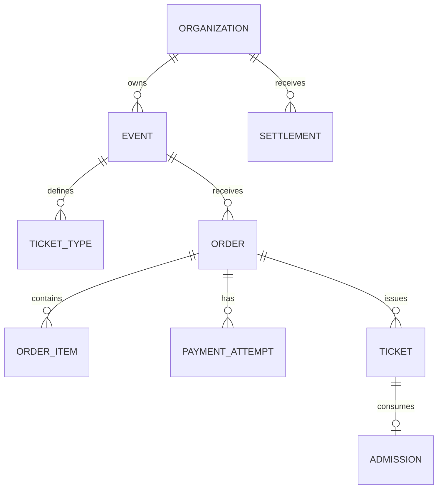

# Event Ticketing Platform

**API Specification | v0.1.0 | MVP 1.0**

## 1. Document control and authority

| Attribute | Value |
| --- | --- |
| Product | Event Ticketing Platform |
| Document | `06-api-specification.md` |
| Version | 0.1.0 |
| Status | API contract proposal for review |
| Parent design | `04-system-design.md` |
| Database design | `05-database-design.md` |
| Product authority | `01-product-requirements.md` |
| Business authority | `02-business-rules.md` |
| UI authority | `03-ui-ux-design.md` |
| API style | REST/JSON over HTTPS |
| Contract format | OpenAPI 3.1 (canonical contract to be extracted from this document) |

This document defines the external and service-facing HTTP contract: resources, methods, authorization, headers, pagination, errors, idempotency, webhooks and compatibility rules. It does not introduce refund, seat, queue, promotion, transfer, resale, offline check-in or native-app endpoints.

`MUST` is inherited from the PRD/BRS. `PROPOSED` is a technical default. `OPEN` requires a product, finance, security or payment-provider decision before production.

## 2. API conventions

### 2.1. Base URL and media types

```text
https://api.example.com/api/v1
```

- All traffic uses HTTPS. The gateway owns the public hostname and routes to the owning service.
- Request and response JSON uses `camelCase`.
- Success responses use `application/json`; errors use `application/problem+json`.
- Public identifiers are UUID strings. Timestamps are ISO-8601 UTC instants; event timezone is returned separately for display.
- Currency is `VND`; amounts are integer whole VND values such as `1500000`, never floating-point.
- IDs, payment references, QR credentials and internal service names are not placed in logs or error details unless safe and necessary.

### 2.2. Required and common headers

| Header | Direction | Requirement |
| --- | --- | --- |
| `Authorization: Bearer <accessToken>` | Request | Required for protected endpoints |
| `X-Request-ID` | Both | Optional client value; gateway generates one if absent and returns it |
| `traceparent` | Both | W3C trace context; gateway/service may create the root span |
| `Idempotency-Key` | Request | Required for reserve, payment attempt, webhook application, check-in and settlement mutations |
| `If-Match` | Request | Required for stale-sensitive moderation/configuration updates; value is an opaque version/ETag |
| `Accept-Language` | Request | `vi` or `en`; service falls back to user preference then `vi` |
| `Content-Type` | Request | `application/json` for JSON mutations |
| `Retry-After` | Response | Required for `429`, `503`, `504` when a retry delay is known |
| `Deprecation`, `Sunset`, `Link` | Response | Required when an API version or field is deprecated |

`Idempotency-Key` is an opaque 16–128 character value. The owning service stores a request hash and result in its `platform.idempotency_keys` table. Reusing a key with a different payload returns `IDEMPOTENCY_CONFLICT`.

### 2.3. Response envelopes

Single resource:

```json
{
  "data": {
    "id": "7d2e7e7e-4c2e-4b9d-9e9b-0f0c1b3e7f01"
  },
  "meta": {
    "requestId": "req_01J..."
  }
}
```

Collection:

```json
{
  "data": [],
  "pagination": {
    "nextCursor": "eyJ...",
    "hasMore": true,
    "limit": 20
  },
  "meta": {
    "requestId": "req_01J...",
    "dataUpdatedAt": "2026-11-19T10:00:00Z"
  }
}
```

The envelope is stable across services. Clients must ignore unknown response fields and must use machine-readable `code` values instead of localized message text for branching.

### 2.4. Pagination, filtering and sorting

- Collections default to `limit=20`; maximum `limit=100`. Check-in mobile lists may default to 10.
- Cursor pagination is the default: `?cursor=<opaque>&limit=20`. Cursors encode a stable sort key and scope; clients must not decode or modify them.
- Sorts are allow-listed per endpoint, with a deterministic `id` tie-breaker. Unknown sort fields return `INVALID_PARAMETER`.
- Filters are explicit query parameters. Changing a filter resets the cursor. A response includes the applied scope in `meta` where a report or export could otherwise be ambiguous.
- Date ranges are half-open `[from,to)` and require an explicit `timezone`/`dateBasis` on reporting endpoints.
- Public search may be served from the Discovery projection and includes `dataUpdatedAt`; booking revalidates price, event state and inventory in Event Commerce.

### 2.5. HTTP status semantics

| Status | Use |
| --- | --- |
| `200` | Successful read or mutation with a result |
| `201` | New resource created synchronously |
| `202` | Accepted for recoverable asynchronous work; response includes a status resource or obligation ID |
| `204` | Successful operation with no response body, only where replay does not need a result |
| `400` | Malformed JSON, invalid syntax or invalid parameter |
| `401` | Missing, invalid, expired or revoked authentication |
| `403` | Authenticated but not authorized for the resource/action |
| `404` | Resource not found or intentionally hidden to prevent cross-organization disclosure |
| `409` | State/version/idempotency conflict |
| `422` | Semantically invalid business command |
| `429` | Rate limit exceeded |
| `500` | Unexpected server failure; never exposes internals |
| `502/503/504` | Gateway/dependency/provider unavailability; retry guidance included |

## 3. Authentication and authorization contract

The API uses a short-lived JWT access token in the `Authorization` header. Refresh is an authenticated session operation described in `07-security-design.md`; the browser refresh token is not returned in JSON. Every service rechecks account status, current role and resource ownership/membership. A gateway role claim is not an authorization decision.

| Audience | Public endpoints | Protected scope |
| --- | --- | --- |
| Guest | Discovery reads, registration, login, password reset request | None |
| Customer | Public discovery | Own orders, tickets, profile and organizer application |
| Organizer | Public discovery | Own verified organization and assigned event scope |
| Check-in Staff | Public discovery | Assigned events and minimum ticket metadata |
| Admin | Public discovery | Explicit administrative capabilities; no direct inventory counter edit |

Sensitive endpoints return `404` instead of revealing whether a resource in another organization exists when the caller has no visibility. `403` is used when the resource is known to be in the caller's allowed scope but the action is not permitted.

## 4. Resource model



Canonical ownership remains in the service databases defined by the SDD. The API may compose a view from several services, but one endpoint must identify which service is authoritative for each returned status.

## 5. Identity and profile endpoints

### 5.1. Registration and session

| Method and path | Access | Purpose |
| --- | --- | --- |
| `POST /auth/register` | Guest | Create an unverified account |
| `POST /auth/login` | Guest | Authenticate and issue an access session |
| `POST /auth/refresh` | Session cookie | Rotate/refresh the session; no token in URL |
| `POST /auth/logout` | Authenticated | Revoke the current refresh session |
| `POST /auth/verify-email` | Guest with single-use token | Verify email; token is accepted in body, not logged |
| `POST /auth/forgot-password` | Guest | Always return a generic accepted response |
| `POST /auth/reset-password` | Guest with single-use token | Replace password and revoke affected sessions |
| `GET /users/me` | Authenticated | Read current profile |
| `PATCH /users/me` | Authenticated | Update profile and locale |
| `PATCH /users/me/password` | Authenticated | Change password and rotate/revoke sessions |

Register request:

```json
{
  "email": "customer@example.com",
  "password": "<not logged>",
  "displayName": "Nguyen Van A",
  "locale": "vi"
}
```

The response never returns a password, refresh token or verification secret. Password-reset and verification requests do not reveal account existence.

### 5.2. Profile schema

```json
{
  "id": "uuid",
  "email": "customer@example.com",
  "displayName": "Nguyen Van A",
  "roles": ["CUSTOMER"],
  "status": "ACTIVE",
  "emailVerified": true,
  "preferredLocale": "vi",
  "createdAt": "2026-11-19T10:00:00Z"
}
```

Roles are informational for navigation. Organization membership and event assignment are returned by scoped endpoints and checked server-side.

## 6. Organization and staff endpoints

| Method and path | Access | Purpose |
| --- | --- | --- |
| `POST /organizer-applications` | Verified Customer | Submit organizer information |
| `GET /organizer-applications/me` | Applicant | Read own verification status |
| `PATCH /organizer-applications/{id}` | Applicant, allowed state | Update a rejected/draft application |
| `POST /organizer-applications/{id}/resubmit` | Applicant | Resubmit after correction |
| `GET /organizations` | Member | List organizations visible to current user |
| `GET /organizations/{organizationId}` | Member/Admin | Read organization detail |
| `PATCH /organizations/{organizationId}` | Organization manager | Update organization metadata |
| `GET /organizations/{organizationId}/members` | Organization manager/Admin | List members with cursor pagination |
| `POST /organizations/{organizationId}/members` | Organization manager | Add a member by verified user ID |
| `DELETE /organizations/{organizationId}/members/{userId}` | Organization manager | Revoke membership |
| `GET /organizations/{organizationId}/event-staff` | Organization manager | List assignments |
| `PUT /organizations/{organizationId}/events/{eventId}/staff/{userId}` | Organization manager | Assign staff idempotently |
| `DELETE /organizations/{organizationId}/events/{eventId}/staff/{userId}` | Organization manager | Revoke assignment |
| `GET /organizations/{organizationId}/payout-destinations` | Finance permission | Masked destination versions only |
| `POST /organizations/{organizationId}/payout-destinations` | Finance permission | Add a verified destination version |

Payout destination responses never include a full bank account or unencrypted provider secret. A changed destination does not silently redirect an existing settlement.

## 7. Event discovery and management endpoints

### 7.1. Public discovery

| Method and path | Access | Query/behavior |
| --- | --- | --- |
| `GET /discover/events` | Guest | `q`, `category`, `city`, `from`, `to`, `minPrice`, `maxPrice`, `featured`, `cursor`, `limit`, `sort` |
| `GET /discover/events/{eventId}` | Guest | Public event projection and ticket sale display state |
| `GET /discover/categories` | Guest | Active categories |

Discovery results are not a price or inventory reservation. `saleState` values such as `NOT_STARTED`, `ON_SALE`, `SOLD_OUT`, `PAUSED` and `CLOSED` are derived presentation states; they do not grant purchase permission.

### 7.2. Organizer event management

| Method and path | Access | Purpose |
| --- | --- | --- |
| `POST /organizations/{organizationId}/events` | Organization member | Create a draft |
| `GET /organizations/{organizationId}/events` | Organization member | List own events |
| `GET /organizations/{organizationId}/events/{eventId}` | Organization member | Read event detail and current version |
| `PATCH /organizations/{organizationId}/events/{eventId}` | Authorized organizer | Update allowed draft/non-critical fields with `If-Match` |
| `POST /organizations/{organizationId}/events/{eventId}/submit` | Verified organizer | Submit current revision for review |
| `POST /organizations/{organizationId}/events/{eventId}/publish` | Verified organizer | Publish approved current revision |
| `POST /organizations/{organizationId}/events/{eventId}/cancel` | Authorized actor | Cancel with reason and impact confirmation |
| `GET /organizations/{organizationId}/events/{eventId}/ticket-types` | Organizer | List ticket types and authoritative inventory view |
| `POST /organizations/{organizationId}/events/{eventId}/ticket-types` | Organizer | Create ticket type before the applicable policy boundary |
| `PATCH /organizations/{organizationId}/events/{eventId}/ticket-types/{ticketTypeId}` | Organizer | Update allowed fields with `If-Match` |
| `POST /organizations/{organizationId}/events/{eventId}/ticket-types/{ticketTypeId}/pause` | Organizer | Pause new reservations without deleting existing holds |
| `POST /organizations/{organizationId}/events/{eventId}/ticket-types/{ticketTypeId}/resume` | Organizer | Resume if sale policy allows |

Approve/reject is an Admin command; publish is a separate Organizer command. `If-Match` prevents approving or publishing a stale revision.

Event create example:

```json
{
  "title": "Tech Conference 2027",
  "categoryId": "uuid",
  "venue": {
    "name": "National Convention Center",
    "addressLine": "1 Thang Long Avenue",
    "city": "Ha Noi",
    "timezone": "Asia/Ho_Chi_Minh"
  },
  "description": "...",
  "terms": "...",
  "startAt": "2027-04-10T09:00:00Z",
  "endAt": "2027-04-10T17:00:00Z",
  "eventTimezone": "Asia/Ho_Chi_Minh",
  "capacity": 1000,
  "bannerMediaId": "uuid"
}
```

### 7.3. Media upload and download

MinIO is the media store. The API does not proxy ordinary media bytes or expose
MinIO credentials. A scoped service creates an upload intent, the browser uploads
directly to MinIO with a short-lived presigned URL, and the service completes the
upload only after validating checksum, size, content type and malware-scan state.

| Method and path | Access | Purpose |
| --- | --- | --- |
| `POST /media/uploads` | Authenticated scoped actor | Create a MinIO upload intent for an allowed media kind and owner |
| `POST /media/uploads/{uploadId}/complete` | Same actor/service | Verify the uploaded object and mark metadata `AVAILABLE` |
| `DELETE /media/uploads/{uploadId}` | Same actor | Abandon an unreferenced upload |
| `GET /media/{mediaId}/download` | Authorized owner/scope | Return a short-lived download URL or stream |

The request declares an allow-listed media kind, expected byte size, content
type, SHA-256 checksum and owner reference. The server derives the bucket and
object key; clients cannot choose either. Download authorization is evaluated
against the current owner, organization/event scope and media status. Private
verification documents and ticket artifacts are never CDN/shared-cached. Public
event images may be cached only after publication and with versioned immutable
keys. Exact upload limits and the MinIO bucket topology are **OPEN** until
operations/security review.

## 8. Booking and order endpoints

| Method and path | Access | Required idempotency | Purpose |
| --- | --- | --- | --- |
| `POST /orders/reservations` | Customer with verified email | Yes | Atomically reserve all lines and create a pending order |
| `GET /orders` | Customer | No | Own order history with cursor/filter by status |
| `GET /orders/{orderId}` | Owner/authorized staff/Admin | No | Authoritative order, payment/issuance summary and `expiresAt` |
| `POST /orders/{orderId}/cancel` | Order owner/Admin policy | Yes | Cancel a safe pending order and release the hold |
| `POST /orders/{orderId}/confirm-free` | Order owner, total 0 | Yes | Confirm a free order while the hold is active |
| `GET /orders/{orderId}/items` | Owner/authorized scope | No | Read immutable price snapshots |

Reserve request:

```json
{
  "eventId": "uuid",
  "lines": [
    { "ticketTypeId": "uuid", "quantity": 2 }
  ],
  "selectionVersion": "opaque-event-or-ticket-version"
}
```

Reserve response includes `orderId`, `reservationId`, immutable line snapshots, `serverTime`, `expiresAt`, `totalVnd`, `currency`, `status` and allowed actions. The backend recomputes all amounts and returns `PRICE_CHANGED`, `LIMIT_EXCEEDED` or `INSUFFICIENT_INVENTORY` without partially allocating another line.

`POST /orders/{orderId}/confirm-free` is not a generic payment confirmation endpoint. Paid confirmation is created by verified Payment Service evidence and is exposed to the client through `GET /orders/{orderId}`.

## 9. Payment and webhook endpoints

| Method and path | Access | Purpose |
| --- | --- | --- |
| `POST /orders/{orderId}/payment-attempts` | Order owner | Create one safe provider attempt from the order snapshot |
| `GET /orders/{orderId}/payment-attempts` | Order owner/Admin | Read attempt states and safe provider references |
| `GET /orders/{orderId}/payment-status` | Order owner | Query authoritative payment/order state after return or timeout |
| `POST /webhooks/payments/{providerCode}` | Provider allowlist/signature | Receive provider callback; no browser token |
| `POST /admin/payments/reconciliation-runs` | Admin/Finance | Start a bounded reconciliation run |
| `GET /admin/payment-exceptions` | Admin/Finance | List open/in-review exceptions |
| `POST /admin/payment-exceptions/{exceptionId}/review` | Admin/Finance | Claim/review with audit |
| `POST /admin/payment-exceptions/{exceptionId}/resolve` | Admin/Finance | Record evidence and actual return/reconciliation |

Payment attempt request:

```json
{
  "returnUrl": "https://customer.example.com/payment/result/uuid"
}
```

The service reads the authoritative order snapshot; the client cannot submit an amount or currency. Response:

```json
{
  "data": {
    "paymentAttemptId": "uuid",
    "status": "PENDING",
    "providerCode": "configured-provider",
    "redirectUrl": "https://gateway.example/checkout/...",
    "expiresAt": "2026-11-19T10:10:00Z"
  }
}
```

The webhook response acknowledges only after durable receipt/idempotency handling. Exact provider-specific HTTP acknowledgment and signature fields are **OPEN** until the gateway is selected. Browser success parameters never change order state.

## 10. Ticket and check-in endpoints

### 10.1. Customer tickets

| Method and path | Access | Purpose |
| --- | --- | --- |
| `GET /tickets` | Customer | Own ticket list, cursor-paginated |
| `GET /tickets/{ticketId}` | Ticket owner | Ticket details, status and check-in time |
| `GET /tickets/{ticketId}/pdf` | Ticket owner | Authorized PDF stream/download; no ticket regeneration |
| `GET /orders/{orderId}/tickets` | Order owner | Issuance progress and ticket units |

Ticket response contains `ticketId`, event summary, ticket type, buyer/attendee display data, `status`, `issuedAt`, `checkedInAt` when authorized and a QR display token only when the ticket is currently usable. It never places a raw QR credential in a URL or list response.

### 10.2. Check-in staff

| Method and path | Access | Required idempotency | Purpose |
| --- | --- | --- | --- |
| `GET /check-in/events` | Assigned staff/authorized organizer | No | Assigned event list |
| `POST /check-in/events/{eventId}/scan` | Assigned staff | Yes | Validate and atomically consume a QR admission |
| `POST /check-in/events/{eventId}/lookup` | Assigned staff | No | Manual lookup with minimum metadata; no mutation |
| `POST /check-in/events/{eventId}/lookup/{ticketId}/confirm` | Assigned staff | Yes | Confirm manual check-in using the same guards |
| `GET /check-in/events/{eventId}/history` | Assigned staff/organizer | No | Cursor history with minimal PII |
| `GET /check-in/events/{eventId}/stats` | Assigned staff/organizer | No | Server-side unique admission counts |

Scan request:

```json
{
  "credential": "opaque-qr-credential"
}
```

Scan success and denial use a stable semantic response:

```json
{
  "data": {
    "outcome": "SUCCESS",
    "ticketId": "uuid",
    "eventId": "uuid",
    "checkedInAt": "2027-04-10T07:15:00Z"
  }
}
```

Possible outcomes include `SUCCESS`, `ALREADY_USED`, `INVALID_TICKET`, `WRONG_EVENT`, `VOIDED`, `EVENT_CANCELLED`, `OUTSIDE_CHECK_IN_WINDOW`, `FORBIDDEN` and `UNKNOWN`. A timeout is never shown as a fresh success. Replaying the same idempotency key returns the original result.

## 11. Finance, settlement and reporting endpoints

| Method and path | Access | Purpose |
| --- | --- | --- |
| `GET /organizations/{organizationId}/reports/summary` | Organization finance permission | KPI summary with scope/date basis |
| `GET /organizations/{organizationId}/reports/sales` | Organization finance permission | Server aggregate sales data |
| `GET /organizations/{organizationId}/reports/sales.csv` | Organization finance permission | Same scope as report, CSV-safe |
| `GET /organizations/{organizationId}/settlements` | Organization finance permission | Settlement list |
| `POST /organizations/{organizationId}/settlements` | Organization finance permission | Claim eligible entitlements once |
| `GET /organizations/{organizationId}/settlements/{settlementId}` | Organization finance permission | Settlement snapshot and status |
| `GET /admin/reports/summary` | Admin | Global KPI with explicit date basis |
| `GET /admin/settlements` | Admin/Finance | Review queue |
| `POST /admin/settlements/{settlementId}/process` | Admin/Finance | Recheck and mark `PROCESSING` |
| `POST /admin/settlements/{settlementId}/settle` | Admin/Finance | Record verified manual transfer evidence |
| `POST /admin/settlements/{settlementId}/fail` | Admin/Finance | Record definite transfer failure |
| `GET /admin/commission-config` | Admin/Finance | Read versioned fee configuration |
| `POST /admin/commission-config` | Admin/Finance | Create future effective configuration |

Report query requires `from`, `to`, `timezone`, `dateBasis` and optional `eventId`. `dataUpdatedAt` is returned. A dashboard total is never calculated by summing the current page. Settlement is blocked for unresolved financial exceptions or estimated gateway fees.

## 12. Admin moderation and configuration endpoints

| Method and path | Access | Purpose |
| --- | --- | --- |
| `GET /admin/users` | Admin | Search users, cursor-paginated |
| `POST /admin/users/{userId}/lock` | Admin | Lock account with reason and audit |
| `POST /admin/users/{userId}/unlock` | Admin | Unlock account with audit |
| `GET /admin/organizer-applications` | Admin | Verification queue |
| `POST /admin/organizer-applications/{id}/approve` | Admin | Approve current revision |
| `POST /admin/organizer-applications/{id}/reject` | Admin | Reject with required reason |
| `GET /admin/events/approval` | Admin | Event review queue |
| `POST /admin/events/{eventId}/approve` | Admin | Approve expected event version; does not publish |
| `POST /admin/events/{eventId}/reject` | Admin | Reject with required reason |
| `POST /admin/events/{eventId}/feature` | Admin | Change discovery featured flag only |
| `GET /admin/audit-logs` | Admin/audit permission | Restricted audit query/export |
| `GET /admin/settings` | Admin | Versioned system configuration |
| `PATCH /admin/settings/{key}` | Admin | Audited configuration update with `If-Match` |

Admin APIs cannot directly update inventory counters, mark an order paid without verified evidence, or edit settled amounts.

## 13. Common schemas

### 13.1. Problem Details

```json
{
  "type": "https://api.example.com/errors/insufficient-inventory",
  "title": "Insufficient inventory",
  "status": 422,
  "code": "INSUFFICIENT_INVENTORY",
  "detail": "The requested quantity is no longer available.",
  "instance": "/api/v1/orders/reservations",
  "requestId": "req_01J...",
  "retryable": false,
  "details": [
    {
      "field": "lines[0].quantity",
      "code": "INSUFFICIENT_INVENTORY",
      "currentAvailable": 1
    }
  ]
}
```

`detail` is safe for the caller and localized by `Accept-Language`; it never contains SQL, stack traces, provider secrets, QR credentials or another organization's data.

### 13.2. Error catalog

| Code | HTTP | Retry? | Safe client action |
| --- | ---: | --- | --- |
| `VALIDATION_ERROR` | 400 | No | Fix fields |
| `AUTH_REQUIRED` / `INVALID_TOKEN` | 401 | After refresh/login | Authenticate |
| `FORBIDDEN` | 403 | No | Switch permitted workspace or contact support |
| `RESOURCE_NOT_FOUND` | 404 | No | Refresh/list; do not infer another tenant's state |
| `IDEMPOTENCY_CONFLICT` | 409 | No | Use a new key only after resolving the original request |
| `STALE_VERSION` | 409 | After reload | Reload resource and reconfirm |
| `CONCURRENT_MODIFICATION` | 409 | After reload | Reload and retry safe mutation |
| `ORDER_EXPIRED` / `ORDER_CANCELLED` | 409 | No | Create a new selection/order |
| `PAYMENT_IN_PROGRESS` / `PAYMENT_UNKNOWN` | 409 | Query first | Query existing attempt; no blind retry |
| `PAYMENT_EXCEPTION_OPEN` | 409 | No automatic retry | Show reference and support path |
| `EVENT_NOT_BOOKABLE` / `EVENT_CANCELLED` | 422 | No | Stop purchase |
| `SALE_NOT_STARTED` / `SALE_CLOSED` / `SALE_PAUSED` | 422 | After state refresh | Refresh sale state |
| `INSUFFICIENT_INVENTORY` / `LIMIT_EXCEEDED` | 422 | After reselect | Re-select quantity |
| `PRICE_CHANGED` | 409 | After reconfirmation | Reload price and ask user |
| `TICKET_ALREADY_USED` / `INVALID_TICKET` / `WRONG_EVENT` | 422 | No | Deny admission |
| `SETTLEMENT_NOT_ELIGIBLE` / `ALREADY_CLAIMED` | 422/409 | No | Show blocking reason |
| `RATE_LIMIT_EXCEEDED` | 429 | Yes, after `Retry-After` | Backoff with jitter |
| `DEPENDENCY_UNAVAILABLE` | 503 | Yes if safe | Retry boundedly; show pending state |
| `INTERNAL_SERVER_ERROR` | 500 | Maybe | Use request ID; do not assume mutation failed |

### 13.3. Idempotent mutation response rules

For a repeated request with the same key and payload, return the original HTTP status and body where safe. For a request whose result is still processing, return `202` with the status resource. If the client timed out, it must call the authoritative `GET` endpoint before creating a new mutation.

## 14. Payment webhook contract

The gateway-specific adapter validates the signature, merchant, reference, amount, currency and provider state before creating a canonical receipt. The canonical internal event is:

```json
{
  "eventId": "uuid",
  "eventType": "payment.succeeded",
  "eventVersion": 1,
  "providerCode": "configured-provider",
  "merchantReference": "safe-reference",
  "providerTransactionRef": "safe-reference",
  "amountVnd": 1500000,
  "currency": "VND",
  "providerOccurredAt": "2027-04-10T01:00:00Z",
  "signatureVerified": true
}
```

Invalid callbacks are rejected/quarantined and audited without changing order, inventory or ticket state. Duplicate delivery IDs and duplicate underlying transaction references are both deduplicated. Exact provider field names and acknowledgment codes are **OPEN** until the provider is selected.

## 15. OpenAPI 3.1 skeleton

The implementation repository should generate a complete `openapi.yaml` from this contract. This skeleton fixes the shared components and critical booking path:

```yaml
openapi: 3.1.0
info:
  title: Event Ticketing Platform API
  version: 1.0.0
servers:
  - url: https://api.example.com/api/v1
paths:
  /orders/reservations:
    post:
      operationId: reserveTickets
      security: [{ bearerAuth: [] }]
      parameters:
        - $ref: '#/components/parameters/IdempotencyKey'
        - $ref: '#/components/parameters/RequestId'
      requestBody:
        required: true
        content:
          application/json:
            schema: { $ref: '#/components/schemas/ReserveTicketsRequest' }
      responses:
        '200':
          description: Reservation and pending order created
          content:
            application/json:
              schema: { $ref: '#/components/schemas/OrderEnvelope' }
        '401': { $ref: '#/components/responses/Unauthorized' }
        '409': { $ref: '#/components/responses/Conflict' }
        '422': { $ref: '#/components/responses/UnprocessableEntity' }
  /orders/{orderId}:
    get:
      operationId: getOrder
      security: [{ bearerAuth: [] }]
      parameters:
        - $ref: '#/components/parameters/OrderId'
      responses:
        '200':
          description: Authoritative order
          content:
            application/json:
              schema: { $ref: '#/components/schemas/OrderEnvelope' }
        '401': { $ref: '#/components/responses/Unauthorized' }
        '404': { $ref: '#/components/responses/NotFound' }
components:
  securitySchemes:
    bearerAuth:
      type: http
      scheme: bearer
      bearerFormat: JWT
  parameters:
    IdempotencyKey:
      name: Idempotency-Key
      in: header
      required: true
      schema: { type: string, minLength: 16, maxLength: 128 }
    RequestId:
      name: X-Request-ID
      in: header
      required: false
      schema: { type: string, maxLength: 128 }
    OrderId:
      name: orderId
      in: path
      required: true
      schema: { type: string, format: uuid }
  schemas:
    ReserveTicketsRequest:
      type: object
      required: [eventId, lines]
      properties:
        eventId: { type: string, format: uuid }
        selectionVersion: { type: string }
        lines:
          type: array
          minItems: 1
          items:
            type: object
            required: [ticketTypeId, quantity]
            properties:
              ticketTypeId: { type: string, format: uuid }
              quantity: { type: integer, minimum: 1 }
    OrderEnvelope:
      type: object
      required: [data, meta]
      properties:
        data: { $ref: '#/components/schemas/Order' }
        meta: { $ref: '#/components/schemas/Meta' }
    Order:
      type: object
      required: [id, eventId, status, currency, totalVnd, expiresAt]
      properties:
        id: { type: string, format: uuid, readOnly: true }
        eventId: { type: string, format: uuid, readOnly: true }
        status: { type: string, enum: [PENDING_PAYMENT, CONFIRMED, EXPIRED, CANCELLED] }
        currency: { type: string, const: VND }
        totalVnd: { type: integer, minimum: 0 }
        expiresAt: { type: string, format: date-time, nullable: true }
        lines: { type: array, items: { type: object } }
    Meta:
      type: object
      required: [requestId]
      properties:
        requestId: { type: string }
        dataUpdatedAt: { type: string, format: date-time }
    Problem:
      type: object
      required: [type, title, status, code, requestId]
      properties:
        type: { type: string, format: uri }
        title: { type: string }
        status: { type: integer }
        code: { type: string }
        detail: { type: string }
        requestId: { type: string }
        retryable: { type: boolean }
        details: { type: array, items: { type: object } }
  responses:
    Unauthorized:
      description: Authentication required
      content:
        application/problem+json:
          schema: { $ref: '#/components/schemas/Problem' }
    NotFound:
      description: Resource not found or hidden
      content:
        application/problem+json:
          schema: { $ref: '#/components/schemas/Problem' }
    Conflict:
      description: State or idempotency conflict
      content:
        application/problem+json:
          schema: { $ref: '#/components/schemas/Problem' }
    UnprocessableEntity:
      description: Business rule rejection
      content:
        application/problem+json:
          schema: { $ref: '#/components/schemas/Problem' }
```

The complete spec must be linted with `npx @redocly/cli lint openapi.yaml` before API implementation is accepted. Generated Angular clients and Spring interfaces should be produced from the same committed contract.

## 16. Compatibility and deprecation

- Public APIs use major URI versions: `/api/v1`, `/api/v2` when a breaking change is unavoidable.
- Additive response fields and optional request fields are backward compatible. Removing/renaming fields, changing types/status semantics or making a new request field required requires a new major version.
- API v1 remains supported through a published deprecation window. Deprecated responses include `Deprecation`, `Sunset` and a successor `Link`.
- Event topics use independent `eventVersion` and Schema Registry compatibility. API and event versions are not assumed to advance together.
- Service-to-service endpoints are private and may be versioned by package/contract, but breaking changes still require a compatibility window.

## 17. API security and operational requirements

- Validate all JSON, path, query, upload and header input at the service boundary. Use parameterized queries and allow-listed sort/filter fields.
- Enforce rate limits at the gateway and sensitive-service level. Exact limits are defined in `07-security-design.md` after abuse testing.
- Do not retry non-idempotent mutations without `Idempotency-Key`. Do not retry payment attempts while another attempt is pending/unknown.
- Use request/trace IDs in logs and support responses. Never log access tokens, passwords, refresh tokens, raw QR credentials, card data or full payment payloads.
- CSV endpoints use server-side authorization, stable filters and formula-injection protection. Private responses are not shared-cached.
- Webhooks accept only configured providers, verify signatures and reconcile amount/currency/reference before publishing a payment event.

## 18. Traceability and validation

| API area | Source references |
| --- | --- |
| Authentication | PRD AUTH-01–11; BRS §3; UI C-05–07, X-01–02 |
| Organizer/event | PRD ORG/EVT; BRS §4–5; UI O-01, O-03–06, A-03–06 |
| Inventory/booking | PRD INV/ORD; BRS §6, §8; UI C-08–12, O-07 |
| Payment | PRD PAY; BRS §9, BRS-T18–25; UI C-09–10, A-09–10 |
| Ticket/check-in | PRD ETK/CHK; BRS §10–11, BRS-T26–32/T50; UI C-13–14, S-01–06 |
| Finance/reporting | PRD STL/RPT; BRS §12–13, BRS-T35–47; UI O-12–14, A-01, A-11–12 |
| Notifications | PRD §6.13; BRS §15; UI email UX |

Before implementation, validate the contract with:

1. OpenAPI lint and generated-client compilation.
2. Contract tests for every role/scope, `404` anti-disclosure behavior and `If-Match` conflicts.
3. Idempotency tests for BRS-T11, T20, T28–29, T36–38 and T48.
4. Provider sandbox fixtures for signature, duplicate, late, wrong-amount and unknown payment callbacks.
5. E2E tests for UX-01–UX-22, including server-authoritative timer and unknown mutation outcomes.

## 19. Open decisions

| ID | Decision | Owner |
| --- | --- | --- |
| API-01 | Final payment provider callback fields/acknowledgment | Product/Finance/Provider |
| API-02 | Access/refresh token lifetime and cookie policy | Security |
| API-03 | Exact rate limits and upload limits | Security/Operations |
| API-04 | Buyer versus attendee payload and PII visibility | Product/Security |
| API-05 | Report date basis, Popular lookback and CSV retention | Product/Analytics |
| API-06 | Error documentation hostname and version sunset period | Platform/Product |


## Local checkout methods (decision 0004)

The owner-authorized QR/card extension keeps the existing Payment boundary.
`GET /payment-sessions/{id}` and `POST /payment-sessions/{id}/method` are
authenticated owner-only operations; requests contain method and optional sample
card number, never an outcome or amount. Responses are `Cache-Control: no-store`.
The session supplies server time, an expiry bounded by the original hold and a
QR data URI only while active. Full submitted card numbers are not retained.
`/local-payments/{id}/scenario` now requires ADMIN and serves regression tooling.
Machine-readable contracts: `backend/openapi/phase3.json`; configuration semantics
and SQL examples: [payment-test-configuration.md](payment-test-configuration.md).
