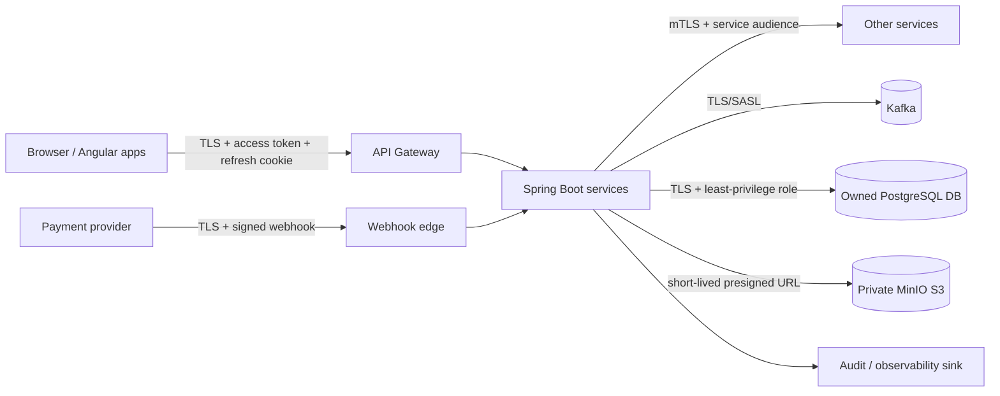

# Event Ticketing Platform

**Security Design Document | v0.1.0 | MVP 1.0**

## 1. Document control and authority

| Attribute | Value |
| --- | --- |
| Product | Event Ticketing Platform |
| Document | `07-security-design.md` |
| Version | 0.1.0 |
| Status | Security design proposal for review |
| Product authority | `01-product-requirements.md` |
| Business authority | `02-business-rules.md` |
| UI authority | `03-ui-ux-design.md` |
| System design | `04-system-design.md` |
| Database design | `05-database-design.md` |
| API contract | `06-api-specification.md` |
| Primary framework | Spring Security 6 on Spring Boot 3.x |
| Security baseline | OWASP ASVS 4.0.3, OWASP API Security Top 10, TLS 1.2+ |

This document defines controls for identity, sessions, authorization, data, APIs,
payments, QR admission, messaging, storage and operational evidence. It does
not add refund automation, offline check-in, social login, promotion, resale,
seat-map or native-mobile scope.

`MUST` carries an accepted product or business rule. `PROPOSED` is a technical
default that can be changed during review. `OPEN` needs an identified product,
security, finance, provider or operations decision before production.

### 1.1. Authority and traceability

| Authority | Security implications |
| --- | --- |
| PRD §14, §16, §19 | HTTPS, RBAC/JWT, no sensitive card data, auditability, operational security |
| BRS IDN-R01–R08 | Guest boundary, identity/role/ownership checks, lockout, token secrecy, brute-force resistance |
| BRS ORG-R03/R04/R08 | Membership and event assignment scope, restricted payout/verification data, no cross-organization access |
| BRS EVT-R04/R05/R07/R09 | Revision/version checks, cancellation fence, audited moderation |
| BRS BR-08/09/11/12/17/22/23/24/25 | No ticket before confirmation, idempotent callbacks/check-in/issuance/settlement, audit, no card storage |
| UX §10.2 and UX-01–22 | No secrets or PII in logs/URLs, authoritative server state, safe payment return, guarded routes |
| `04-system-design.md` | Service/database ownership, gateway, Kafka outbox/inbox, Angular clients |
| `05-database-design.md` | Separate database roles, platform idempotency/outbox/inbox tables, retention and MinIO media boundaries |

## 2. Security objectives and scope

The security objectives are:

1. Only an authenticated, active principal with the required role and current
   organization/event scope can perform a private operation.
2. A stale, replayed, forged or client-modified request cannot allocate stock,
   confirm payment, issue a ticket, admit a person or settle money.
3. Confidential customer, organizer, payment-reference and operational data is
   disclosed only to the minimum authorized audience.
4. Every financial, moderation, membership, identity-lock and admission
   decision is attributable, tamper-evident and recoverable.
5. Security failures fail closed while already accepted provider callbacks and
   durable obligations remain recoverable through the reconciliation process.

The public attack surface is the HTTPS API gateway, Angular applications,
payment-provider webhook endpoints, ticket PDF/object downloads, discovery
search, check-in scanner endpoints, authentication endpoints and operational
administrative endpoints. Internal attack surfaces include Kafka consumers,
outbox publishers, service-to-service calls, PostgreSQL roles, MinIO storage,
CI/CD and operator access.

The design assumes the browser, customer device, organizer device, check-in
camera and payment-provider redirect are untrusted. A successful redirect,
hidden Angular control, JWT role claim, cached discovery value or QR display is
not evidence that a business action is allowed.

## 3. Threat model and protected assets

### 3.1. Actors

| Actor | Trust level | Relevant abuse cases |
| --- | --- | --- |
| Guest | Untrusted | Enumeration, credential stuffing, abuse of discovery/auth endpoints |
| Customer | Authenticated but not trusted with other tenants | IDOR, order/ticket scraping, payment replay, QR sharing |
| Organizer/member | Authenticated and scoped | Cross-organization access, data export, payout manipulation, staff abuse |
| Check-in staff | Authenticated and event-scoped | QR replay, wrong-event admission, PII over-collection |
| Admin/Finance | Privileged human | Excessive access, insider misuse, unaudited financial/moderation changes |
| Payment provider | External system | Forged/replayed/out-of-order webhook, amount/reference mismatch |
| Compromised service/client | Technical threat | Stolen credential, malicious event, poisoned message, secret misuse |
| Operator/CI identity | Infrastructure privileged | Secret exposure, production data access, unsafe migration or deployment |

### 3.2. Assets and security properties

| Asset | Confidentiality | Integrity | Availability / recovery |
| --- | --- | --- | --- |
| Account credentials and sessions | High | High | Revoke and recover |
| User PII and organizer verification | High | High | Restore from backup/audit |
| Event, quota, reservation and order state | Medium/High | Critical | Transactional recovery |
| Payment references and exceptions | High | Critical | Reconcile from provider evidence |
| Ticket/QR credentials and admission history | High | Critical | Reissue only idempotently; preserve admission history |
| Payout destinations and settlement evidence | Critical | Critical | Dual review and immutable audit |
| Kafka events/outbox/inbox | Internal | Critical | Replay and DLT recovery |
| Audit logs and security telemetry | Restricted | Critical | Append-only retention and export |
| Signing keys, database credentials and provider secrets | Critical | Critical | KMS/Vault rotation and break-glass procedure |

### 3.3. Security invariants

- The browser cannot choose a role, organization membership, ticket owner,
  payment amount, currency, inventory counter, check-in event or settlement
  amount.
- Resource authorization is evaluated against current database state; a role or
  membership removed after token issuance takes effect on the next request.
- A payment provider callback must pass signature, merchant, reference, amount,
  currency, timestamp/replay and state checks before it can create a canonical
  receipt.
- A ticket admission command must atomically validate event, ticket, status,
  check-in window, assignment and one-time-use state.
- A duplicate event, command or retry has one durable outcome and cannot create
  a second financial allocation, ticket or admission.

## 4. Trust boundaries and deployment controls



| Boundary | Required control |
| --- | --- |
| Browser → gateway | TLS, strict origin allowlist, input validation, rate limits, security headers, no secrets in URL |
| Provider → webhook edge | Provider IP/routing allowlist where reliable, signature verification, replay window, isolated endpoint, DLT/quarantine |
| Gateway → service | mTLS or private network plus authenticated service identity; propagate request/trace IDs without trusting caller roles |
| Service → service | Audience-scoped workload token, mTLS, timeout, allowlisted method/scope, no shared database credentials |
| Service → PostgreSQL | TLS, separate database/user per service, no DDL for runtime role, prepared statements, audit-sensitive transaction boundaries |
| Service → Kafka | TLS, SASL or mTLS, ACL per topic/group, `acks=all`, idempotent producer, schema compatibility and DLT |
| Service → MinIO | Private bucket, TLS, scoped service policy, encryption, object-key authorization, short-lived presigned URLs, malware/type validation on upload |
| Runtime → secrets/KMS | Workload identity, secret manager access policy, rotation, no secrets in images, logs or configuration commits |

Production workloads run in private network segments. Only the gateway,
webhook edge and explicitly public object-download mechanism are internet
reachable. Administrative access uses SSO/MFA, a bastion or identity-aware
proxy, short-lived credentials and recorded operator audit.

## 5. Identity, authentication and session lifecycle

### 5.1. Account states and gates

The Identity & Access service is authoritative for account status, normalized
email, verification state, password hash, refresh sessions and lockout state.
Account states are `PENDING_EMAIL`, `ACTIVE`, `LOCKED` and `DISABLED`.

- Guest endpoints are limited to public discovery, registration, login,
  verification and generic password-recovery requests.
- A verified email is required for reservation, organizer onboarding and
  check-in staff operations, as required by BRS IDN-R06 (currently
  `PROPOSED`).
- `LOCKED` and `DISABLED` accounts fail private requests even if an access JWT
  has not expired. Provider callbacks use a service identity and are not blocked
  by a customer's account lock.
- Role assignment, organization membership and event assignment are server-side
  records. Client JSON cannot grant or remove any of them.

### 5.2. Access token

The gateway and each resource service validate a signed JWT access token.

**PROPOSED defaults:** 10-minute lifetime, `RS256` or `ES256` asymmetric key,
issuer `https://identity.example.com`, audience restricted to the target API,
`sub` as immutable user UUID, `jti` unique ID, `iat`, `nbf`, `exp`, and a small
set of coarse role/capability claims. The JWT contains no password, PII,
payment data, organization list or QR credential.

Spring Security 6 resource servers MUST:

1. Validate signature against a pinned issuer/JWK set and reject unknown `kid`,
   `alg=none`, wrong issuer, wrong audience, expired, not-yet-valid or malformed
   tokens. Allow at most 60 seconds of clock skew (`PROPOSED`).
2. Map claims to an internal principal without treating a client-supplied
   `scope`, organization or role claim as proof of resource permission.
3. Apply `SecurityFilterChain` rules for coarse endpoint access and
   `@PreAuthorize`/authorization-manager checks for the resource and action.
4. Query current account status and current membership/assignment for private
   commands. Cache only with a short, explicitly invalidated TTL; lock,
   logout, membership revoke and role changes must invalidate relevant state.
5. Return the API's Problem Details response without exposing decoder,
   signature or key-set internals.

Access tokens are held in Angular application memory. They are not written to
`localStorage`, `sessionStorage`, IndexedDB, analytics, URLs or logs. A page
reload uses the refresh session to obtain a new access token. If a deployment
requires a backend-for-frontend, that decision is `OPEN`; it must preserve the
same server-side authorization checks.

### 5.3. Refresh session

The refresh credential is an opaque, cryptographically random value, stored only
in a `Secure`, `HttpOnly` cookie. The Identity service stores only a slow hash
and metadata (`session_id`, user, token-family ID, issued/last-used/expiry,
client risk metadata, revoked time and reuse-detected time), never the raw
value.

**PROPOSED cookie policy:** `__Host-refresh`, `Path=/`, no `Domain`,
`SameSite=Lax` for same-site Angular/API deployments, and `SameSite=Strict`
where the chosen payment/login flow permits it. The final cross-site topology
and whether `SameSite=None; Secure` is required are **OPEN**.

Refresh rotation is one-time use. On refresh, the old session token is
atomically marked used and a replacement is issued. Reuse of an old token
revokes the entire token family, records a security event and requires login.
Logout revokes the current session. Password reset, password change, lock,
disable and a high-confidence compromise revoke all affected sessions. Access
tokens already issued are bounded by their short lifetime and blocked by the
account-status check.

`POST /auth/refresh` is the only endpoint that accepts the refresh cookie. It
uses a strict origin/CSRF check (see §7), does not accept a refresh token in
JSON, query parameters or an `Authorization` header, and never returns the
refresh value in a response body.

### 5.4. Registration, verification, reset and login protection

- Passwords are hashed with Argon2id (`PROPOSED`) using a unique salt and a
  server-side pepper held in KMS/Vault. bcrypt with a reviewed work factor is
  the fallback if Argon2id is unavailable. Passwords are never reversible,
  logged, emailed or stored in event payloads.
- Email-verification and password-reset tokens are random, single-use, stored
  as hashes, bound to the intended account and purpose, and expire quickly
  (`PROPOSED`: 24 hours for verification, 30 minutes for reset). The raw token
  appears only in the HTTPS link and is removed from browser history/state after
  use.
- Registration, login, verification and password-reset requests use generic
  responses and comparable timing. A reset request does not reveal whether an
  email exists.
- Failed login attempts are throttled per account identifier and source
  fingerprint, with exponential backoff and a bounded temporary lock. CAPTCHA
  or a managed challenge is introduced only after an abuse threshold;
  threshold values are **OPEN**.
- Password change requires the current credential or a valid reset flow, revokes
  sessions according to policy and records an audit/security event. MFA for
  customer and organizer accounts is **OPEN**; admin/finance MFA is a
  production prerequisite (`MUST` operational control).

## 6. Authorization and anti-IDOR design

### 6.1. Decision layers

Authorization is evaluated in this order:

1. **Authentication:** token/session is valid and account is active.
2. **Capability:** the actor has the required coarse role/capability.
3. **Tenant scope:** organization membership is current and the target event,
   order, ticket, settlement or application belongs to that scope.
4. **Ownership/assignment:** customer owns the order/ticket; staff is assigned
   to the event; organizer has the required organization permission.
5. **State and version:** the business transition, `If-Match` version, time
   window and admission/payment fence are valid.
6. **Audit and idempotency:** the command is recorded with actor, request and
   idempotency context before returning success.

The service that owns the resource makes the final decision. Gateway route
guards, Angular guards, URL obscurity, role claims and a successful `GET` from a
projection do not replace this check.

### 6.2. Organization and event scoping

Every organizer/staff query includes an explicit organization or event scope
from the authenticated principal and a server-side join/lookup to the owning
service. Cross-service UUIDs have no foreign keys, so the owning service must
verify existence and scope before returning or mutating data.

- An organizer cannot read or mutate another organization's event, member,
  order, attendee, payout destination or settlement by changing a path UUID.
- A staff member can scan or look up only an assigned event and receives minimum
  ticket metadata. Revocation takes effect at the next authorization check.
- A customer can read only their own profile, order, ticket and payment status.
  Support/admin views use separate capabilities and masked PII.
- Admin capabilities are explicit. Admin does not automatically become a
  customer, edit inventory counters, confirm payment without evidence or alter
  settled amounts.

For an unscoped resource, return `404 RESOURCE_NOT_FOUND` to avoid confirming
its existence. Return `403 FORBIDDEN` only when the resource is known to be in a
scope the actor can see but the requested action is disallowed. All denied
decisions emit a low-cardinality security event without copying secrets or raw
QR values.

### 6.3. Spring Security implementation boundary

Each Spring Boot service has a stateless resource-server `SecurityFilterChain`
for bearer access tokens, method security enabled, CSRF disabled only for
bearer-only endpoints, and a separate CSRF-protected refresh-cookie endpoint.
Controllers use validated DTOs and return the common Problem Details format.
Authorization managers call a scoped domain service rather than embedding
ownership logic in a controller or trusting a request field. Actuator endpoints
are on a separate internal listener and require an operator/service authority.

## 7. Web, transport and browser controls

### 7.1. TLS and headers

- TLS 1.2 or newer is required; TLS 1.3 is preferred. Public certificates are
  managed and renewed automatically. Internal service traffic uses mTLS or a
  private network plus authenticated workload identity.
- HTTP is redirected to HTTPS at the edge. HSTS is enabled after domain
  verification (`Strict-Transport-Security`, preload decision **OPEN**).
- The gateway sets `Content-Security-Policy` appropriate to the Angular build,
  `X-Content-Type-Options: nosniff`, `Referrer-Policy: strict-origin-when-cross-origin`,
  `Permissions-Policy` denying unused camera/microphone/geolocation by default,
  and frame protections (`frame-ancestors 'none'` unless an approved embed is
  required).
- CORS is an explicit production origin allowlist. Wildcard origins and
  wildcard credentials are forbidden. `Access-Control-Allow-Credentials` is
  enabled only for the refresh-cookie flow if cross-origin cookies are needed.

### 7.2. CSRF and cookie strategy

Most API calls use an in-memory bearer token and therefore do not rely on
ambient browser credentials. The refresh endpoint does use an ambient cookie;
it requires a synchronizer/double-submit CSRF token, strict `Origin` checking,
same-site cookie policy and a narrow route allowlist. State-changing webhook and
service endpoints do not use browser cookies and are protected by signature or
service authentication instead. CORS is not a CSRF control by itself.

No access or refresh credential is placed in a query string, URL fragment,
referrer, PDF filename, analytics event, browser console or exception detail.
Payment return URLs carry only a non-secret order identifier; the server queries
the authoritative payment/order state.

### 7.3. Input, output and upload controls

- Spring validation enforces type, size, enum, range, date and content rules at
  the boundary; domain services enforce state and ownership again.
- SQL uses prepared statements/JPA parameters. Dynamic sort/filter fields are
  allow-listed. HTML/Markdown event content is sanitized or rendered as plain
  text; output encoding prevents stored/reflected XSS.
- Uploads use an allowlist of MIME type and extension, bounded size and image
  dimensions, generated MinIO object keys, malware scanning and
  content-disposition headers. The original filename is not used as an
  executable path. Upload policy and exact limits are **OPEN**.
- CSV export neutralizes spreadsheet formulas (`=`, `+`, `-`, `@`) and applies
  the same scope/PII policy as the corresponding report.

## 8. Payment and webhook security

The Payment & Reconciliation service is authoritative for provider attempts,
receipts, exceptions and reconciliation state. The platform does not store PAN,
CVV, PIN, full magnetic-stripe data or provider credentials in PostgreSQL,
Kafka, MinIO, logs or analytics, satisfying BRS BR-25.

The provider adapter performs all of the following before accepting a callback:

1. Validate TLS, provider route and configured merchant identity.
2. Verify the provider's signature over the exact raw body using a constant-time
   comparison and a rotated key set. The signature algorithm and header names
   remain **OPEN** until the provider is selected.
3. Enforce a timestamp/replay window and deduplicate both provider delivery ID
   and underlying transaction/reference ID.
4. Recompute and compare merchant reference, order ID, amount, currency and
   expected merchant account. Never accept amount or currency from the browser.
5. Apply an allowed payment state transition under a database transaction. A
   late failure cannot downgrade a previously accepted success; an ambiguous or
   late success becomes a payment exception and never silently issues a ticket.
6. Commit the canonical receipt and outbox event before acknowledging the
   callback. Invalid or unverifiable callbacks are rejected/quarantined and
   audited without changing order, inventory or ticket state.

Webhook endpoints have a separate rate limit and payload size limit, no browser
session requirement, no redirect trust and no generic retry that could turn an
unknown outcome into a second charge. Reconciliation uses least privilege,
manual evidence and idempotency keys; no admin UI can mark an order paid by
editing a status field.

## 9. Ticket, QR and check-in security

### 9.1. Credential design

Each issued ticket receives a unique, opaque credential generated with a CSPRNG
or a signed token containing only a non-sensitive ticket reference, event
binding, key ID, issuance/version and expiry/validity metadata. **PROPOSED:** a
random 128-bit or larger secret stored as a hash plus a server-side signature
for fast rejection. The raw credential is delivered only to the authorized
ticket view/PDF and is never persisted in audit logs, URLs, analytics or Kafka
headers.

QR data contains no name, email, phone, order total or other raw PII. A ticket
has one QR credential; it is not regenerated on every render. Key rotation uses
key IDs and retains verification keys for the maximum ticket lifetime plus a
recovery period. Exact credential format and lifetime are **OPEN**.

Ticket PDF downloads are authorized against current ticket ownership/status and
are streamed from a private MinIO bucket through a short-lived, single-purpose
presigned URL or gateway stream. A voided/cancelled ticket cannot obtain a usable
credential. Caching is private/no-store for sensitive responses.

### 9.2. Atomic admission controls

The Ticket & Admission service verifies credential, event binding, ticket status,
event cancellation, check-in window, staff assignment and account status inside
one transaction. A conditional update such as `status = 'ISSUED'` to
`'CHECKED_IN'` with a unique ticket constraint ensures that concurrent scans
produce one `SUCCESS` and all other attempts produce `ALREADY_USED`.

The admission fence wins against cancellation according to the owning
transaction's commit order. An event cancellation immediately blocks new scans;
already recorded successful admissions remain immutable history. Offline scan
queues are forbidden in MVP. Manual lookup still requires the same confirm
command, idempotency key and guards as camera scanning.

Check-in responses reveal only the minimum result needed by staff. History and
statistics are scoped to the assigned event, omit raw credentials and mask PII.

## 10. Rate limits, abuse prevention and availability

The gateway and service owners enforce quotas with a distributed limiter (for
example, Redis) and return `429` with `Retry-After`. Limits are keyed by the
least-privileged useful combination of route, source, account and organization;
they must not be keyed only by a spoofable header.

| Surface | Baseline policy |
| --- | --- |
| Login/register/reset/verify | Tight per-account and per-source throttling; generic responses |
| Discovery/search | Anonymous quota and bounded query/page size |
| Reservation/payment attempt | Authenticated customer + event/order scope; strict burst cap |
| Webhook | Provider route/signature identity, body-size limit, replay protection |
| QR/check-in | Assigned staff + event + device risk signal; reject offline replay |
| PDF/download/export | Owner/scope checks, short-lived link, per-resource burst cap |
| Admin/config/settlement | Low quota, MFA/operator session, audit and optional step-up |

Exact numeric quotas, bot challenge threshold, trusted proxy configuration and
distributed-limiter failure behavior are **OPEN**. A limiter outage must fail
closed for high-risk mutation endpoints or use a reviewed bounded fallback; it
must never silently disable authorization.

Abuse detection alerts on credential stuffing, refresh-token reuse, repeated
IDOR-like 403/404 patterns, webhook signature failures, QR replay spikes,
unusual exports, payout-destination changes and DLT growth. Security response
can revoke sessions, quarantine provider callbacks, pause an event's sale or
disable a compromised integration without editing business history.

## 11. Data protection, classification and retention

### 11.1. Classification and handling

| Class | Examples | Handling |
| --- | --- | --- |
| Restricted secret | Signing keys, refresh hashes, DB/provider credentials, password pepper | KMS/Vault, strict workload ACL, rotation, never log/export |
| Restricted personal/financial | Email, phone, verification documents, payout account, payment references, attendee data | Encryption at rest/in transit, field masking, purpose/scope checks, audited access |
| Confidential business | Draft events, inventory, order line snapshots, settlement calculations, staff assignments | Service ownership, tenant scope, encrypted backups, no public projection |
| Internal operational | Kafka payloads, traces, metrics, exception references | Minimize fields, ACLs, redaction, controlled retention |
| Public | Published event title, venue and public sale metadata | Publication state and moderation still apply |

Sensitive columns are encrypted at rest through managed database/MinIO
encryption. Highly sensitive values such as provider secrets, payout secrets and
document encryption keys use envelope encryption and key version metadata.

### 11.2. Retention and deletion

Retention is the minimum needed for legal, financial, support and security
obligations, with the final legal schedule **OPEN**. The following are
`PROPOSED` defaults:

- Security/audit records: 24 months online plus an approved immutable archive;
  financial audit may be longer if required by Vietnamese law or finance policy.
- Payment receipts, settlement evidence and order/ticket history: retain for the
  approved accounting/legal period; never delete an event transaction merely to
  satisfy a UI request.
- Access/refresh sessions: active until expiry/revocation; purge expired
  material after 90 days.
- Verification/reset token hashes: purge after use or expiry plus 30 days.
- Raw webhook payloads: short quarantine window (for example 30 days), then
  retain canonical receipt/evidence rather than unnecessary payment data.
- Outbox/inbox/idempotency rows: retain until replay, reconciliation and Kafka
  retention obligations are satisfied; cleanup is an audited operational job.
- QR credentials: retain only while the ticket can be used plus a recovery
  window; hashes and admission evidence outlive the raw credential.
- Traces and application logs: 30–90 days (`OPEN`), with security events
  retained under the audit policy.

Account closure/anonymization must preserve order, payment, ticket, admission,
settlement and audit integrity. It removes or masks data only where policy and
legal obligations allow; it does not cascade-delete financial history.

## 12. Secrets, keys and cryptographic operations

- Secrets and private keys are issued by a managed secret store/KMS using
  workload identity. Environment variables are acceptable only as a delivery
  mechanism from that store, never as committed defaults.
- Separate development, staging and production keys, databases, Kafka ACLs and
  MinIO buckets. Production data is not copied to development without
  approved minimization/redaction.
- Key rotation is versioned and overlap-safe: new signatures use the active
  key, validators accept current and previous keys for a bounded window, and
  retired keys are destroyed only after all tokens/objects/events expire.
- Use platform-approved CSPRNGs, TLS libraries and password KDFs. Do not invent
  encryption, hashing or token formats. Constant-time comparison is required
  for signatures and secret hashes where applicable.
- Secret access, rotation, failed retrieval and break-glass use are audited.
  A compromised key triggers revocation/rotation and a scoped incident review.

## 13. Kafka, database and MinIO security

### 13.1. Kafka

Kafka production clusters use TLS and SASL/mTLS, ACLs per producer topic and
consumer group, and separate credentials per service. Producers use
`acks=all`, idempotence and bounded retries. Event keys preserve aggregate
ordering where required; payloads use a registry-backed schema with at least
`BACKWARD` compatibility and CI compatibility checks.

Every consumer has a DLT for deserialization, schema, authorization and
business-poison failures. DLT records are access-controlled and retain the
original event ID, error category and redacted metadata; raw secrets/QR values
are never copied. Replay requires an operator runbook, deduplication through the
inbox table and reconciliation of side effects. Consumer lag, DLT rate, broker
disk and retention are monitored with an owner.

### 13.2. PostgreSQL

Each service uses a separate database role and preferably a separate database.
Runtime roles cannot create schema, trigger, truncate or access another service's
tables. Connections use TLS and a pooler with bounded pools. Migrations run with
a separate deployment role and are reviewed for lock duration and rollback.

Prepared statements, least-privilege grants, row-level service authorization and
parameterized queries are required. Security-sensitive mutations write their
domain record, audit record and outbox event in one transaction. Backups are
encrypted, access-controlled and restore-tested; replication/PITR credentials
are distinct from application credentials.

### 13.3. MinIO object storage

Buckets are private with public ACLs disabled, server-side encryption enabled,
versioning and lifecycle policy configured. Object keys are generated UUID/path
values without PII. Access is through service authorization and short-lived
presigned URLs. Download logs record actor, object class, result and request ID,
never the presigned URL or QR secret.

## 14. Audit, logging and observability

Security and business audit is append-only from application perspective and
written by the owning service or Admin & Audit service. An audit event includes:

```json
{
  "auditId": "uuid",
  "occurredAt": "2026-11-19T10:00:00Z",
  "actorType": "USER|SERVICE|PROVIDER|SYSTEM",
  "actorId": "uuid-or-service-id",
  "action": "ORDER_RESERVED",
  "resourceType": "ORDER",
  "resourceId": "uuid",
  "organizationId": "uuid-or-null",
  "outcome": "SUCCESS|DENIED|ERROR",
  "reasonCode": "safe-code",
  "requestId": "req_01J...",
  "traceId": "trace-id",
  "metadata": {"version": 3}
}
```

Audit metadata is allow-listed and redacted. It must not contain passwords,
access/refresh tokens, reset/verification tokens, raw QR credentials, card
data, full bank accounts, presigned URLs or unnecessary PII. High-value actions
that always require audit include login failure/success, refresh reuse,
verification/reset, lock/unlock, role/membership/assignment changes, organizer
and event decisions, price/quota changes, reservation/order transitions,
payment callbacks/exceptions, ticket issuance/void, check-in, payout changes,
settlement, configuration changes, export/download and support access.

Application logs are structured JSON with severity, service, environment,
request ID, trace ID, actor class and safe error code. Log correlation data is
not an authorization signal. Traces and metrics use low-cardinality labels;
email, order details, QR values and provider payloads are not metric labels.
Alerting covers authentication abuse, authorization anomalies, key/secret
errors, webhook failures, DLT, consumer lag, database permission failures,
backup/restore failure and audit sink unavailability. If audit persistence is
unavailable, high-value mutations fail closed or enter a durable safe pending
state; they do not claim success without evidence.

## 15. Threat and risk register

| ID | Threat | Severity | Primary mitigation | Residual/open item |
| --- | --- | --- | --- | --- |
| SEC-01 | Credential stuffing or password spraying | High | KDF, generic errors, per-account/source throttling, lockout, alerting | CAPTCHA/MFA thresholds OPEN |
| SEC-02 | Stolen access token used after account lock | High | Short JWT TTL plus current account-status check and session revocation | Cache invalidation target OPEN |
| SEC-03 | Refresh-token theft/replay | High | HttpOnly Secure cookie, rotation, family reuse detection, revocation | SameSite topology OPEN |
| SEC-04 | IDOR across organization/order/ticket | Critical | Owning-service scope checks, 404 hiding, anti-IDOR tests, no client role trust | Permission granularity OPEN |
| SEC-05 | Forged or replayed payment webhook | Critical | Signature, merchant/amount/currency checks, replay window, dedupe, quarantine | Provider algorithm/headers OPEN |
| SEC-06 | Browser return marks payment successful | Critical | Browser is non-authoritative; provider receipt/reconciliation only | Provider contract OPEN |
| SEC-07 | QR copied or scanned twice | High | Opaque credential, event binding, atomic one-time admission, no offline mode | Credential lifetime OPEN |
| SEC-08 | Cross-event QR admission | High | Event binding and assigned-event authorization in admission transaction | None identified |
| SEC-09 | Admin or organizer data overreach | High | Explicit capabilities, tenant scope, masked views, audit, MFA | Admin MFA rollout evidence OPEN |
| SEC-10 | Kafka poison message stalls processing | High | Schema registry, DLT, ACLs, idempotent inbox, lag/DLT alerts | Topic retention values OPEN |
| SEC-11 | SQL/XSS/upload abuse | High | Prepared queries, allowlists, output encoding, sanitizer, malware scan | Upload size/type limits OPEN |
| SEC-12 | Secret or PII leakage in telemetry | High | Redaction contract, field allowlists, secret scanning, review and alerts | Log retention/legal schedule OPEN |
| SEC-13 | Payout destination manipulation | Critical | Masked access, verification, versioned destination, step-up/dual review, audit | Finance approval workflow OPEN |
| SEC-14 | Race between cancellation/payment/check-in | Critical | Owning transaction fence, state machine, outbox, exception handling and tests | Exact operational refund policy OPEN |
| SEC-15 | Availability attack on reservation/check-in | Medium/High | Rate limits, bounded payloads, circuit breakers, autoscaling, fail-closed mutation fallback | Numeric SLO/quota profile OPEN |
| SEC-16 | Backup or MinIO exposure | High | Private encrypted buckets, least privilege, restore drills, presigned URLs | Restore RTO/RPO OPEN |

## 16. Security verification and test plan

Security tests are required in CI/staging before production. They must use
synthetic data and authorized environments; no production penetration test is
implied by this document.

| Test area | Required proof | Traceability |
| --- | --- | --- |
| JWT validation | Wrong issuer/audience/signature, expired, `nbf`, unknown key, `alg=none` all fail; valid token succeeds | IDN-R02/R04, UX-01/02 |
| Account lifecycle | Locked/disabled account fails private API despite unexpired token; provider callback remains processable | IDN-R04/R07, BR-23 |
| Session security | Refresh rotates; reuse revokes family; logout/reset/password change revoke; cookie flags present; no token in JSON/log | IDN-R05/R07/R08, X-01/02 |
| Auth abuse | Generic reset/login errors, enumeration timing review, throttling/lockout and `429` behavior | IDN-R08, UX-02/03 |
| RBAC/anti-IDOR | Matrix tests for every role; mutate path UUID to another tenant/order/event and assert 404/403 with no data leak | IDN-R01–03, ORG-R03/R08, AUTH-01–11 |
| Version/state guards | Stale `If-Match`, rejected event, unverified organizer, cancelled event, expired order and wrong role fail safely | EVT-R04/R05/R07, INV-R03/R05, UX-05/10/17 |
| Payment | Invalid signature, changed amount/currency/reference, duplicate/out-of-order/late callback and browser success parameter cannot confirm | BR-09/23/25, UX-04/05/20 |
| Idempotency | Same key/payload replays one result; same key/different payload conflicts; timeout query does not double allocate/charge | BR-09/22/24, C-08/09/12 |
| QR/admission | Forged, expired, wrong-event, voided, already-used credentials fail; two concurrent scans yield one success | BR-11/12/20, UX-13/14 |
| Data leakage | Logs, traces, errors, URLs, CSV/PDF and Kafka payloads contain no forbidden secret/card/raw QR/full bank data | BR-25, UX §10.2, UX-22 |
| API/web security | CORS allowlist, CSRF refresh protection, CSP/security headers, SSRF/open redirect, XSS, SQLi, path traversal and upload tests | PRD security, UX §10.2 |
| Kafka | ACL denial, schema compatibility CI, DLT routing/replay with inbox dedupe, lag/DLT alert exercise | SDD messaging, BR-09/22 |
| Database/MinIO storage | Runtime role cannot DDL/cross-service read; encrypted backup/MinIO restore; presigned URL scope/expiry; migration lock review | DBD §§2–4 |
| Audit/operations | High-value actions create complete audit events; audit outage fails safe; alert and incident runbooks are exercised | BR-17, UX-20/22 |

Automated tests should include Spring Security slice/integration tests,
Testcontainers for PostgreSQL/Kafka, contract tests for webhook signatures and
OpenAPI security responses, and concurrency tests for reservation, issuance and
check-in. Dependency, secret and container scans run in CI. A staging review
must confirm that the deployment actually enforces gateway, database, Kafka,
MinIO and secret-manager controls; configuration presence alone is not
proof.

## 17. Incident response and recovery

The on-call path preserves evidence first: request/trace IDs, audit IDs, safe
provider references, event IDs, consumer offsets and key versions. Operators
can revoke sessions, rotate keys, disable an integration, pause risky mutation
routes and quarantine a webhook/topic without deleting domain history.

Recovery procedures must cover credential compromise, payment-provider
dispute/forged callbacks, QR abuse, tenant data exposure, Kafka DLT replay,
database restore and MinIO exposure. Every replay is idempotent and
reconciled against orders, payment receipts, tickets and settlements. Incident
severity, notification duties, RTO/RPO, regulator/customer notification and
forensic retention are **OPEN** operational decisions.

## 18. Open security decisions before production

1. Final organization permission model: coarse roles only or explicit
   management/finance/check-in permissions.
2. JWT algorithm/key service, access-token lifetime, clock-skew and account
   status cache invalidation target.
3. Browser/API topology and refresh-cookie `SameSite` policy; whether a BFF is
   required.
4. MFA scope and step-up authentication for admin, finance, organizer and
   payout-destination changes.
5. Password policy, KDF parameters, lockout thresholds and CAPTCHA provider.
6. Payment provider, webhook signature headers/algorithm, replay window,
   provider IP policy and PCI responsibility boundary.
7. QR credential format, lifetime, key rotation and ticket-PDF delivery mode.
8. Exact rate limits, body/upload limits, MinIO bucket topology, bot signals and limiter outage mode.
9. Legal retention, deletion/anonymization and Vietnamese financial/audit
   obligations.
10. Kafka topic ACL/partition/retention values, schema-registry subjects and DLT
    replay ownership.
11. Backup encryption, restore RTO/RPO, security event retention and incident
    notification/runbooks.

No item above should be silently converted into product behavior by a client or
service default. The API, database and implementation plans must link each
decision to its approved owner before production release.
