# Thiết kế hệ thống bán vé sự kiện trực tuyến

## Lời mở đầu

Event Ticketing Platform hỗ trợ toàn bộ quá trình tổ chức sự kiện, bán vé, thanh toán, phát hành QR, kiểm soát vào cửa và đối soát. Báo cáo giải thích trách nhiệm của từng dịch vụ, dữ liệu sở hữu và cách phối hợp khi giao dịch thành công hoặc bị gián đoạn.

Hệ thống dùng Angular, Spring Boot, PostgreSQL, Kafka và MinIO. Các sơ đồ trình bày kiến trúc, vòng đời và trình tự xử lý; bảng mô tả service và ràng buộc dữ liệu. Phiên bản hiện tại chạy trong môi trường local với provider thanh toán mô phỏng.

## Danh mục thuật ngữ

| Thuật ngữ | Ý nghĩa trong báo cáo |
| --- | --- |
| API | Giao diện lập trình giữa trình duyệt và dịch vụ hoặc giữa các dịch vụ. |
| Bounded context | Phạm vi nghiệp vụ có quyền sở hữu dữ liệu và quy tắc riêng. |
| Transaction | Nhóm thao tác cơ sở dữ liệu cùng thành công hoặc cùng hoàn tác. |
| Idempotency | Gửi lại cùng yêu cầu không tạo thêm tác động nghiệp vụ. |
| Outbox và inbox | Bản ghi bền vững dùng để phát thông điệp và nhận diện thông điệp đã xử lý. |
| Projection | Bản sao dữ liệu phục vụ đọc, được cập nhật từ nguồn nghiệp vụ. |
| Snapshot | Bản chụp dữ liệu tại một thời điểm, dùng để bảo toàn giá, phí hoặc kết quả báo cáo. |
| DLT | Topic lưu thông điệp không xử lý được sau số lần thử lại giới hạn. |
| PK và FK | Khóa chính và khóa ngoại được cơ sở dữ liệu thực thi. |
| SLO và P95 | Mục tiêu mức dịch vụ và mức thời gian mà 95% phép đo không vượt quá. |
| RPO và RTO | Mức mất dữ liệu và thời gian phục hồi mục tiêu. |
| VND | Đơn vị tiền của luồng bán vé, được lưu bằng số nguyên. |

## Chương 1 Tổng quan bài toán và yêu cầu

### Bối cảnh và mục tiêu

Thiết kế cần giữ nhất quán giữa tồn kho, đơn, khoản thu và quyền sử dụng vé, kể cả khi nhiều khách mua vé cuối, callback đến lặp hoặc hai thiết bị quét cùng QR. Mỗi quyết định thuộc một dịch vụ sở hữu; tác vụ nền được lưu để có thể tiếp tục sau lỗi [S01–S03].

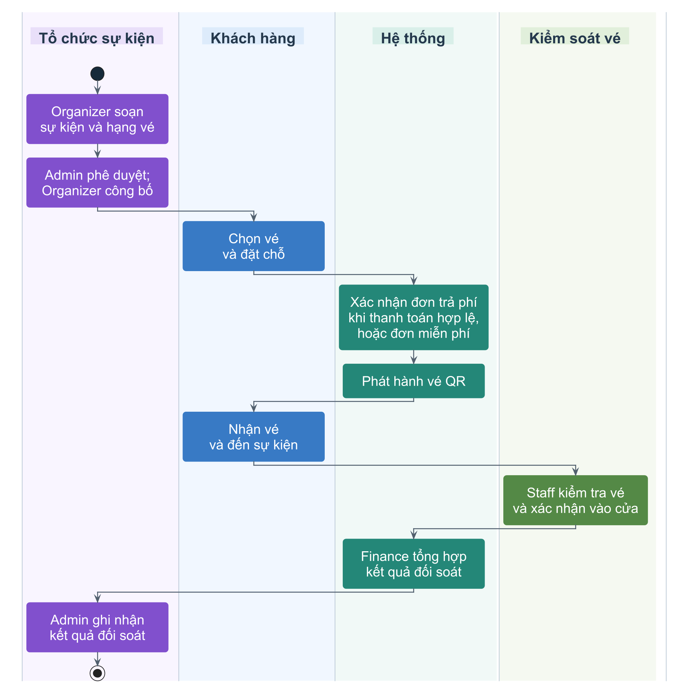

### Tác nhân và phạm vi quyền

| Tác nhân | Chức năng chính | Giới hạn dữ liệu |
| --- | --- | --- |
| Customer | Tìm sự kiện, chọn vé, thanh toán, xem đơn, mở QR và tải PDF. | Đơn và vé thuộc tài khoản hiện tại. |
| Organizer | Nộp hồ sơ, quản lý tổ chức, soạn sự kiện, hạng vé, phân công và theo dõi hoạt động. | Tổ chức và sự kiện được cấp quyền. Quyền MANAGEMENT và FINANCE có phạm vi riêng. |
| Check-in Staff | Xem sự kiện được phân công, quét QR, tra cứu vé, xác nhận vào cửa. | Tài khoản, tổ chức, membership và phân công hiện còn hiệu lực. |
| Admin | Kiểm duyệt, quản trị tài khoản, xử lý ngoại lệ, cấu hình phí và ghi nhận đối soát. | Quyền quản trị được kiểm tra tại backend; thao tác quan trọng có lịch sử. |


Một tài khoản có thể mang nhiều vai trò. Portal chỉ hỗ trợ điều hướng; backend kiểm tra quyền trên từng tổ chức, sự kiện, đơn và vé.

### Nhóm chức năng

| Nhóm | Nội dung được triển khai |
| --- | --- |
| Tài khoản và tổ chức | Đăng ký, xác thực email, đăng nhập, làm mới phiên, khôi phục mật khẩu, xét duyệt đơn vị tổ chức, thành viên và tài khoản nhận tiền. |
| Sự kiện và tồn kho | Nháp chưa đầy đủ, gửi duyệt, từ chối hoặc phê duyệt, công khai, tải ảnh, hạng vé, quota, tạm dừng bán và hủy. |
| Khám phá và đặt vé | Tìm kiếm công khai, đọc giá hiện hành, chấp thuận điều khoản, giữ vé, đơn miễn phí hoặc trả phí, lịch sử đơn. |
| Thanh toán | Phiên QR hoặc thẻ mẫu, callback được xác minh, giao dịch chưa rõ kết quả, đối chiếu lại và bằng chứng hoàn mô phỏng. |
| Vé và vào cửa | Phát hành từng vé, QR ổn định, PDF riêng tư, check-in online, tra cứu thủ công, lịch sử và thống kê. |
| Tài chính và vận hành | Snapshot phí, một batch đối soát mỗi sự kiện, báo cáo và CSV, audit tổng hợp, cấu hình vận hành và email. |


MVP dùng vé vào cửa chung, chưa phân ghế, chuyển nhượng, bán lại, mã giảm giá hoặc hàng đợi mua vé. Tích hợp thanh toán thực chưa được thiết lập.

### Quy tắc nghiệp vụ cốt lõi

Một đơn thuộc một sự kiện, giữ giá và điều khoản tại lúc tạo, có hạn giữ 10 phút. Đơn trả phí chỉ được xác nhận từ bằng chứng backend; khoản thu muộn hoặc dư trở thành ngoại lệ. Đơn confirmed không được khách tự hủy. Mỗi vé chỉ có một admission thành công; check-in từ hai giờ trước lúc bắt đầu đến trước lúc kết thúc. Lỗi email không hoàn tác giao dịch.

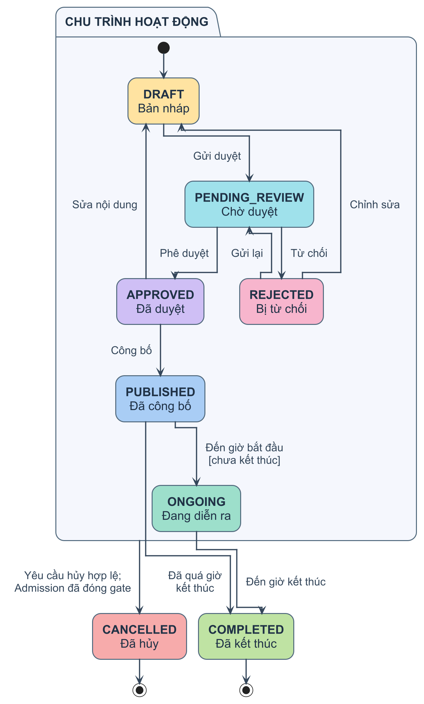

Sự kiện bắt đầu ở DRAFT. Có thể yêu cầu hủy khi sự kiện chưa ở COMPLETED hoặc CANCELLED. Commerce đặt cờ cancellation_pending để chặn bán mới và dừng cập nhật vòng đời; chỉ ghi CANCELLED sau khi Admission xác nhận đã đóng quyền vào cửa. Nếu chưa đóng được gate, hệ thống lưu yêu cầu để thử lại.

### Yêu cầu phi chức năng

| Chỉ tiêu trong đặc tả | Mục tiêu | Mức đáp ứng hiện tại |
| --- | --- | --- |
| Sẵn sàng | 99,9% | Chưa có số liệu vận hành production. |
| Người dùng đồng thời | 5.000 | Chưa có phép đo tải tương ứng. |
| API đọc | P95 không quá 500 ms | Mục tiêu thiết kế, chưa được xác nhận bằng benchmark. |
| Đặt vé và check-in | P95 không quá 1.000 ms | Kiểm thử chức năng không chứng minh ngưỡng này. |
| Phát hành vé | P95 không quá 30 giây | Chưa có tập phép đo phân vị. |
| Phục hồi | RPO 5 phút, RTO 60 phút | Chưa có diễn tập backup và restore trong hồ sơ nghiệm thu được dùng. |
| Khả năng tiếp cận | WCAG 2.2 AA | Có kiểm tra giao diện giới hạn, chưa chứng nhận đầy đủ. |


Các mục tiêu trên thuộc đặc tả; cần kiểm thử tải và diễn tập khôi phục để xác nhận [S04, S15].

## Chương 2 Kiến trúc hệ thống

### Kiến trúc tổng thể

Frontend gửi HTTP qua API Gateway đến microservice phụ trách. PostgreSQL lưu giao dịch, Kafka phân phối sự kiện, MinIO lưu tệp và MailHog nhận thư local. Mỗi service có schema và role cơ sở dữ liệu riêng.

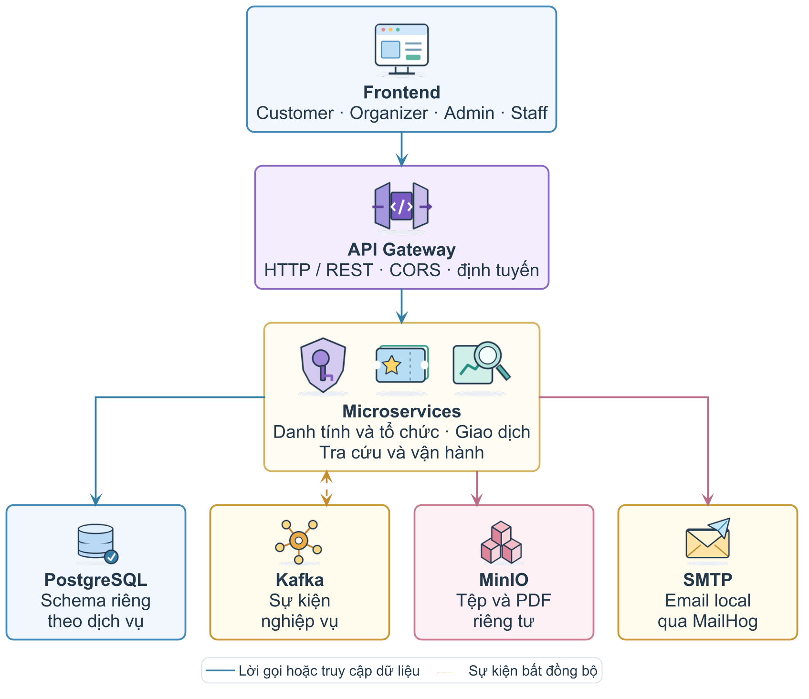

Báo cáo dùng ba góc nhìn thành phần, tương tác và triển khai theo arc42/C4 [R01, R02].

### Phân chia miền nghiệp vụ

Commerce giữ sự kiện, tồn kho và đơn trong cùng miền để giao dịch giữ vé được nguyên tử. Payment bảo toàn khoản thu độc lập với khả năng xác nhận đơn. Admission quản lý từng vé; Finance quản lý phí và số tiền đủ điều kiện đối soát.

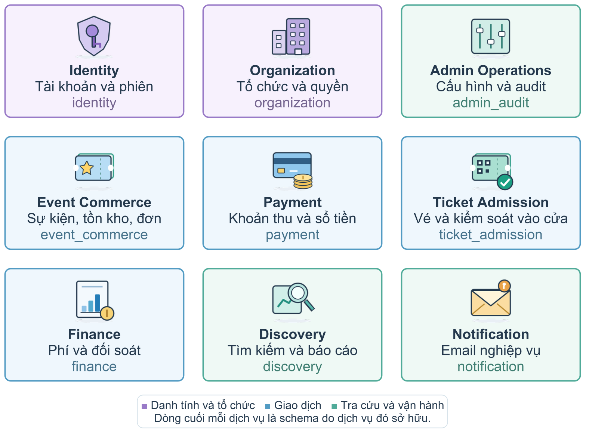

Identity và Organization cung cấp danh tính, phạm vi quyền. Discovery và Admin Operations giữ bản sao để truy vấn; quyết định giao dịch vẫn cần dữ liệu hiện hành từ owner.

### Công nghệ và tổ chức ứng dụng

| Thành phần | Công nghệ | Vai trò |
| --- | --- | --- |
| Frontend | Angular 19.2, TypeScript 5.8, RxJS 7.8 | Giao diện theo vai trò, quản lý phiên và gọi API. |
| API Gateway | Spring Cloud Gateway, BOM 2024.0.1 | Định tuyến HTTP và cấu hình CORS. |
| Backend | Java 21, Spring Boot 3.4.4 | Xử lý nghiệp vụ, phân quyền, giao dịch và tác vụ nền. |
| Dữ liệu | PostgreSQL 16, JPA và JdbcTemplate | Dữ liệu quan hệ, khóa, ràng buộc và truy vấn. |
| Truyền thông | Kafka, thông điệp JSON có phiên bản | Phân phối sự kiện giữa các dịch vụ. |
| Tệp và email | MinIO, SMTP qua MailHog | Lưu đối tượng và gửi thư trong môi trường local. |


Frontend dùng chung thư viện phiên và kiểu API, quản lý trạng thái bằng signals/RxJS. Access token nằm trong bộ nhớ; backend kiểm tra quyền. Redis và Schema Registry có trong hạ tầng phát triển nhưng chưa tham gia giữ vé hoặc hợp đồng Kafka JSON hiện tại [S05–S09].

### Giao tiếp đồng bộ và bất đồng bộ

REST phục vụ quyết định cần phản hồi ngay; Kafka truyền fact đã xảy ra để dịch vụ nhận xử lý độc lập [R03]. Vì vậy đơn có thể CONFIRMED trước khi vé sẵn sàng.

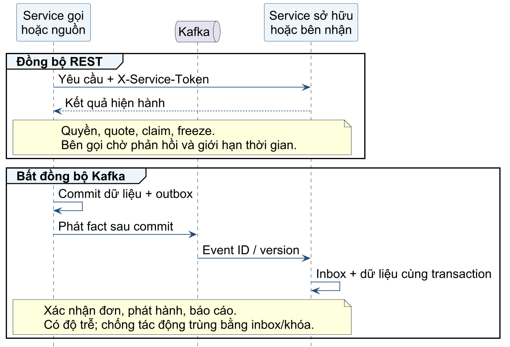

### Ranh giới giao dịch và lựa chọn thiết kế

Transaction chỉ bao phủ dữ liệu của một service. Quote Finance đã lưu không bị rollback cùng đơn Commerce; HTTP timeout cũng không chứng minh phía nhận chưa xử lý. Các thao tác dùng định danh ổn định để đọc lại hoặc tiếp tục.

Outbox commit cùng nghiệp vụ rồi phát sau; inbox và khóa duy nhất xử lý thông điệp lặp [R04]. Các schema hiện dùng chung PostgreSQL nên chia sẻ tài nguyên và miền sự cố. Khóa theo sự kiện bảo vệ tồn kho nhưng làm đơn cùng sự kiện chờ nhau; cần đo tải trước khi đổi mức khóa.

## Chương 3 Thiết kế backend microservices

### Cấu trúc xử lý trong dịch vụ

Controller nhận yêu cầu, lớp nghiệp vụ kiểm tra quyền và trạng thái, repository thực hiện truy vấn và khóa dữ liệu. REST client gọi dịch vụ khác; consumer và worker xử lý tác vụ nền. Hình dưới minh họa cách tổ chức này trong Commerce.

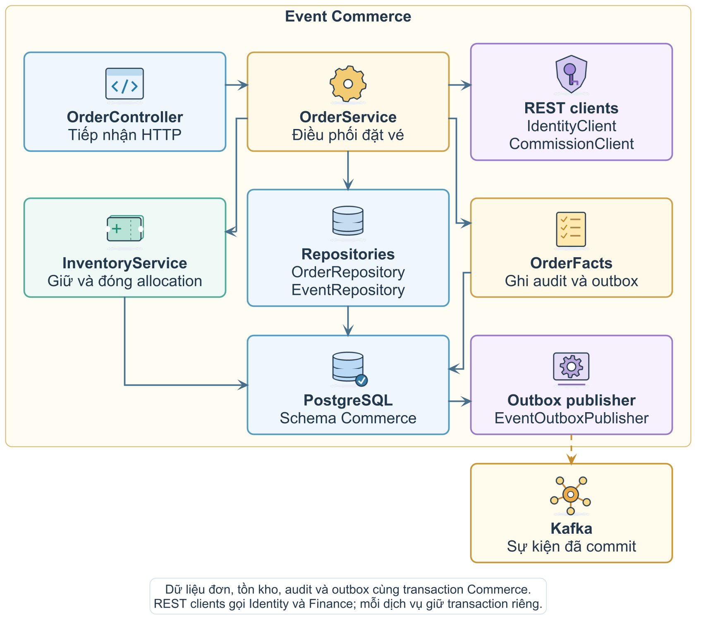

Identity và Organization dùng JPA cho nhiều thực thể. Commerce, Payment, Admission và Finance dùng JdbcTemplate ở các luồng cần SQL và khóa tường minh. Mỗi dịch vụ chỉ ghi schema của mình [S10–S14].

### API Gateway

| Khía cạnh | Thiết kế |
| --- | --- |
| Trách nhiệm | Điểm vào HTTP; định tuyến yêu cầu và cấu hình CORS cho frontend. |
| Dữ liệu sở hữu | Không có bảng nghiệp vụ; không mở transaction đặt vé. |
| Thành phần | Spring Cloud Gateway và cấu hình route theo nhóm tài nguyên. |
| API | Chuyển `/auth`, `/users`, `/orders`, `/tickets`, `/discover`, `/settlements` đến dịch vụ tương ứng. |
| Phối hợp | Route cụ thể được xét trước route tổng quát. API nội bộ không được công khai qua gateway. |
| Nhất quán | Quyền và trạng thái giao dịch do dịch vụ đích kiểm tra; gateway chuyển tiếp kết quả. |
| Phục hồi | Lỗi dịch vụ đích được trả về frontend; thao tác gửi lại dùng quy tắc idempotency của nghiệp vụ. |

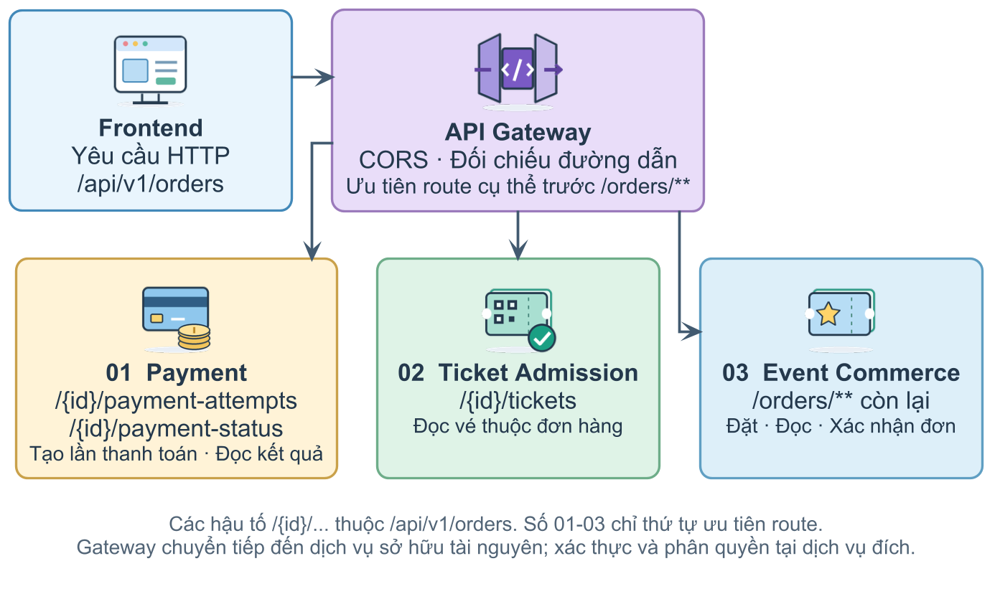

### Identity Service

| Khía cạnh | Thiết kế |
| --- | --- |
| Trách nhiệm | Đăng ký, xác thực email, đăng nhập, làm mới phiên, khôi phục mật khẩu và quản trị tài khoản. |
| Dữ liệu sở hữu | Schema `identity`: users, user_roles, verification_tokens, refresh_sessions, security_audit và email_deliveries. |
| Thành phần | AuthService quản lý tài khoản; TokenService cấp token; CurrentAccountService kiểm tra trạng thái hiện hành. |
| API | `/auth`; nội bộ `/internal/users/{id}/security-state` và `/notification-contact`. |
| Phối hợp | Cung cấp danh tính, trạng thái phiên và liên hệ cho các dịch vụ nghiệp vụ. Thư xác thực do worker Identity gửi. |
| Nhất quán | Mật khẩu Argon2; JWT RS256. Refresh token lưu hash, xoay khi dùng; thay đổi tài khoản và lịch sử cùng transaction. |
| Phục hồi | Phiên bị thu hồi hoặc token tái sử dụng bị từ chối. Không xác minh được trạng thái hiện hành thì không cấp quyền. |

### Organization Service

| Khía cạnh | Thiết kế |
| --- | --- |
| Trách nhiệm | Xét duyệt tổ chức; quản lý thành viên, quyền MANAGEMENT/FINANCE, phân công staff và đích nhận tiền. |
| Dữ liệu sở hữu | Schema `organization`: organizer_applications, organizations, organization_members, verification_documents, event_staff_assignments và payout_destinations. |
| Thành phần | OrganizerApplicationService, OrganizationManagementService, StaffAssignmentService và PayoutService. |
| API | Hồ sơ, tổ chức, thành viên, staff, payout; API nội bộ kiểm tra quyền và chấp thuận đích nhận tiền. |
| Phối hợp | Đọc người dùng từ Identity, sự kiện từ Commerce; cấp phạm vi thao tác cho Commerce, Admission và Finance. |
| Nhất quán | Membership theo tổ chức và người dùng. Mỗi tổ chức chỉ có một payout ACTIVE; thay đổi payout tăng version. |
| Phục hồi | Authorization lưu theo settlement và fingerprint để dùng lại. Thông báo được ghi outbox cùng quyết định nghiệp vụ. |

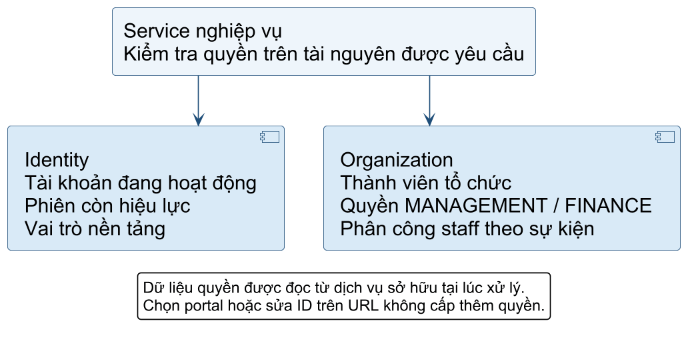

### Event Commerce Service

| Khía cạnh | Thiết kế |
| --- | --- |
| Trách nhiệm | Nội dung và vòng đời sự kiện, hạng vé, tồn kho, giữ chỗ, xác nhận và hết hạn đơn. |
| Dữ liệu sở hữu | Schema `event_commerce`: events, ticket_types, inventory_allocations, allocation_lines, orders, order_items, order_requests và event_outbox. |
| Thành phần | EventService, InventoryService, OrderService, EventCancellation; repository cung cấp khóa sự kiện và đơn. |
| API | Booking quote, reservations, xem đơn, confirm-free; nội bộ cấp payment claim, dữ liệu phát hành và báo cáo. |
| Phối hợp | Organization kiểm tra quyền; Finance cấp quote phí; Payment gửi bằng chứng; Admission xác nhận freeze khi hủy. |
| Nhất quán | Khóa sự kiện trước đơn. Allocation, đơn, giá và phí chụp, kết quả request, outbox cùng transaction. Hạn giữ 10 phút không đổi khi retry. |
| Phục hồi | Replay trả đơn cũ; hết hạn giải phóng allocation. Hủy dở giữ cancellation_pending, chặn bán và tiếp tục freeze. |

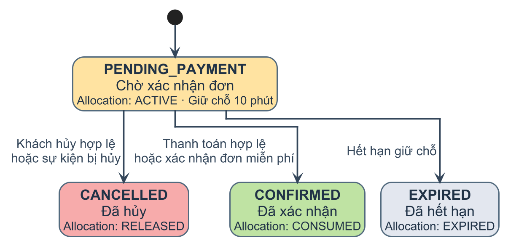

### Payment Service

| Khía cạnh | Thiết kế |
| --- | --- |
| Trách nhiệm | Lần thử thanh toán, phiên QR/thẻ, callback, khoản thu, ngoại lệ, bằng chứng hoàn và đối chiếu phí gateway. |
| Dữ liệu sở hữu | Schema `payment`: attempts, receipts, transactions, exceptions, return_evidence, gateway_reconciliations và sổ tài chính. |
| Thành phần | PaymentService, CheckoutService, ReceiptService, FinancialLedger; MockDeliveryWorker mô phỏng provider. |
| API | Tạo payment-attempts, chọn method, nhận webhook local-mock; nội bộ cung cấp bằng chứng tài chính. |
| Phối hợp | Commerce cấp claim và quyết định áp dụng tiền vào đơn. Finance yêu cầu proof; Payment kiểm tra payout tại Organization. |
| Nhất quán | HMAC trên raw body; khóa khoản thu theo provider/merchant/reference. Receipt, transaction và outbox cùng commit; SUCCESS/REFUNDED không bị hạ trạng thái. |
| Phục hồi | Request key khôi phục attempt. Khoản thu muộn, dư hoặc chưa ánh xạ được giữ để đối chiếu; UNKNOWN không tự thành FAILED. |

### Ticket Admission Service

| Khía cạnh | Thiết kế |
| --- | --- |
| Trách nhiệm | Phát hành từng vé, QR, PDF riêng tư, tra cứu, check-in và đóng quyền vào cửa khi hủy. |
| Dữ liệu sở hữu | Schema `ticket_admission`: issuance_obligations, tickets, event_gates, admissions, admission_requests, inbox và outbox. |
| Thành phần | IssuanceService/Worker, Credentials, AdmissionService, EventGates và TicketFacts. |
| API | Vé, PDF, tiến độ theo đơn, scan/lookup/confirm; nội bộ freeze theo sự kiện. |
| Phối hợp | Commerce xác nhận đơn và sự kiện; Identity cung cấp liên hệ; Organization kiểm tra phân công staff hiện hành. |
| Nhất quán | Inbox và nghĩa vụ commit trước ack. UNIQUE (order, item, ordinal) giữ danh tính vé; UNIQUE admission theo vé và khóa gate chống sử dụng trùng. |
| Phục hồi | Nguồn lỗi giữ PENDING; retry không đổi QR. Mất phản hồi scan dùng lại request key. Vé đã dùng giữ lịch sử, vé chưa dùng chuyển VOIDED khi hủy. |

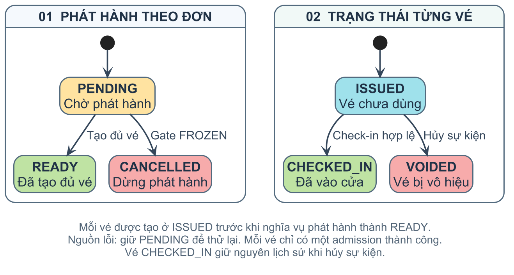

### Finance Service

| Khía cạnh | Thiết kế |
| --- | --- |
| Trách nhiệm | Cấu hình phí, quote bất biến, điều kiện đối soát, batch settlement và bằng chứng hoàn tất. |
| Dữ liệu sở hữu | Schema `finance`: commission_configs, commission_quotes, settlements, settlement_items, quyết định hoàn tất, audit và outbox. |
| Thành phần | CommissionService, SettlementEligibility, SettlementService, SettlementCompletion và FinanceSources. |
| API | Nội bộ quote phí; tổ chức xem/yêu cầu settlement; Admin quản lý cấu hình và ghi nhận hoàn tất. |
| Phối hợp | Commerce cung cấp đơn đủ điều kiện. Finance gọi Payment xác nhận sổ tiền; Payment gọi Organization xác nhận đích nhận tiền. |
| Nhất quán | Một settlement mỗi sự kiện; một claim mỗi đơn. Proof gắn settlement và fingerprint; chỉ ghi SETTLED sau khi proof hợp lệ. |
| Phục hồi | Timeout dùng lại bằng chứng đã lưu; UNKNOWN không tạo lần chi mới. Net bằng 0 dùng NO_TRANSFER; net dương cần PAID. Hiện chưa chuyển tiền ngân hàng thật. |

### Discovery Service

| Khía cạnh | Thiết kế |
| --- | --- |
| Trách nhiệm | Tìm sự kiện công khai, danh sách người tham dự, dashboard và CSV. |
| Dữ liệu sở hữu | Schema `discovery`: public_events, event_attendees, projection báo cáo, snapshot, version và inbox. |
| Thành phần | ProjectionService, AttendeeProjection, ReportingProjection/Backfill, ReportService và ReportCalculator. |
| API | `/discover/events`, báo cáo theo tổ chức/Admin; danh sách người tham dự nội bộ. |
| Phối hợp | Nhận fact từ Commerce, Payment, Admission, Finance; backfill qua feed Commerce. |
| Nhất quán | Inbox chống trùng, chỉ áp dụng version mới hơn. Dashboard và CSV dùng chung snapshotId, bộ lọc và thời điểm dữ liệu. |
| Phục hồi | Backfill phân trang và lặp vòng để bắt commit muộn. Projection có độ trễ; không quyết định xác nhận đơn, check-in hay settlement. |

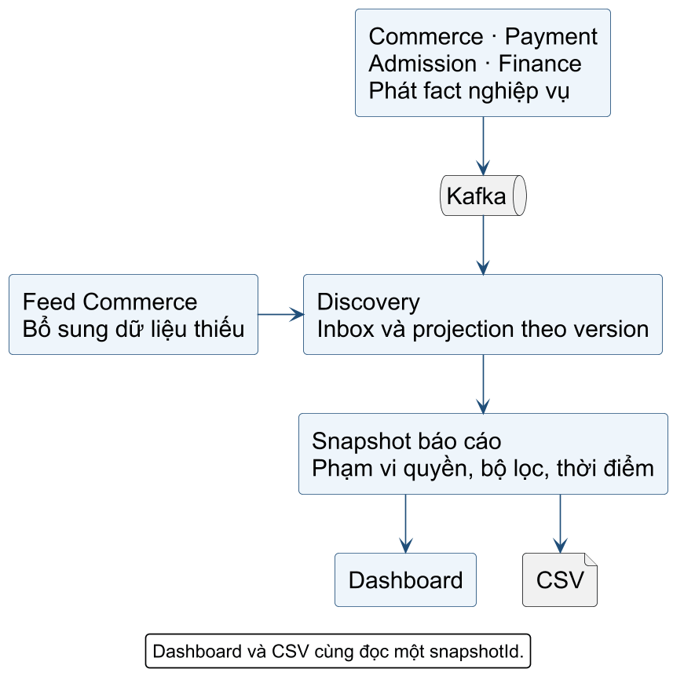

### Notification Service

| Khía cạnh | Thiết kế |
| --- | --- |
| Trách nhiệm | Thư đơn hàng, vé sẵn sàng, hủy, nhắc lịch và thông báo vận hành. Thư xác thực thuộc Identity. |
| Dữ liệu sở hữu | Schema `notification`: inbox và công việc gửi theo loại thông báo. |
| Thành phần | OperationsPoller, MailWorker, TicketMailWorker và OperationsMailWorker. |
| API | Tiếp nhận qua Kafka và poll REST nội bộ; không cung cấp quyết định nghiệp vụ cho frontend. |
| Phối hợp | Đọc notification_outbox của Organization, Commerce, Finance; lấy liên hệ và trạng thái hiện hành trước gửi. |
| Nhất quán | Lưu công việc và người nhận trước xác nhận nguồn; khóa chống trùng theo đơn hoặc thông báo/người nhận. |
| Phục hồi | SMTP lỗi giữ công việc để retry; không hoàn tác đơn hay vé. SMTP đã nhận nhưng chưa lưu delivered có thể gây gửi thư lặp. |

### Admin Operations Service

| Khía cạnh | Thiết kế |
| --- | --- |
| Trách nhiệm | Cấu hình vận hành được cho phép và lịch sử tổng hợp cho Admin. |
| Dữ liệu sở hữu | Schema `admin_audit`: settings, audit_records và source_cursors. |
| Thành phần | SettingsService kiểm tra key/version/quyền; tác vụ nền thu thập audit theo cursor. |
| API | `/admin/settings`, `/admin/audit-logs`, `/internal/operations/settings`. |
| Phối hợp | Đọc feed audit của từng owner; cung cấp cấu hình như nhắc lịch và email hỗ trợ. |
| Nhất quán | Nhận diện audit theo (source, id); che dữ liệu nhạy cảm. Lịch sử gốc vẫn thuộc dịch vụ tạo giao dịch. |
| Phục hồi | Nguồn lỗi giữ cursor để tiếp tục. Quản trị tài khoản, duyệt sự kiện và đối soát vẫn do owner tương ứng xử lý. |

### Hợp đồng liên dịch vụ và xử lý lỗi

| Bên gọi | Bên nhận | Nội dung trao đổi | Khi gián đoạn |
| --- | --- | --- | --- |
| Dịch vụ nghiệp vụ | Identity | Tài khoản và phiên hiện hành. | Không cấp quyền khi chưa xác minh. |
| Commerce, Admission, Finance | Organization | Thành viên, phân công, đích nhận tiền. | Không dùng quyền cũ từ giao diện. |
| Commerce | Finance | Quote phí cho đơn. | Hoàn tác tạo đơn; quote đã lưu thuộc Finance. |
| Payment | Commerce | Đơn và payment claim. | Gửi lại cùng request key. |
| Admission | Commerce | Đơn confirmed và sự kiện. | Giữ nghĩa vụ PENDING để thử lại. |
| Commerce | Admission | Đóng quyền vào cửa. | Giữ cancellation_pending và tiếp tục thử lại. |
| Finance | Payment | Chấp thuận sổ tiền và proof. | Dùng lại cùng fingerprint. |
| Payment | Organization | Chấp thuận phiên bản đích nhận tiền. | Dùng lại cùng fingerprint. |

Với Kafka, dịch vụ phát gửi fact có ID và version; dịch vụ nhận xử lý qua inbox. Outbox giữ trách nhiệm phát lại, còn retry giới hạn và DLT dành cho thông điệp chưa xử lý được.

REST client có timeout theo tích hợp, chưa có circuit breaker chung. Lời gọi trong transaction có thể kéo dài thời gian giữ khóa; retry cần dùng định danh nghiệp vụ ổn định [S07, S10–S14].

## Chương 4 Thiết kế cơ sở dữ liệu

### Phân vùng sở hữu dữ liệu

PostgreSQL lưu 84 bảng trong các schema theo dịch vụ. Mỗi service chỉ ghi dữ liệu sở hữu; các liên kết liên dịch vụ được giải quyết qua API hoặc sự kiện.

| Schema | Số bảng | Dữ liệu chủ đạo |
| --- | --- | --- |
| identity | 6 | Tài khoản và phiên đăng nhập. |
| organization | 9 | Tổ chức, thành viên, phân công và payout. |
| event_commerce | 19 | Sự kiện, tồn kho và đơn hàng. |
| payment | 15 | Lần thử, khoản thu, hoàn và ngoại lệ. |
| ticket_admission | 7 | Vé, gate và lịch sử vào cửa. |
| finance | 12 | Cấu hình phí, quote và đối soát. |
| discovery | 9 | Tìm kiếm, người tham dự và báo cáo. |
| notification | 4 | Công việc gửi thông báo. |
| admin_audit | 3 | Cấu hình vận hành và audit tổng hợp. |
| Tổng | 84 | Dữ liệu của các miền nghiệp vụ. |

### Quy ước và lựa chọn mô hình

UUID định danh thực thể; `timestamptz` lưu thời gian; `bigint` lưu tiền VND. Phần trăm dùng basis point, chẳng hạn 500 bps = 5%. Các bảng quan hệ giữ PK, FK và constraint; JSONB chứa payload, bằng chứng và snapshot.

Giá, tên vé, điều khoản và phí được chụp để bảo toàn giao dịch lịch sử. CHECK snapshot phí dùng `IS TRUE` để chặn giá trị UNKNOWN; trigger ngăn sửa snapshot đã lưu.

### Mô hình sự kiện và đơn hàng

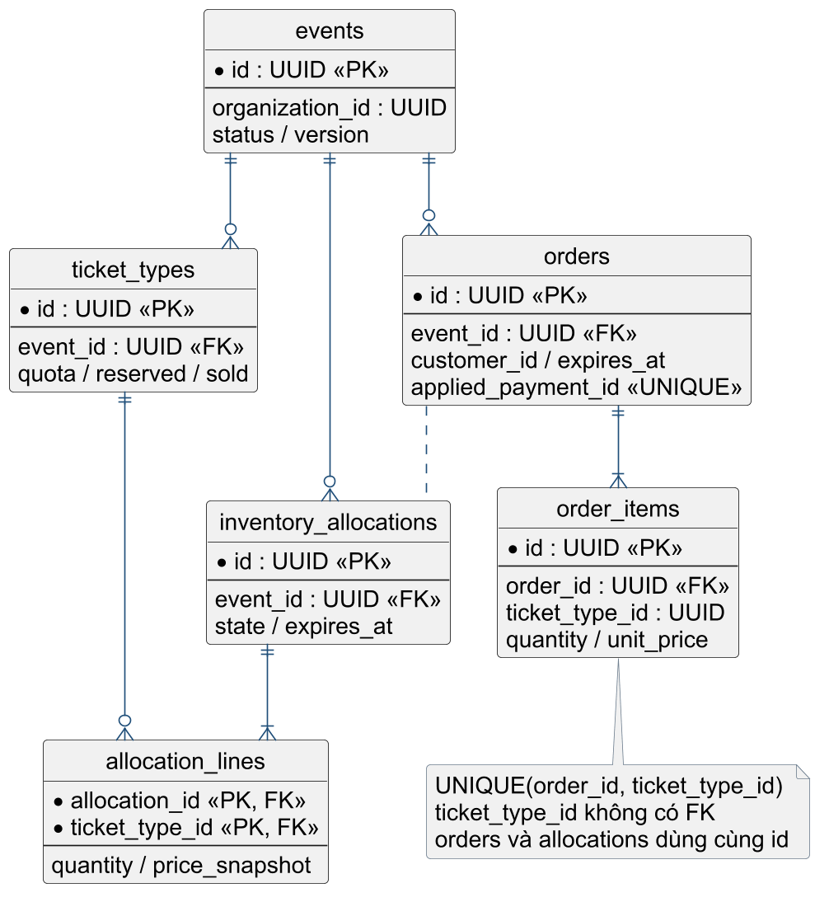

| Bảng và trường | Kiểu và ràng buộc | Vai trò |
| --- | --- | --- |
| events.id | UUID, PK | Định danh sự kiện và hàng khóa chung cho thao tác thương mại. |
| events.status và version | VARCHAR có CHECK, BIGINT | Vòng đời và kiểm tra bản sửa đổi. |
| events.start_at và end_at | TIMESTAMPTZ, có thể NULL khi nháp | CHECK thứ tự thời gian; service kiểm tra điều kiện theo trạng thái. |
| events.cancellation_pending | BOOLEAN | Chặn hoạt động mới khi giao thức hủy chưa hoàn tất. |
| ticket_types.event_id | UUID, FK đến events | Một sự kiện có nhiều hạng vé. |
| ticket_types.quota, reserved, sold | INTEGER, CHECK | Quota dương; reserved và sold không âm; tổng không vượt quota. |
| ticket_types.price | BIGINT, không âm | Giá hiện hành cho đơn tạo mới. |
| inventory_allocations.state | VARCHAR có CHECK | ACTIVE, CONSUMED, RELEASED hoặc EXPIRED. |
| allocation_lines | PK allocation_id và ticket_type_id | Số lượng và giá khi giữ vé, FK đến allocation và hạng vé. |
| orders.total_vnd và expires_at | BIGINT, TIMESTAMPTZ | Tổng tiền và hạn giữ nguyên bản. |
| orders.applied_payment_id | UUID, UNIQUE, có thể NULL | Một khoản thu chỉ được áp dụng cho tối đa một đơn. |
| orders.commission_snapshot | JSONB hoặc NULL lịch sử | Snapshot phí bất biến; thiếu dữ liệu không được hiểu là phí bằng 0. |
| order_items | PK id, UNIQUE order_id và ticket_type_id | Định danh dòng dùng tiếp khi phát hành từng vé. |
| order_requests | PK actor_id và request_key | Lưu fingerprint và kết quả cho gửi lại cùng yêu cầu. |


ERD dùng đường liền cho FK, đường đứt cho liên kết logic. `orders.id` và `inventory_allocations.id` dùng cùng UUID nhưng không có FK trực tiếp; `order_items.ticket_type_id` cũng là liên kết do ứng dụng duy trì.

### Mô hình thanh toán và vé

Payment tách lần thử, lần nhận callback và khoản thu. Định danh provider/merchant/reference chống ghi trùng tiền; khoản chưa ánh xạ vẫn được lưu để đối chiếu.

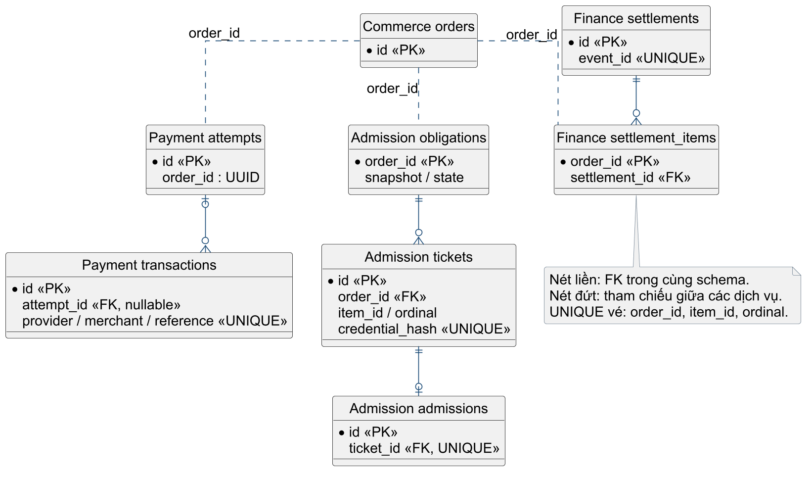

Một transaction chỉ có một exception; bằng chứng hoàn có reference duy nhất và tổng hoàn không vượt khoản thu. Thiếu đối chiếu phí gateway nghĩa là chưa biết phí.

Vé có UNIQUE (order_id, item_id, ordinal); một dòng số lượng 3 sinh ba đơn vị riêng. Credential hash hỗ trợ tra cứu, ciphertext phục vụ khôi phục QR. `admissions.ticket_id` có UNIQUE/FK; CHECK buộc thời điểm check-in phù hợp trạng thái. Kết quả request được lưu để phục hồi phản hồi bị mất [S06, S11].

### Tổ chức tài khoản và đối soát

Membership dùng khóa (organization_id, user_id); phân công staff có FK ghép đến membership. Partial unique index chỉ cho một payout ACTIVE mỗi tổ chức, với version tăng khi đổi đích nhận tiền.

Finance có UNIQUE settlement theo sự kiện và PK claim theo order_id. Reference chi trả không được dùng cho hai sự kiện. Các bảng payout_authorizations tại Payment và Organization giữ proof của từng owner [S06, S12].

### Bất biến và kiểm soát đồng thời

Ký hiệu Q là quota, R là đang giữ, S là đã bán, A là còn lại. CHECK bảo vệ từng hạng vé; tổng quota theo capacity được kiểm tra dưới khóa sự kiện. Ví dụ sau minh họa hai kết quả của một lần giữ hai vé.

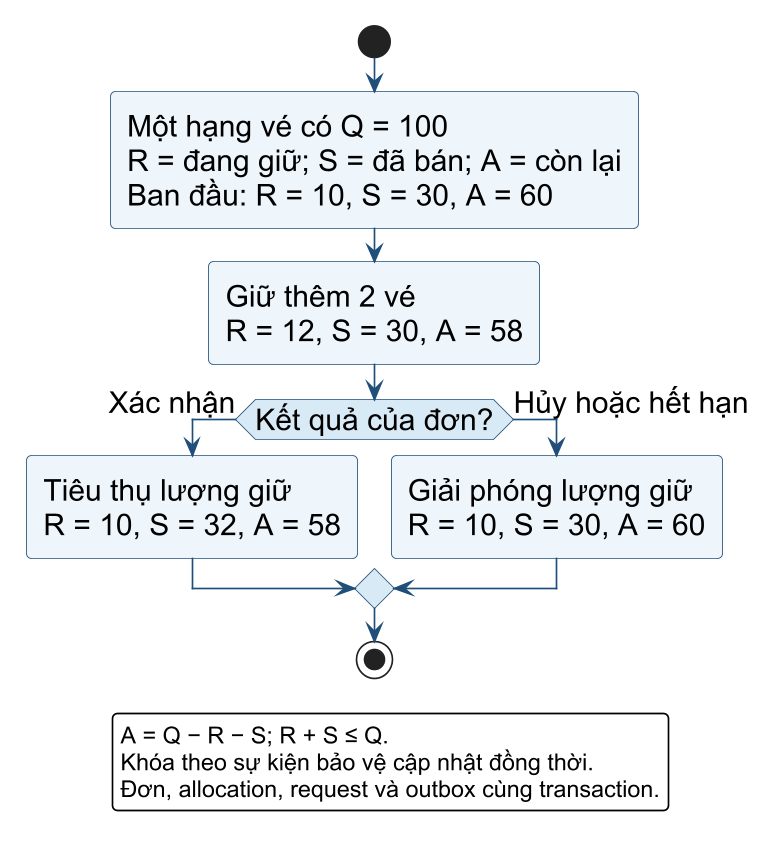

Commerce khóa sự kiện trước đơn. Admission dùng khóa gate cho phát hành, scan và freeze. Advisory lock theo actor/request key kết hợp kết quả đã lưu bảo vệ thao tác gửi lại. Các khóa không thay thế kiểm tra quyền và thời hạn [S10, S11].

### Chỉ mục và thay đổi lược đồ

| Chỉ mục đang có | Mục đích của truy vấn được hỗ trợ |
| --- | --- |
| order_customer và order_event | Lịch sử đơn theo chủ sở hữu hoặc sự kiện, sắp theo created_at và id. |
| order_expiry | Tìm đơn PENDING_PAYMENT đến hạn mà không quét toàn bộ lịch sử. |
| event_outbox_pending và outbox_pending | Worker lấy thông điệp chưa phát, theo thời điểm sẵn sàng. |
| ticket_owner_page và ticket_event | Danh sách vé của khách và thống kê theo sự kiện. |
| admission_event_page | Lịch sử vào cửa theo thời điểm và mã admission. |
| public_upcoming và public_popular | Danh sách khám phá theo thời gian hoặc số vé confirmed. |
| report_scope và audit_time | Giới hạn projection theo tổ chức và truy vấn audit theo thời gian. |


Migration có phiên bản theo service; nâng cấp phải giữ ràng buộc snapshot phí và trạng thái hủy.

## Chương 5 Thiết kế các luồng nghiệp vụ

### Quy ước biểu diễn

Mũi tên liền là lời gọi, nét đứt là phản hồi. Khung transaction chỉ bao phủ một service. Kafka được tách riêng; gateway và xác thực lặp lại được lược bớt để tập trung vào nghiệp vụ.

### Đăng nhập và kiểm tra quyền hiện hành

Identity kiểm tra mật khẩu, tạo refresh session và trả access token cùng cookie. Frontend giữ token trong bộ nhớ.

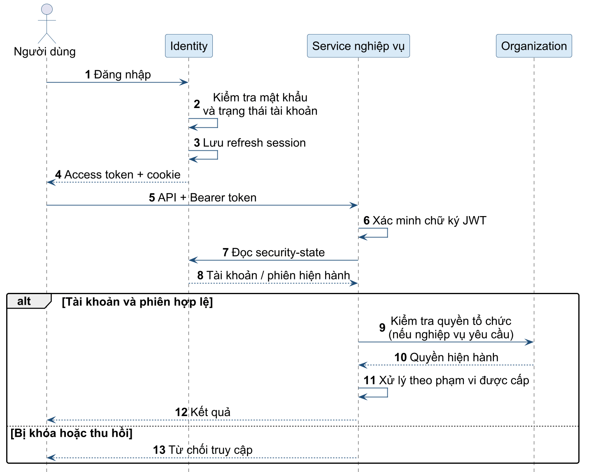

Service xác minh JWT, trạng thái tài khoản/phiên tại Identity và quyền tổ chức khi cần. Access token hết hạn thì refresh; phiên không hợp lệ yêu cầu đăng nhập lại.

### Duyệt và công bố sự kiện

Nháp có thể chưa đầy đủ; gửi duyệt cần lịch, địa điểm, capacity, điều khoản và hạng vé hợp lệ. PENDING_REVIEW khóa nội dung.

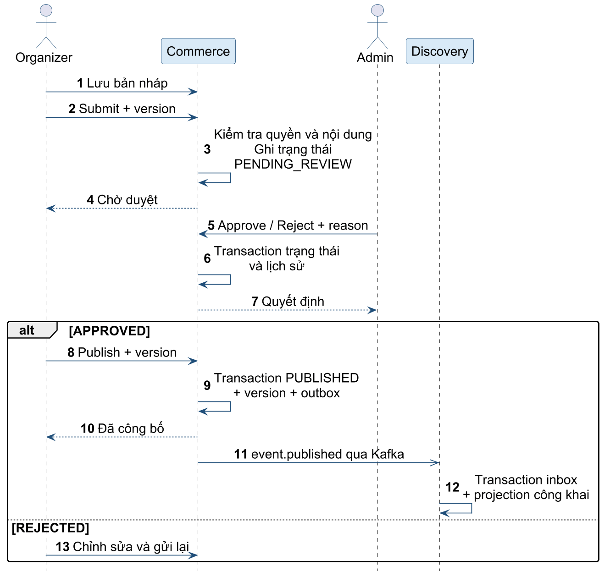

Publish ghi trạng thái, version, audit và outbox. Discovery cập nhật danh sách sau khi nhận fact. Sửa nội dung APPROVED đưa về DRAFT; nội dung cốt lõi bị khóa sau PUBLISHED.

### Giữ vé và tạo đơn

Client gửi lựa chọn, selectionVersion, chấp thuận điều khoản và Idempotency-Key. Backend tính lại giá; thay đổi giá/điều khoản trả PRICE_CHANGED.

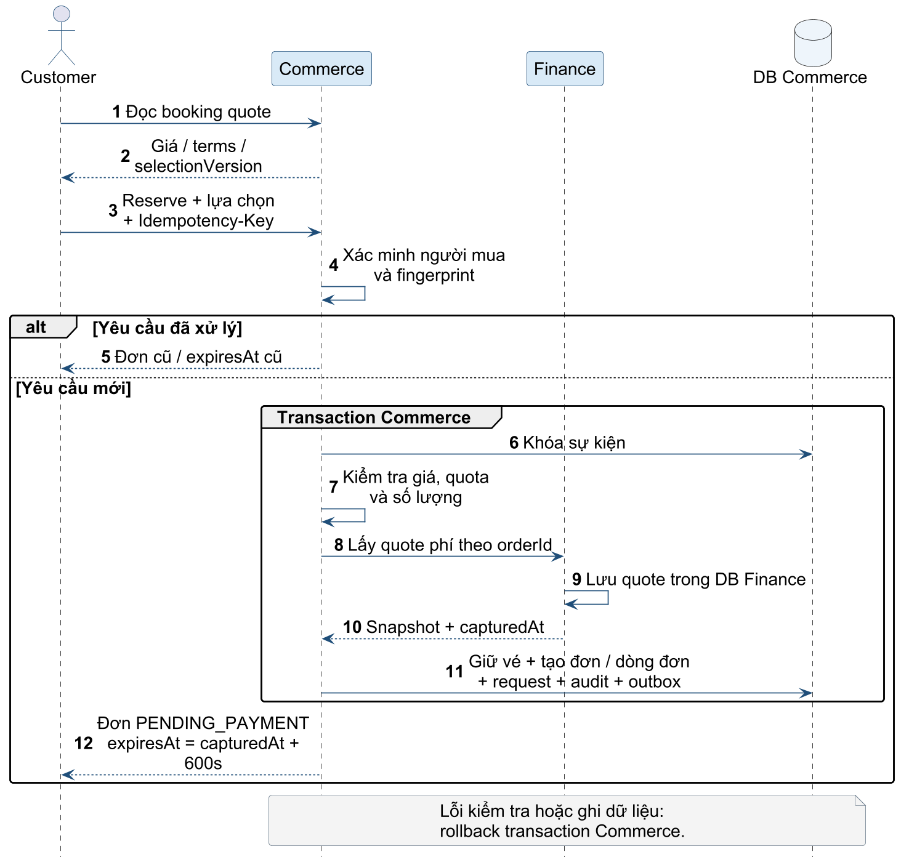

Commerce kiểm tra replay trước khi khóa sự kiện. Allocation, đơn, quote phí, request và outbox cùng commit; expiresAt = capturedAt + 600 giây. Key dài 8–128 ký tự URL-safe, theo actor: cùng nội dung trả đơn cũ, khác nội dung bị từ chối. Quote đã lưu tại Finance không nằm trong rollback Commerce.

### Thanh toán và xác nhận đơn

Payment lấy claim có attemptId ổn định từ Commerce rồi lưu lựa chọn QR/thẻ. Callback được kiểm tra HMAC trên raw body, merchant và cửa sổ 5 phút; receipt, khoản thu và outbox commit trước phản hồi.

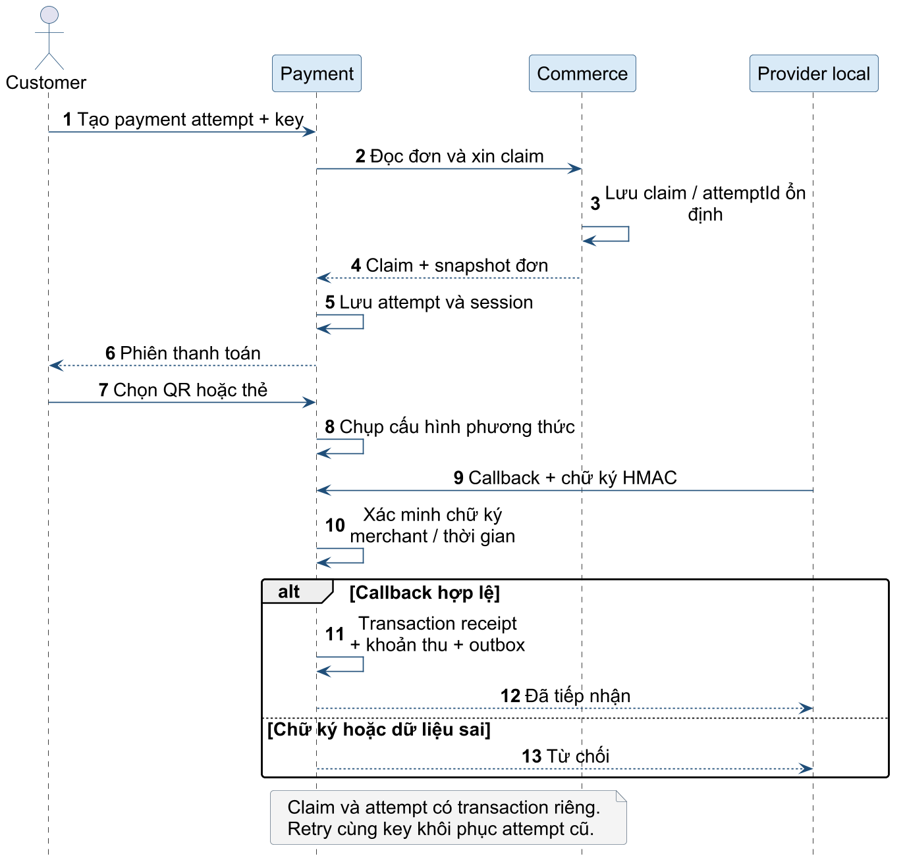

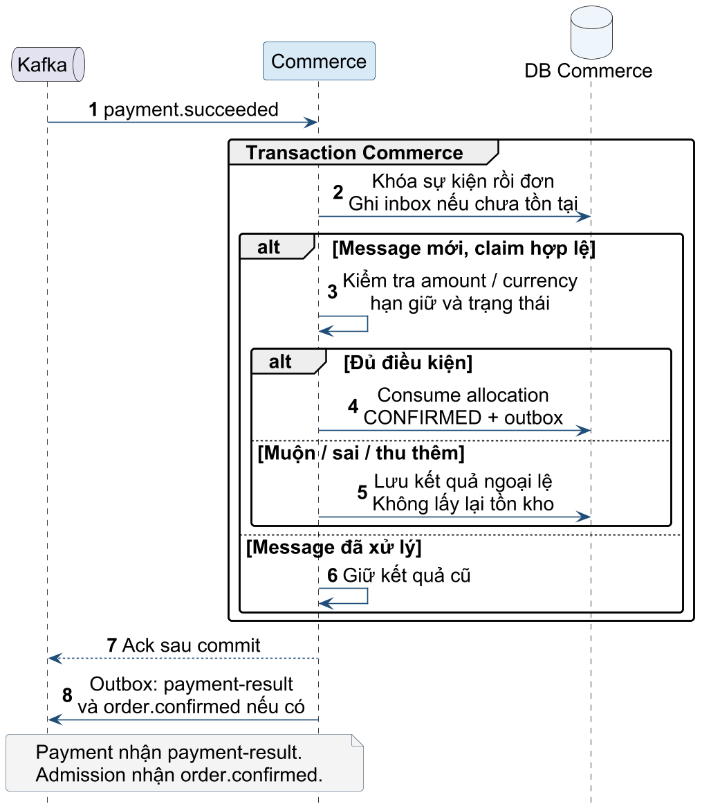

| Trường hợp | Xử lý đơn và tồn kho | Xử lý khoản thu |
| --- | --- | --- |
| Thành công đúng số tiền và còn hạn | CONFIRMED, consume allocation một lần. | Ghi APPLIED. |
| Callback hoặc thông điệp lặp | Giữ kết quả cũ, không tăng sold lần nữa. | Nhận diện receipt hoặc transaction đã có. |
| Thành công sau khi đơn hết hạn | Không lấy lại lượng vé đã giải phóng. | Ngoại lệ LATE_SUCCESS. |
| Sai số tiền hoặc loại tiền | Không xác nhận đơn. | Ngoại lệ AMOUNT_MISMATCH, giữ bằng chứng thu. |
| Khoản thu thêm cho đơn đã xác nhận | Không tạo thêm đơn hoặc vé. | Ngoại lệ DUPLICATE_COLLECTION. |
| Kết quả chưa rõ | Chưa cho tạo attempt mới tùy ý. | Query hoặc reconciliation để xác minh. |


Commerce kiểm tra claim, amount, currency, thời hạn và sự kiện dưới khóa trước khi consume allocation. Đơn bằng 0 dùng confirm-free, không tạo attempt. Đơn hỗn hợp phát hành mọi dòng sau khi trả đủ tổng tiền. Trang chuyển về không có quyền xác nhận [S03, S07, S10].

### Phát hành vé và cung cấp mã QR

Consumer lưu inbox và nghĩa vụ trước ack; worker đọc lại đơn/sự kiện và khóa gate trước khi tạo từng đơn vị vé.

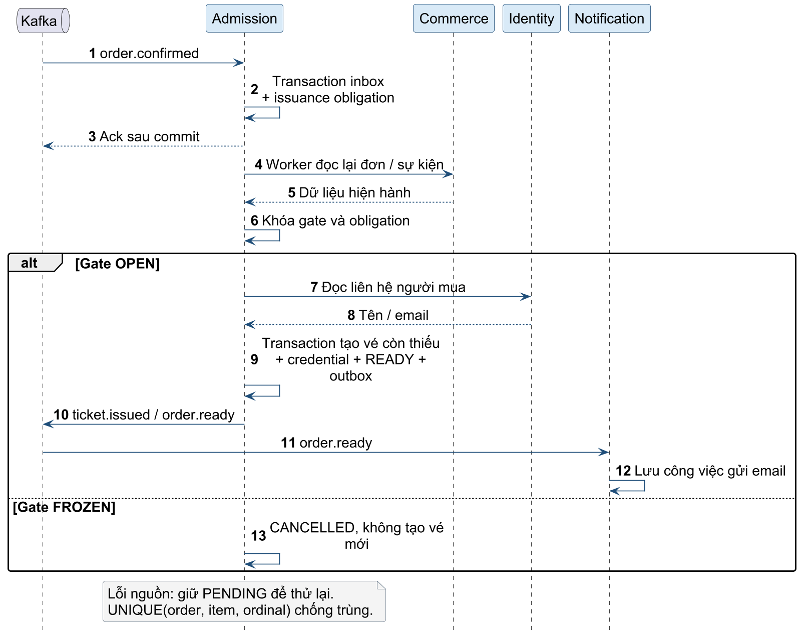

Worker phát ticket.issued và ticket.order.ready; email dẫn tới trạng thái hiện hành, không chứa credential. Nguồn lỗi giữ PENDING; gate FROZEN chuyển nghĩa vụ CANCELLED. PDF qua API kiểm tra chủ sở hữu; tạo tệp lỗi không phát hành lại vé.

### Kiểm soát vào cửa

Staff cần tài khoản, membership và phân công hiện hành. Vé phải đúng sự kiện, ISSUED, gate OPEN và trong cửa sổ check-in.

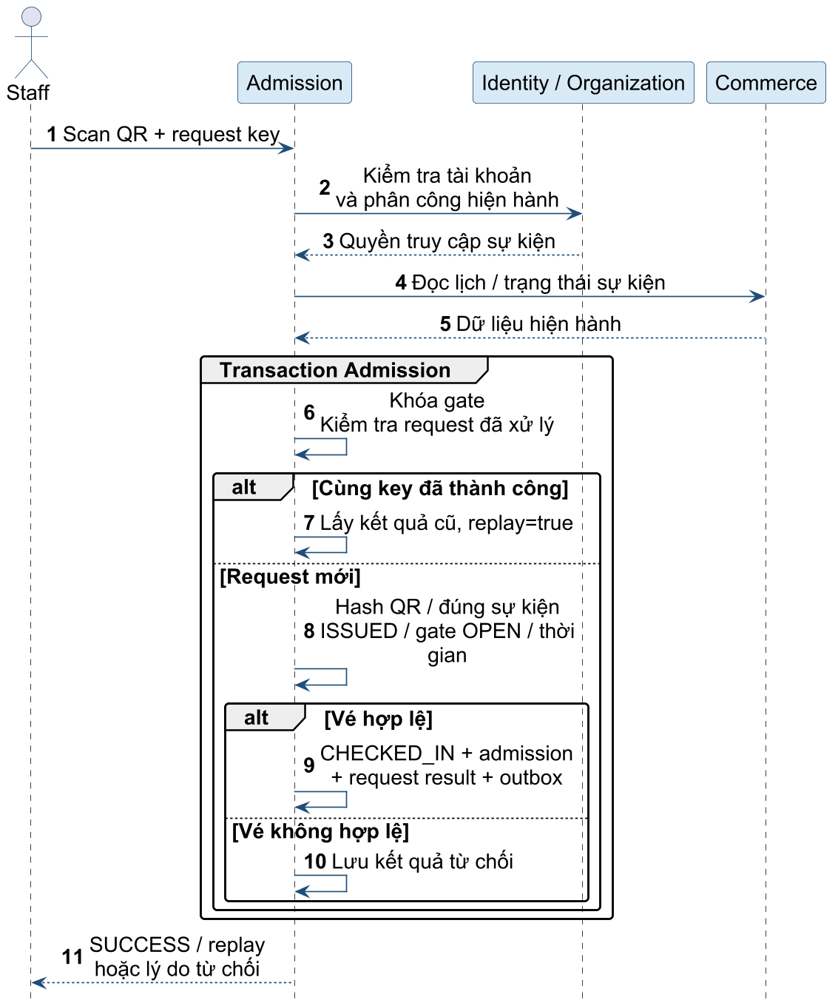

Cập nhật vé, admission, request và outbox cùng transaction. Cùng key trả kết quả replay; scan mới vé đã dùng trả ALREADY_USED. Lookup cần lệnh confirm riêng. Offline không được công nhận check-in thành công [S11].

### Hủy sự kiện và ngăn sử dụng vé

Commerce dừng bán trước, Admission đóng quyền vào cửa, sau đó Commerce hoàn tất hủy. Freeze đồng bộ loại bỏ khoảng trễ có thể còn nhận khách sau khi hiển thị CANCELLED.

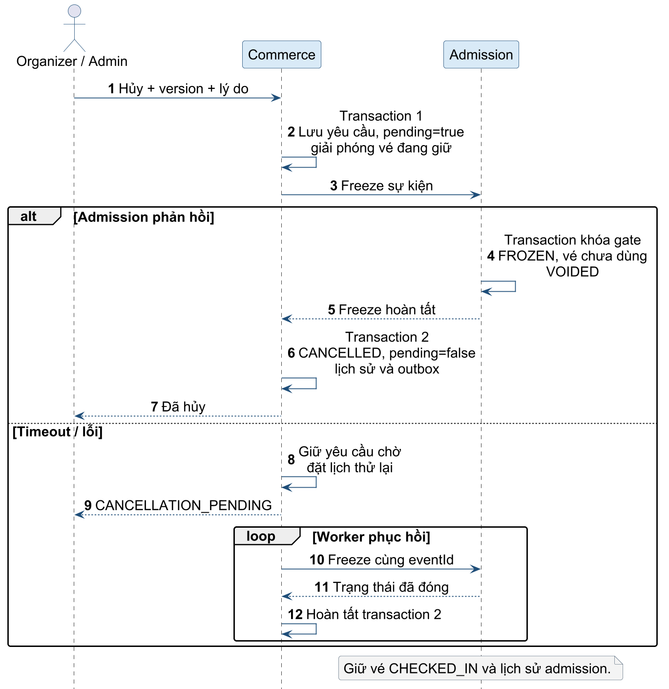

Transaction đầu bật cancellation_pending và giải phóng allocation; freeze thực hiện sau commit; transaction cuối ghi CANCELLED. Vé CHECKED_IN giữ lịch sử. Timeout trả tiến độ chờ, worker retry; bán mới vẫn bị chặn, không có transaction xuyên hai service.

### Phí nền tảng và đối soát

Quote chụp cấu hình tại lúc tạo đơn. Phí phần trăm làm tròn HALF_UP trên từng vé, không vượt giá; vé miễn phí có phí 0. Ví dụ hai vé 100.000 VND, phí 5%, gateway có bằng chứng phí 0, không hoàn: gross 200.000, phí 10.000, net 190.000 VND.

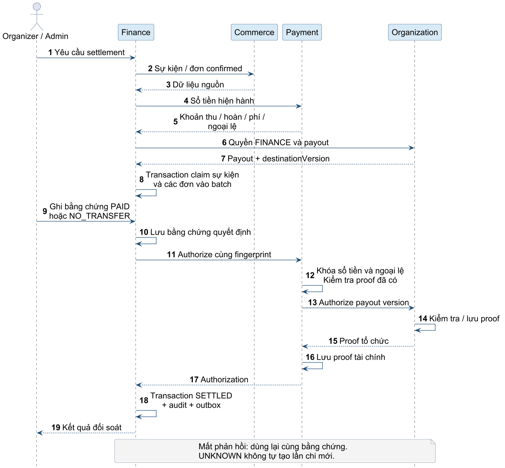

Finance lưu quyết định trước khi gọi Payment; Payment khóa sổ tiền và ngoại lệ chưa ánh xạ, gọi Organization xác minh payout rồi lưu proof. Chỉ proof hợp lệ mới cho ghi SETTLED. UNKNOWN giữ batch; replay dùng cùng fingerprint. Net 0 dùng NO_TRANSFER, net dương cần PAID mô phỏng. Thiếu snapshot hoặc phí gateway vẫn là chưa đủ dữ liệu. Hoàn đủ khoản đã áp dụng mới đảo toàn bộ phí; hoàn khoản dư/muộn không đảo phí bán hợp lệ [S03, S12].

### Phân phối sự kiện và cập nhật dữ liệu đọc

Outbox giữ fact cùng commit nghiệp vụ; inbox và version ngăn tác động trùng hoặc dữ liệu cũ ghi đè mới.

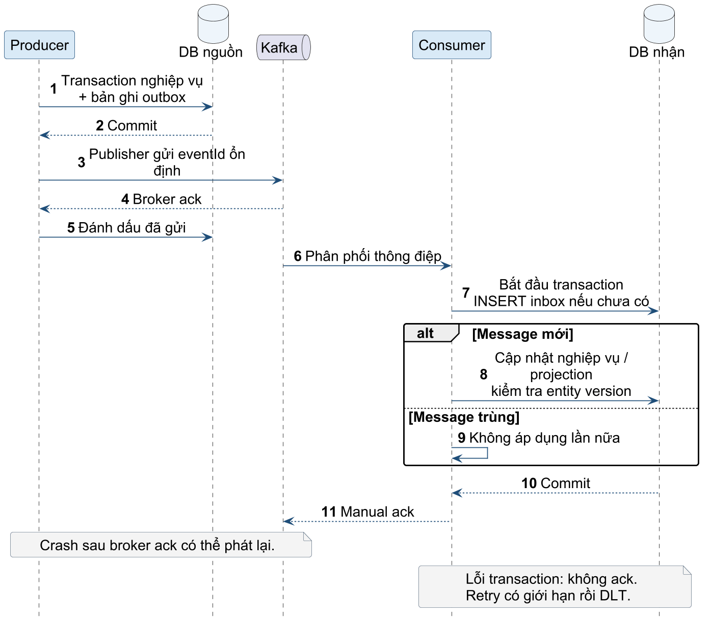

Thông điệp lỗi qua retry giới hạn rồi DLT; xuất DLT thất bại chưa được coi là xử lý xong. Báo cáo dùng snapshotId, khoảng [from, to) và timezone, mặc định Asia/Ho_Chi_Minh. Doanh số theo confirmedAt, tiền theo bằng chứng, đối soát theo hoàn tất, check-in theo checkedInAt. Khoản tiền chưa gắn sự kiện chỉ thuộc cash toàn nền tảng.

### Hợp đồng REST

Các đường dẫn dưới đây có tiền tố `/api/v1`; hợp đồng đầy đủ nằm trong OpenAPI [S09].

| Thao tác | Phương thức và đường dẫn |
| --- | --- |
| Đăng nhập và làm mới phiên | POST `/auth/login`, POST `/auth/refresh` |
| Danh sách sự kiện công khai | GET `/discover/events` |
| Lấy giá và phiên bản lựa chọn | GET `/events/{id}/booking` |
| Giữ vé và tạo đơn | POST `/orders/reservations` |
| Xem hoặc xác nhận đơn miễn phí | GET `/orders/{id}`, POST `/orders/{id}/confirm-free` |
| Khởi tạo attempt | POST `/orders/{id}/payment-attempts` |
| Chọn QR hoặc thẻ | POST `/payment-sessions/{id}/method` |
| Nhận callback local | POST `/webhooks/payments/local-mock` |
| Lấy vé và PDF | GET `/tickets/{ticketId}`, GET `/tickets/{ticketId}/pdf` |
| Quét QR | POST `/check-in/events/{eventId}/scan` |
| Tra cứu rồi xác nhận thủ công | POST `/check-in/events/{eventId}/lookup` và `/lookup/{ticketId}/confirm` |
| Yêu cầu đối soát | POST `/organizations/{org}/settlements` |
| Ghi nhận hoàn tất | POST `/admin/settlements/{id}/settle` |

Ví dụ body giữ vé dưới đây dùng định danh minh họa. Client phải lấy `selectionVersion` thực từ booking quote và gửi header `Idempotency-Key` hợp lệ, dài 8–128 ký tự URL-safe. Giá được server tự tính.

```json
{
  "eventId": "11111111-1111-4111-8111-111111111111",
  "lines": [{
    "ticketTypeId": "22222222-2222-4222-8222-222222222222",
    "quantity": 2
  }],
  "selectionVersion": "gia-tri-lay-tu-booking-quote",
  "termsAccepted": true
}
```

Phân trang đơn trả `data`, `hasMore`, `nextCursor`; cursor dựa vào thứ tự ổn định. Nhiều thao tác sửa dữ liệu dùng version để phát hiện cập nhật trên bản cũ. Lỗi nghiệp vụ sử dụng Problem Details với status, code và detail; handler thông thường có thêm requestId và timestamp. Một số lỗi từ filter xác thực có cấu trúc rút gọn, vì vậy không giả định mọi lỗi đều có cùng tập trường. `IDEMPOTENCY_CONFLICT` yêu cầu kiểm tra kết quả cũ, còn `PRICE_CHANGED` yêu cầu tải lại quote và xác nhận lựa chọn.

### Danh mục sự kiện tích hợp

Envelope JSON gồm `eventId`, `eventVersion`, `occurredAt`, `producer`, `aggregateType`, `aggregateId`, `correlationId`, `causationId` và `payload`. Key Kafka là UUID aggregate. Version của envelope mô tả hợp đồng; version của thực thể ngăn fact cũ ghi đè projection mới. Không đưa credential QR vào thông điệp. Hợp đồng đầy đủ xem [S07].

| Nhóm fact | Producer | Tác dụng chính |
| --- | --- | --- |
| event.event.published hoặc updated hoặc cancelled.v1 | Commerce | Cập nhật trạng thái sự kiện và tìm kiếm. |
| event.order.confirmed.v1 | Commerce | Tạo nghĩa vụ phát hành, projection tài chính và email. |
| payment.payment.succeeded hoặc failed hoặc refunded.v1 | Payment | Commerce áp dụng kết quả với kiểm tra riêng. |
| event.order.payment-result.v1 | Commerce | Payment biết khoản thu đã được áp dụng hay trở thành ngoại lệ. |
| ticket.ticket.issued hoặc voided.v1 | Admission | Cập nhật người tham dự theo từng ticket. |
| ticket.admission.checked-in.v1 | Admission | Cập nhật trạng thái tham dự. |
| payment.payment.financial-updated.v1 | Payment | Projection sổ tài chính và ngoại lệ. |
| finance.settlement.updated hoặc completed.v1 | Finance | Projection batch và kết quả đối soát. |


## Chương 6 Bảo mật triển khai và vận hành

### Xác thực và phân quyền

Các lớp bảo vệ đi từ phiên trình duyệt đến quyền trên tài nguyên và quyền truy cập dữ liệu. Backend kiểm tra trạng thái hiện hành thay vì chỉ dựa vào role trong JWT [S14].

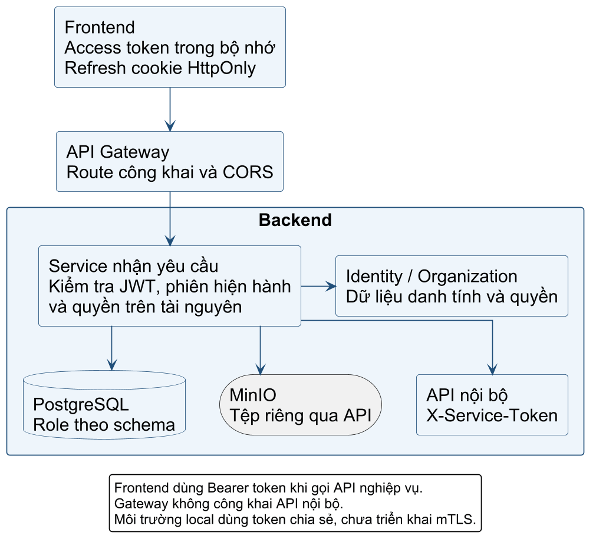

Local dùng access token 10 phút, refresh 30 ngày; cookie HttpOnly, SameSite=Lax, Secure cấu hình được. Refresh/logout kiểm tra Origin. Token email có hạn 24 giờ, reset 30 phút, cooldown gửi lại 60 giây. Endpoint nội bộ kiểm tra X-Service-Token dù một số security chain permitAll; token chia sẻ chưa tương đương mTLS.

### Bảo vệ dữ liệu nhạy cảm

Ảnh PNG/JPEG tối đa 5 MB đi qua staging, kiểm tra nội dung và SHA-256. Tài liệu tổ chức, payout và vé có kiểm tra quyền riêng. Payout được mã hóa, hiển thị che số; credential QR chỉ có hash tra cứu và bản mã khôi phục.

API xác thực trước khi stream PDF từ bucket riêng. Vé CHECKED_IN/VOIDED không còn QR trong PDF. Khóa mã hóa được lưu lại để đọc dữ liệu cũ; khóa RSA Identity hiện tạo trong bộ nhớ khi khởi động. Quản lý/đổi khóa, quét mã độc và retention còn cần hoàn thiện [S03, S08, S14].

### Môi trường và cổng dịch vụ

Ứng dụng chạy thành các tiến trình; Compose cung cấp hạ tầng. Local và validation dùng dữ liệu, cổng và quyền sở hữu riêng [S08].

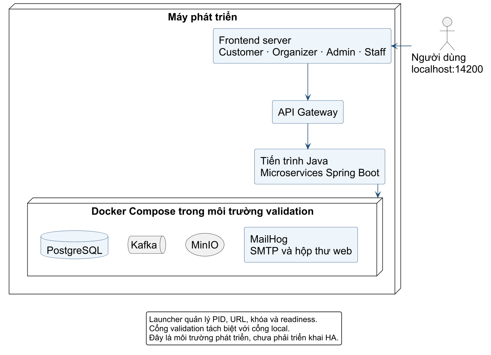

| Thành phần | Cổng mặc định local | Cổng validation |
| --- | --- | --- |
| Frontend chung | 14200 | 14200 |
| API Gateway | 8080 | 18080 |
| Identity | 8081 | 18081 |
| Organization | 8082 | 18082 |
| Commerce | 8083 | 18083 |
| Discovery | 8084 | 18084 |
| Payment | 8087 | 18085 |
| Notification | 8086 | 18086 |
| Ticket Admission | 8088 | 18087 |
| Finance | 8089 | 18088 |
| Admin Operations | 8090 | 18089 |
| PostgreSQL và Kafka | 5432 và 9092 | 15432 và 19092 |
| MinIO API và console | 9000 và 9001 | 19000 và 19001 |
| MailHog SMTP và web | 1025 và 8025 | 11025 và 18025 |


Schema Registry local dùng cổng 8085. Không reset hoặc xóa volume local để làm kiểm thử đạt.

### Build và khởi chạy có thể tái lập

Chạy tại gốc dự án với Java 21, Node 20, npm và Docker Compose:

```sh
./backend/gradlew -p backend test bootJar
npm --prefix frontend ci
npm --prefix frontend run test:unit
npm --prefix frontend run build:all
docker compose -f infra/validation/docker-compose.yml up -d --wait
python3 scripts/run-validation.py start
python3 scripts/run-validation.py status
```

Launcher thiết lập URL, cổng, token, khóa mã hóa và bí mật mock; quản lý PID và readiness. Thao tác start/stop chạy tuần tự; rebuild frontend theo runbook. Nhóm cấu hình gồm database theo owner, Kafka, JWKS, URL phụ thuộc, SMTP và cookie. Mock mặc định tắt ngoài launcher, cần bí mật hợp lệ.

Notification mặc định trỏ Admission tới 8087, khác cổng thực 8088; chạy riêng cần ghi đè URL. Validation launcher đã dùng 18087.

### Quan sát và phục hồi tác vụ

Actuator health/info hỗ trợ readiness; chưa có đầy đủ Prometheus, tracing và cảnh báo production.

| Tình huống | Trạng thái được giữ và hướng xử lý |
| --- | --- |
| Kafka không khả dụng | Outbox chưa published được giữ để retry; kiểm tra lỗi và backlog trước khi replay. |
| Consumer gặp payload lỗi | Kiểm tra DLT, sửa hoặc xác minh payload rồi mới phát lại; inbox chống tác động trùng. |
| SMTP lỗi | Nghĩa vụ email còn pending; retry không thay đổi trạng thái đơn. |
| Gửi SMTP xong nhưng chưa ghi delivered | Lần thử lại có thể gửi email trùng vì trạng thái đã gửi chưa được lưu. |
| Payment chưa rõ hoặc mất callback | Query/reconciliation đi lại đường xác minh bằng chứng; không tự xác nhận từ trang khách. |
| Hủy sự kiện bị gián đoạn | Giữ cancellation_pending và nghĩa vụ; tiếp tục freeze rồi hoàn tất. |
| Phát hành hoặc tạo PDF lỗi | Giữ nghĩa vụ hoặc retry artifact theo quyền hiện tại; không phát lại danh tính vé. |
| Đối soát timeout hoặc UNKNOWN | Giữ batch và bằng chứng; đọc lại hoặc replay đúng quyết định, không tạo lần chuyển mới. |
| Projection chậm | Kiểm tra thời điểm đồng bộ, source cursor và lỗi từ feed nguồn; tiếp tục backfill khi nguồn phục hồi. |


Health UP không chứng minh cả luồng bán vé. Backup/restore và mục tiêu RPO/RTO cần diễn tập riêng.

## Chương 7 Kiểm thử và đánh giá

### Phương pháp kiểm chứng

Ba mức kiểm thử bổ sung cho nhau: quy tắc cục bộ, transaction với cơ sở dữ liệu thật và hành vi xuyên dịch vụ [S15].

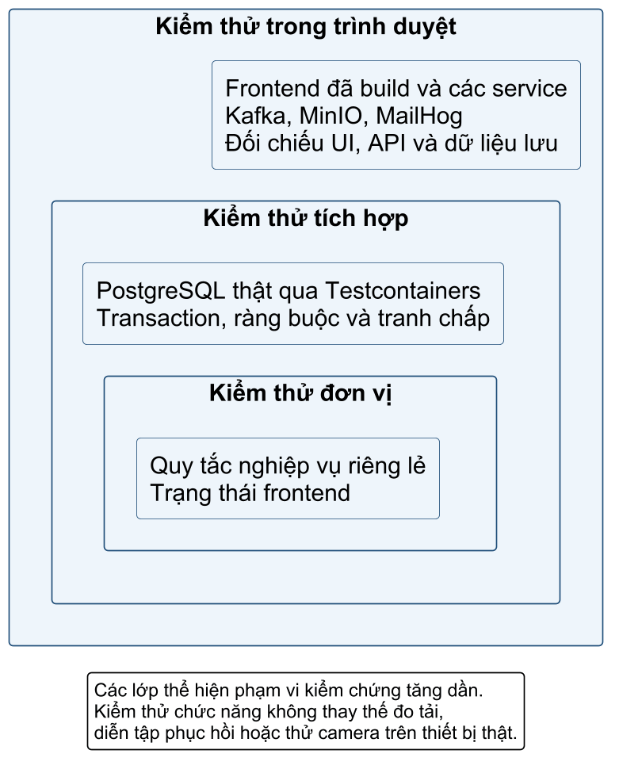

| Rủi ro cần kiểm tra | Bằng chứng thực thi trong repository |
| --- | --- |
| Bán vượt vé cuối | OrderIntegrationTest có 100 buyer đồng thời; Phase 6 có hai browser đồng bộ tại HTTP reservation. |
| Xác nhận và hết hạn chạy cùng lúc | OrderIntegrationTest kiểm tra bảo toàn reserved và sold. |
| Callback lặp hoặc thất bại sau thành công | PaymentIntegrationTest và OrderIntegrationTest kiểm tra không tạo tác động thứ hai hoặc hạ trạng thái sai. |
| Phát hành trùng | TicketIntegrationTest kiểm tra khóa đơn vị và QR ổn định. |
| Hai nhân viên quét cùng vé | TicketIntegrationTest kiểm tra một admission mới duy nhất. |
| Hủy đồng thời với phát hành hoặc scan | TicketIntegrationTest kiểm tra cancellation fence. |
| Claim hoặc ghi payout lặp | SettlementIntegrationTest kiểm tra UNIQUE claim, UNKNOWN và reference. |
| Dashboard và CSV không khớp | ReportingIntegrationTest kiểm tra cùng snapshot dù đơn mới xuất hiện. |
| Email lỗi | Các test delivery giữ nghĩa vụ và không hoàn tác giao dịch gốc. |

### Kết quả đã ghi nhận

Bảng sau tổng hợp các đợt kiểm thử trong môi trường local theo hồ sơ nghiệm thu [S15–S17].

| Hồ sơ và ngày | Kết quả ghi trong nguồn | Giới hạn diễn giải |
| --- | --- | --- |
| Phase 6 ngày 20/11/2026 | 193 backend tests, 148 frontend tests, bốn build frontend và 733 browser checks. | Kết quả của đợt local đã ghi nhận; phạm vi môi trường local. |
| Nghiệm thu bốn vai trò ngày 21/11/2026 | Một đơn 200.000 VND, hai vé, hai admission; net và settlement mô phỏng 190.000 VND. | Một luồng xuyên suốt với fixture cụ thể, không phải toàn bộ regression. |
| Sửa luồng soạn sự kiện ngày 21/11/2026 | 196 backend tests, 171 frontend tests, bốn build; 73 checks Phase 2 và 17 checks phục hồi authoring. | Hồ sơ mới hơn cho phạm vi thay đổi; không cộng với Phase 6 thành một lần chạy. |


Test trích xuất PDF từng lỗi do ligature UUID rồi đạt khi chạy lại. Camera nghiệm thu dùng video QR tổng hợp, chưa chứng minh thiết bị vật lý hoặc mọi browser engine [S15–S17].

### Đánh giá và phần cần phát triển

Transaction, snapshot và unique constraint bảo vệ tranh chấp tại owner; outbox/inbox giúp tiếp tục tác vụ. Các giới hạn còn lại là thời gian chờ khóa cùng sự kiện, phụ thuộc REST, độ trễ projection và email có thể gửi lặp.

Trước production cần tích hợp thanh toán/chi trả thật, quản lý khóa và mạng, HA cho PostgreSQL/Kafka, backup/restore, retention, giám sát/cảnh báo, kiểm thử tải theo SLO, camera thật và đánh giá tiếp cận đầy đủ.

## Kết luận

Commerce quyết định tồn kho và đơn; Payment bảo toàn khoản thu; Admission quản lý từng vé; Finance quản lý phí và đối soát. Các owner dùng transaction cho thay đổi cục bộ và API/sự kiện cho phối hợp liên dịch vụ.

Hệ thống hỗ trợ chuỗi bán vé trong môi trường local, với khả năng phục hồi nhiều bước bị gián đoạn. Việc mở rộng vận hành cần giữ các ràng buộc chống bán vượt, phát hành trùng, check-in trùng và chi trả trùng, đồng thời hoàn thiện các hạng mục production ở Chương 7.

## Phụ lục A Danh mục bảng dữ liệu

Danh mục dưới đây trình bày các bảng theo schema, khóa chính hoặc khóa duy nhất đáng chú ý và chức năng dữ liệu. Các tham chiếu giữa dịch vụ là liên kết logic; FK chỉ áp dụng trong phạm vi schema sở hữu.

### Schema identity

| Bảng | Khóa đáng chú ý | Nội dung |
| --- | --- | --- |
| `users` | id; email UNIQUE | Tài khoản, mật khẩu băm, locale và trạng thái. |
| `user_roles` | user_id + role; FK users | Các vai trò cùng tồn tại của một tài khoản. |
| `verification_tokens` | id; token_hash UNIQUE; FK users | Token xác thực hoặc reset có hạn và dấu đã dùng. |
| `refresh_sessions` | id; token_hash UNIQUE; FK users | Phiên xoay token, family, thu hồi và reuse. |
| `security_audit` | id | Lịch sử tác động bảo mật lên tài khoản. |
| `email_deliveries` | id | Thư xác thực hoặc reset có body mã hóa và retry. |

### Schema organization

| Bảng | Khóa đáng chú ý | Nội dung |
| --- | --- | --- |
| `organizations` | id | Tổ chức và trạng thái ACTIVE hoặc SUSPENDED. |
| `organizer_applications` | id; một hồ sơ pending mỗi applicant | Hồ sơ đăng ký, dữ liệu xác minh và quyết định. |
| `organization_members` | organization_id + user_id; FK organizations | Membership và permission theo tổ chức. |
| `verification_documents` | id; object_key UNIQUE | Metadata tệp xác minh và chủ sở hữu. |
| `organization_audit` | id | Lịch sử hồ sơ, quyền và hoạt động tổ chức. |
| `payout_destinations` | id; organization_id + destination_version UNIQUE | Tài khoản nhận tiền có phiên bản và chi tiết mã hóa. |
| `event_staff_assignments` | id; event_id + user_id UNIQUE | Phân công staff; FK ghép đến membership. |
| `payout_authorizations` | settlement_id; FK payout và organization | Proof chấp thuận đúng phiên bản tài khoản nhận tiền. |
| `notification_outbox` | id | Nghĩa vụ thông báo chờ Notification tiếp nhận. |

### Schema event_commerce

| Bảng | Khóa đáng chú ý | Nội dung |
| --- | --- | --- |
| `events` | id | Nội dung, lịch, capacity, version và vòng đời sự kiện. |
| `ticket_types` | id; FK events | Giá, quota, reserved, sold, cửa sổ bán và giới hạn đơn. |
| `event_audit` | id; FK events | Lịch sử thay đổi sự kiện kèm actor và reason. |
| `media_uploads` | id; object_key UNIQUE; FK events | Staging upload, hash, hạn và trạng thái khả dụng. |
| `event_outbox` | id | Fact bền vững, thời điểm phát và lịch retry. |
| `inventory_allocations` | id; FK events | Giữ vé có hạn; id trùng order theo ứng dụng. |
| `allocation_lines` | allocation_id + ticket_type_id; hai FK | Số lượng giữ và snapshot giá theo hạng vé. |
| `allocation_ledger` | allocation_id + transition; FK allocation | Nhận diện chuyển trạng thái phân bổ đã thực hiện. |
| `orders` | id; applied_payment_id UNIQUE; FK events | Chủ đơn, trạng thái, tổng tiền, hạn và snapshot phí. |
| `order_items` | id; order_id + ticket_type_id UNIQUE; FK orders | Dòng đơn bất biến và định danh phục vụ phát vé. |
| `order_requests` | actor_id + request_key; FK orders | Fingerprint và đơn trả lại khi replay. |
| `order_payment_claims` | id; order_id + request_key UNIQUE; FK orders | Attempt được Commerce chấp nhận và theo dõi. |
| `order_payment_effects` | payment_id; FK orders | Kết quả áp dụng duy nhất của khoản thu. |
| `order_inbox` | id | Fact thanh toán đã xử lý trong transaction. |
| `order_audit` | id; FK orders | Lịch sử lệnh và chuyển trạng thái đơn. |
| `cancellation_requests` | event_id; FK events | Nghĩa vụ freeze và hoàn tất hủy có retry. |
| `categories` | id; name và lower(name) UNIQUE | Danh mục có trạng thái để chọn cho sự kiện mới. |
| `category_audit` | id; FK categories | Lý do và actor khi sửa hoặc ngừng danh mục. |
| `notification_outbox` | id | Thông báo nghiệp vụ chờ được tiếp nhận. |

### Schema payment

| Bảng | Khóa đáng chú ý | Nội dung |
| --- | --- | --- |
| `attempts` | id | Lần thử với amount kỳ vọng, hạn và outcome time. |
| `mock_sessions` | attempt_id; reference UNIQUE; FK attempts | Phương thức, cấu hình chụp, hạn QR và bốn số thẻ cuối. |
| `receipts` | id | Delivery callback và digest payload để phát hiện sửa đổi. |
| `transactions` | id; provider + merchant + reference UNIQUE | Khoản thu thực tế của provider local; cho phép chưa gắn đơn. |
| `exceptions` | id; transaction_id UNIQUE và FK | Khoản cần xử lý, đã hoàn và trạng thái review. |
| `return_evidence` | id; reference UNIQUE; FK exceptions | Từng bằng chứng hoàn mô phỏng với amount và thời điểm. |
| `audit` | id | Lịch sử tác động vào thanh toán. |
| `inbox` | id | Fact từ owner khác đã được xử lý. |
| `outbox` | id | Fact thanh toán hoặc sổ tài chính chờ xuất bản. |
| `reconciliation_runs` | id | Lần query đối chiếu provider và số bản ghi xem xét. |
| `mock_config` | key | Cấu hình JSONB của QR_PAYMENT và CARD_PAYMENT. |
| `gateway_reconciliations` | transaction_id PK và FK; reference UNIQUE | Phí gateway đã đối chiếu cùng provenance. |
| `financial_versions` | event_id | Version sổ tài chính theo sự kiện. |
| `payout_authorizations` | settlement_id | Proof chấp thuận fingerprint tài chính khi payout. |
| `global_financial_state` | singleton = 1; ledger_id UNIQUE | Danh tính và version sổ tiền chưa ánh xạ sự kiện. |

### Schema ticket_admission

| Bảng | Khóa đáng chú ý | Nội dung |
| --- | --- | --- |
| `event_gates` | event_id | Khóa và trạng thái OPEN hoặc FROZEN của sự kiện. |
| `inbox` | id | Fact đã nhận để deduplicate. |
| `issuance_obligations` | order_id | Snapshot confirmed, số vé kỳ vọng và lịch retry. |
| `tickets` | id; order_id + item_id + ordinal UNIQUE | Đơn vị vé; hash UNIQUE, credential mã hóa, trạng thái. |
| `admissions` | id; ticket_id UNIQUE và FK | Một admission thành công mỗi vé, actor và phương thức. |
| `admission_requests` | actor_id + request_key | Fingerprint và kết quả dùng để phục hồi phản hồi mất. |
| `outbox` | id | Fact vé và admission chờ xuất bản. |

### Schema finance

| Bảng | Khóa đáng chú ý | Nội dung |
| --- | --- | --- |
| `configuration_gate` | id = 1 | Khóa tuần tự hóa thay đổi cấu hình phí. |
| `commission_configs` | id; effective_at và version UNIQUE | Biểu phí phần trăm hoặc cố định theo thời điểm hiệu lực. |
| `commission_quotes` | order_id | Snapshot quote và hash yêu cầu của Commerce. |
| `audit` | id | Lịch sử tài chính với before, after và reason. |
| `outbox` | id | Fact đối soát chờ xuất bản. |
| `inbox` | id | Thông điệp tài chính đã xử lý. |
| `settlements` | id; event_id và transfer_reference UNIQUE | Batch, snapshot, evidence, trạng thái và proof. |
| `settlement_items` | order_id; FK settlements | Claim một đơn vào tối đa một batch. |
| `settlement_requests` | actor_id + request_key; FK settlements | Tạo batch có thể replay an toàn. |
| `confirmed_orders` | order_id | Projection đơn confirmed và source version. |
| `financial_events` | event_id | Projection sổ tài chính mới nhất của sự kiện. |
| `notification_outbox` | id | Thông báo đối soát đã hoàn tất. |

### Schema discovery

| Bảng | Khóa đáng chú ý | Nội dung |
| --- | --- | --- |
| `projection_versions` | id | Version sự kiện để chặn fact cũ làm sống lại dữ liệu. |
| `inbox` | event_id | Thông điệp public hoặc attendee đã xử lý. |
| `public_events` | id | Projection công khai, payload, sold và thời điểm nguồn. |
| `event_attendees` | ticket_id | Một bản ghi người tham dự mỗi vé, version và check-in. |
| `report_inbox` | id | Deduplicate fact báo cáo. |
| `report_entities` | kind + id | Projection nghiệp vụ theo tổ chức, sự kiện và version. |
| `report_snapshots` | id | Kết quả báo cáo chụp cùng filters và actor. |
| `report_exports` | id; FK report_snapshots | Lần xuất CSV gắn đúng snapshot và actor. |
| `reporting_sources` | source | Cursor và trạng thái backfill dữ liệu Commerce. |

### Schema notification

| Bảng | Khóa đáng chú ý | Nội dung |
| --- | --- | --- |
| `inbox` | id | Thông điệp đã tiếp nhận thành nghĩa vụ gửi thư. |
| `email_deliveries` | order_id | Thư xác nhận đơn, thời điểm retry và delivered. |
| `ticket_deliveries` | order_id + kind | Thông báo READY hoặc CANCELLED theo đơn. |
| `operations_deliveries` | obligation_key + user_id | Thông báo vận hành theo người nhận và nghĩa vụ. |

### Schema admin_audit

| Bảng | Khóa đáng chú ý | Nội dung |
| --- | --- | --- |
| `settings` | key trong allowlist | reminderLeadHours và supportEmail có version. |
| `audit_records` | source + id | Bản sao audit từ owner, chống nhập trùng. |
| `source_cursors` | source | Tiến độ và lỗi đồng bộ audit. |

## Tài liệu tham khảo

Tài liệu thiết kế và mã nguồn dự án được tham chiếu tại phiên bản d9af344 ngày 26/11/2026. Các nguồn R01–R05 cung cấp cơ sở trình bày kiến trúc và mẫu thiết kế.

- **S01** Đặc tả sản phẩm — [docs/01-product-requirements.md](01-product-requirements.md).
- **S02** Quy tắc nghiệp vụ — [docs/02-business-rules.md](02-business-rules.md).
- **S03** Các quyết định đã chấp thuận — [docs/decisions](decisions), gồm 0001 đến 0007. Quyết định 0004 thay phần ngôn ngữ checkout của 0002; quyết định 0006 thay entrypoint portal cũ.
- **S04** Thiết kế gốc — [kiến trúc](04-system-design.md), [cơ sở dữ liệu](05-database-design.md), [bảo mật](07-security-design.md). Các nội dung PROPOSED được giữ là đề xuất.
- **S05** Cấu hình xây dựng — [backend/build.gradle](../backend/build.gradle), [backend/settings.gradle](../backend/settings.gradle), [frontend/package.json](../frontend/package.json), [frontend/angular.json](../frontend/angular.json).
- **S06** Migration của từng owner — [backend/services](../backend/services), tại `src/main/resources/db/migration`; [script tạo schema và role](../infra/local/postgres/init).
- **S07** Hợp đồng sự kiện — [backend/event-contracts/README.md](../backend/event-contracts/README.md) và các JSON Schema cùng thư mục.
- **S08** Vận hành — [docs/local-development.md](local-development.md), [Compose local](../infra/local/docker-compose.yml), [Compose validation](../infra/validation/docker-compose.yml), [launcher](../scripts/run-validation.py), [frontend server](../scripts/serve-frontends.mjs), [gateway routes](../backend/services/api-gateway/src/main/resources/application.yml).
- **S09** Hợp đồng REST và frontend — [backend/openapi](../backend/openapi), [API types](../frontend/libs/api-client/src), [session](../frontend/libs/session/src), [route guard](../frontend/libs/auth/src/guards.ts).
- **S10** Giao dịch Commerce — [OrderService](../backend/services/event-commerce-service/src/main/java/com/eventticketing/commerce/application/OrderService.java), [InventoryService](../backend/services/event-commerce-service/src/main/java/com/eventticketing/commerce/application/InventoryService.java), [OrderRepository](../backend/services/event-commerce-service/src/main/java/com/eventticketing/commerce/application/OrderRepository.java), [EventCancellation](../backend/services/event-commerce-service/src/main/java/com/eventticketing/commerce/application/EventCancellation.java).
- **S11** Phát hành và vào cửa — [IssuanceService](../backend/services/ticket-admission-service/src/main/java/com/eventticketing/admission/application/IssuanceService.java), [AdmissionService](../backend/services/ticket-admission-service/src/main/java/com/eventticketing/admission/application/AdmissionService.java), [EventGates](../backend/services/ticket-admission-service/src/main/java/com/eventticketing/admission/application/EventGates.java).
- **S12** Tài chính — [SettlementEligibility](../backend/services/finance-service/src/main/java/com/eventticketing/finance/application/SettlementEligibility.java), [SettlementCompletion](../backend/services/finance-service/src/main/java/com/eventticketing/finance/application/SettlementCompletion.java), [CommissionService](../backend/services/finance-service/src/main/java/com/eventticketing/finance/application/CommissionService.java).
- **S13** Báo cáo — [ReportCalculator](../backend/services/discovery-service/src/main/java/com/eventticketing/discovery/reporting/ReportCalculator.java), [ReportService](../backend/services/discovery-service/src/main/java/com/eventticketing/discovery/reporting/ReportService.java).
- **S14** Xác thực — [TokenService](../backend/services/identity-service/src/main/java/com/eventticketing/identity/application/TokenService.java), [CurrentAccountService](../backend/services/identity-service/src/main/java/com/eventticketing/identity/security/CurrentAccountService.java), [JwtKeyConfiguration](../backend/services/identity-service/src/main/java/com/eventticketing/identity/security/JwtKeyConfiguration.java), [CookieOriginFilter](../backend/services/identity-service/src/main/java/com/eventticketing/identity/security/CookieOriginFilter.java).
- **S15** Chiến lược và nghiệm thu — [docs/08-test-strategy.md](08-test-strategy.md), [Phase 6 ngày 20/11/2026](qa/phase6-local-acceptance.md).
- **S16** Nghiệm thu bốn vai trò — [báo cáo ngày 21/11/2026](qa/four-role-local-acceptance-2026-11-21.md).
- **S17** Sửa và kiểm chứng luồng tạo sự kiện — [kế hoạch hoàn tất ngày 21/11/2026](plans/completed/event-authoring-flow-repair.md).

- **R01** arc42. [Overview of the arc42 template](https://arc42.org/overview). Cấu trúc mô tả kiến trúc, runtime và triển khai. Truy cập 26/11/2026.
- **R02** C4 model. [Container diagram](https://c4model.com/diagrams/container), [Component diagram](https://c4model.com/diagrams/component), [Dynamic diagram](https://c4model.com/diagrams/dynamic). Truy cập 26/11/2026.
- **R03** Microsoft Azure Architecture Center. [Design interservice communication for microservices](https://learn.microsoft.com/en-us/azure/architecture/microservices/design/interservice-communication). Truy cập 26/11/2026.
- **R04** AWS Prescriptive Guidance. [Transactional outbox pattern](https://docs.aws.amazon.com/prescriptive-guidance/latest/cloud-design-patterns/transactional-outbox.html). Truy cập 26/11/2026.
- **R05** PlantUML. [Command line](https://plantuml.com/command-line). Công cụ dựng sơ đồ từ mã nguồn PlantUML. Truy cập 26/11/2026.
