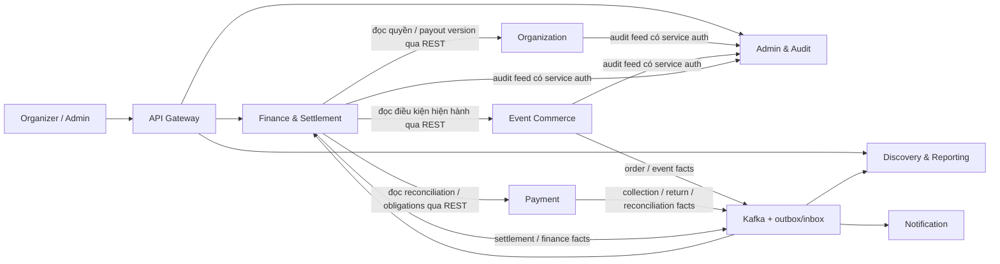

# Execution Plan: Phase 5 — vận hành nền tảng

Date: 2026-11-20

## Status

Completed — toàn bộ P1–P3 đã triển khai và kiểm chứng trên môi trường local, ngày 2026-11-20.

Chủ repository đã chọn “Áp dụng toàn bộ gói P1–P3 (Khuyến nghị)”.
Authority được lưu tại [decision 0005](../../decisions/0005-local-phase5-policy.md).

## Outcome

Organizer xem doanh thu, phí, số tiền có thể đối soát và yêu cầu đối soát.
Admin cấu hình phí cho giao dịch tương lai, kiểm tra điều kiện chi trả, ghi
nhận kết quả có bằng chứng và truy vết lịch sử. Dashboard/CSV dùng dữ liệu
thực, thống nhất phạm vi và thời gian. Hoàn thiện các phần Admin/Email còn
thiếu trong Phase 5, theo từng nhóm được kiểm chứng.

## Context và authority

| Nguồn | Phạm vi đã có căn cứ |
| --- | --- |
| [PRD](../../01-product-requirements.md), §6.10–6.13, Appendix B | STL-01–12, báo cáo, ADM-01–15, các email nghiệp vụ; Phase 5 trước Phase 6 |
| [BRS](../../02-business-rules.md), §12–16 | Snapshot bất biến, không chi trả trùng, đối soát sau COMPLETED, bằng chứng tài chính, phạm vi truy cập |
| [SDD](../../04-system-design.md), §4, §6.4, §7 | Finance riêng; Commerce sở hữu order snapshot; Reporting là projection; không đọc chéo database |
| [Database design](../../05-database-design.md), §10–13 | Entitlement, settlement claim, evidence, projection, audit; DDL phải điều chỉnh theo code thực tế |
| [API specification](../../06-api-specification.md), §11–12 | API tài chính/báo cáo/admin, bộ lọc, quyền và lỗi |
| [UI/UX](../../03-ui-ux-design.md), O-12–14, A-01/A-11–14, §8–9 | Analytics, settlement, commission, audit/settings, trạng thái chờ và dữ liệu không đủ |
| [Security design](../../07-security-design.md) | Kiểm tra quyền server, dữ liệu nhạy cảm, audit và bảo vệ export |
| [Decision 0001](../../decisions/0001-local-phase2-policy.md), [0002](../../decisions/0002-local-phase3-policy.md), [0003](../../decisions/0003-local-phase4-policy.md), [0004](../../decisions/0004-configurable-checkout-methods.md) | Các chính sách local đã chấp thuận; QR/card tiếp tục là provider local |
| [Workflow](../../WORKFLOW.md), [encoding invariants](../../patterns/encoding-invariants.md) | Chỉ áp dụng quy tắc accepted; chứng minh cả trường hợp hợp lệ và vi phạm |

## Baseline quan sát trực tiếp

| Thành phần | Hiện có | Phần còn thiếu liên quan Phase 5 |
| --- | --- | --- |
| Commerce | `OrderService`, `OrderModels`, `OrderFacts`: giá VND, confirmedAt, outbox; `EventLifecycle` chuyển COMPLETED | Order không có commission snapshot; chưa có giao thức chốt dữ liệu cho Finance |
| Organization | `PayoutService`: tài khoản ngân hàng mã hóa, phiên bản, xác minh; permission FINANCE trong `OrganizationAccess` | Đây là tài khoản nhận tiền, không phải settlement; internal authorization hiện chỉ kiểm MANAGEMENT |
| Payment | Receipt, ngoại lệ, hoàn từng phần có bằng chứng; `ReconciliationRunner` truy vấn attempt PENDING | Chưa có gateway fee đã đối soát; chưa phát đầy đủ fact cho từng khoản hoàn từng phần/đóng ngoại lệ |
| Finance | Chưa được khai báo trong `backend/settings.gradle` | Service/schema, config, entitlements, claims, evidence, recovery |
| Discovery | Projection sự kiện, tồn kho, attendee/check-in | Chưa có dashboard doanh thu và CSV tài chính |
| Admin/Audit | Audit cục bộ; routes user, organization, event, order detail, payment và exception | Commission, settlement, audit tổng hợp, settings, category management và rà soát order listing |
| Notification | Order confirmation, ticket ready/cancellation; Identity có email tài khoản | Hoàn thiện email quyết định Organizer/event, reminder, settlement và các nhóm nhận cancellation còn thiếu |
| Frontend | Bốn app Angular và hệ thống giao diện đã dùng | Organizer analytics/settlements và các trang Admin còn thiếu |

Nguồn code: `backend/services/*/src/main/`,
`frontend/apps/{organizer-web,admin-web}/src/app/app.routes.ts`,
`frontend/libs/organization/src/payouts.component.ts`,
`backend/event-contracts/README.md`.

Báo cáo hiện có được đọc lại, không chạy lại: payment methods 66 checks,
payment visual review 11 checks, Phase 4 76 checks. Hai báo cáo sau ghi nhận
không có JS errors/server errors. Đây là bằng chứng lưu từ lượt trước,
không phải chứng minh Phase 5 hay chứng minh runtime hiện tại.

## Gói chính sách local P1–P3 — đã được chấp thuận

### P1. Phí, lịch sử và ghi nhận hoàn tiền

- Seed phí nền tảng **5%** cho đơn tạo mới sau khi bật Phase 5. Admin có thể
  đổi sang phần trăm hoặc số tiền cố định/vé; không kết hợp hai kiểu. Phần
  trăm có độ chính xác 0,01%, phạm vi 0–100%; phí cố định là số nguyên VND ≥0.
- Organizer chịu phí; khách vẫn trả đúng tổng giá vé. Đóng băng cấu hình ở
  lúc tạo đơn, chốt phí khi đơn CONFIRMED. Làm tròn HALF_UP trên từng vé rồi
  nhân số lượng; phí không vượt giá vé; vé miễn phí không chịu phí.
- Cấu hình mới chỉ có hiệu lực từ hiện tại/tương lai, không sửa ngược lịch
  sử và không chồng khoảng hiệu lực. Đơn đang giữ vé giữ snapshot cũ.
- Đơn cũ chưa có snapshot vẫn xuất hiện trong số vé/GMV lịch sử. Hiển thị
  phí và net là **chưa đủ dữ liệu**, không tính bằng 5%, không đổi thành 0,
  không cho đối soát; xử lý lịch sử cần quyết định riêng, không reset dữ liệu.
- Local provider tiếp tục mô phỏng. Phí gateway 0 VND phải được ghi rõ là
  kết quả đối soát của provider local cùng reference; thiếu kết quả vẫn là
  unknown. Không dùng 0 để thay dữ liệu thiếu hoặc coi là phí ngân hàng thật.
- Giữ nguyên snapshot gốc khi hoàn tiền. Hoàn từng phần được báo cáo theo
  từng bằng chứng và vẫn giữ nghĩa vụ còn lại; chỉ khi hoàn đủ khoản thu
  **đã áp dụng cho đơn confirmed** mới ghi một điều chỉnh đảo toàn bộ phí
  nền tảng. Hoàn khoản thu thừa/đến muộn không đảo phí của giao dịch hợp lệ.
  Phí gateway chỉ được đảo nếu có bằng chứng hoàn phí tương ứng. Số phí
  được hưởng của đơn đang hoàn một phần phải thể hiện là pending.
- Không bổ sung chargeback, tùy ý sửa số dư, hay self-service refund. Sự
  kiện CANCELLED không đi vào đối soát thông thường dù đã hoàn xong.

### P2. Đối soát local và thay đổi tài khoản nhận tiền

- Một batch cho toàn bộ doanh thu đủ điều kiện của một event; không payout
  từng phần. Event phải COMPLETED, dữ liệu đầy đủ, phí gateway đã đối soát,
  không còn nghĩa vụ/ngoại lệ chưa xử lý; tổ chức và người thao tác đủ quyền.
- Giữ trạng thái PRD: PENDING → PROCESSING → SETTLED hoặc FAILED. Retry
  FAILED trong cùng batch, chỉ khi có bằng chứng lần trước chưa chuyển tiền.
  UNKNOWN vẫn chặn thao tác chuyển lại; timeout không đồng nghĩa FAILED.
- Local ghi nhận bằng chứng mô phỏng có mã `MOCK-SETTLEMENT-…`, ngày, số tiền,
  tài khoản snapshot và nội dung xác minh. Không kết nối/chuyển tiền ngân hàng.
  Chỉ ADMIN ghi kết quả; không bổ sung quy trình hai người duyệt ở bản local.
- Net bằng 0 được đóng bằng quyết định **không cần chuyển tiền**, có lý do
  và audit; không tạo reference chuyển tiền giả. Net âm chặn chi trả để xử lý.
- Tài khoản nhận tiền giữ ID/phiên bản đã xác minh. Nếu thay đổi, dừng xử lý;
  chỉ cho cập nhật snapshot có audit trong cùng batch trước lần chuyển đầu
  hoặc sau bằng chứng chắc chắn chưa trả. Trường hợp UNKNOWN/đã trả không
  được đổi tài khoản để thử chuyển lại. Mỗi lần tiếp tục đều kiểm tra lại
  quyền, nghĩa vụ, số tiền và phiên bản tài khoản hiện hành.
- Nếu đã có dòng tiền nhưng điều kiện thay đổi, ghi nhận sự thật vào ngoại
  lệ tài chính; không giấu dòng tiền, không settle sai và không trả lần hai.

### P3. Báo cáo và vận hành

- Múi giờ mặc định Asia/Ho_Chi_Minh; lưu UTC và lọc `[from,to)`. Doanh thu/vé
  dựa trên confirmedAt; thu/hoàn tiền dựa thời điểm bằng chứng; chi trả dựa
  thời điểm trả; check-in dựa checkedInAt. Metadata chỉ rõ date basis cho
  từng nhóm số liệu; không lấy một mốc thời gian áp cho mọi nhóm.
- Sell-through = vé confirmed / tổng quota các hạng vé; capacity sự kiện
  hiển thị riêng. Đây là lựa chọn cần chốt vì UI §8 ghi capacity, còn BRS
  RPT-R03 đề xuất tổng quota. Mẫu số 0 hiển thị N/A.
- Check-in rate dùng số admission duy nhất còn thuộc quần thể đủ điều kiện
  trên cùng snapshot / số vé đủ điều kiện. Event đã hủy có lịch sử riêng,
  tỷ lệ tham dự hiện tại là N/A. Payment success rate dùng attempt có kết quả
  SUCCESS/FAILED theo thời điểm kết quả cuối, giữ lịch sử thành công trước
  refund; loại pending/unknown và đơn miễn phí.
- KPI, biểu đồ và CSV do server tính trên toàn bộ phạm vi; có thời điểm cập
  nhật và cùng bộ lọc. Phiên export giữ cùng snapshot/as-of với dashboard
  hoặc báo rõ đã có phiên dữ liệu mới. Không hiện số mẫu thay dữ liệu thật.
- Danh mục đang được dùng chỉ ngừng cho lựa chọn mới, không xóa lịch sử.
  Audit tổng hợp cho các hành động moderation, permission, cấu hình và tài
  chính từ thời điểm triển khai; không bịa lịch sử thiếu trường dữ liệu.
- Settings chỉ cho sửa các key đã chốt: `reminderLeadHours` (số nguyên
  1–168, mặc định 24) và `supportEmail` (email hợp lệ hoặc để trống). Các
  mốc giữ vé/check-in đã accepted hiển thị read-only; không đưa secrets lên UI.
- Reminder gửi một lần cho mỗi event/người nhận đủ điều kiện. Mua vé trong
  cửa sổ nhắc được gửi ở lượt xử lý tiếp theo trước startAt. Đổi cấu hình
  không gửi lại reminder đã hoàn tất; event hủy/vé voided không được nhắc.
  Nội dung theo locale được hỗ trợ, fallback tiếng Việt. Email mới dùng
  obligation/outbox và cơ chế retry hiện có; không tự đổi chính sách retry cũ.

## Scope và thứ tự triển khai

1. Ghi quyết định local sau khi P1–P3 được chốt; giữ một plan này xuyên suốt.
2. Finance/schema, cấu hình phí, Commerce snapshot và tương thích đơn cũ.
3. Payment reconciliation/return facts và settlement có claim, bằng chứng,
   kiểm tra lại điều kiện, recovery cho kết quả UNKNOWN/thay đổi tài khoản.
4. Reporting/CSV và Organizer analytics/settlement; Admin commission/settlement.
5. Đóng các khoảng trống Admin: category, danh sách orders, audit, settings;
   các email PRD còn thiếu và reminder. Giữ chức năng đã hoàn thành ở Phase 1–4.
6. Chạy kiểm chứng theo nhóm, toàn bộ regression liên quan và kiểm tra giao diện.

Ngoài phạm vi: gateway/chuyển tiền thật, production policy/retention/dual
approval, deploy/push, full Phase 6 tải/bảo mật, chargeback, đa tiền tệ,
notification center/template editor, tự sửa số liệu cũ để làm đẹp báo cáo.

## Thiết kế triển khai và trade-offs

Giữ công nghệ và ranh giới service đã chấp thuận; chưa tạo OpenAPI hay
migration có hiệu lực trước khi chốt P1–P3. Các endpoint dự kiến tái sử dụng
đường dẫn trong API §11–12, `/api/v1`, pagination/error/version conventions
hiện có; không đổi route cũ chỉ để khớp tên route minh họa trong mockup.



- Finance sở hữu config/claims/evidence; Commerce lưu commission snapshot
  trong transaction tạo đơn và phát confirmed fact. Lựa chọn config phải
  có phiên bản/thời điểm hiệu lực và chứng minh race khi Admin đổi phí.
  Không dùng projection trễ như thể đó là config hiện hành được đảm bảo.
- Reporting eventual consistency có freshness; không dùng dashboard để
  cho phép payout. Finance xác minh dữ liệu với owner trước quyết định;
  các lần đọc nối tiếp tự chúng không chứng minh an toàn khi trạng thái
  thay đổi đồng thời. Thiết kế giao thức version/hold và recovery, rồi thử
  race tại các cửa chuyển trạng thái trước khi công nhận luồng an toàn.
- Tái sử dụng JSON Kafka versioned, inbox/outbox, retry/DLT và service auth;
  không thêm Schema Registry chỉ vì thiết kế gốc có nhắc đến. Fact mới về
  hoàn từng phần/đối soát phải bền vững, không chỉ phát sau full refund.
- Bổ sung contract tương thích (optional field hoặc fact phiên bản mới);
  payload cũ thiếu snapshot được biểu diễn unknown, không suy ra phí.
- Finance/Audit thêm operational cost; tuân theo service catalogue đã chọn.
  Không join schema khác để rút ngắn triển khai. Audit canonical ở owner;
  tổng hợp qua fact để truy vấn, không trao quyền sửa dữ liệu nghiệp vụ.
- Thừa kế hệ thống Indigo/Be Vietnam Pro, component trạng thái/confirm,
  lazy routes và mức bundle budget hiện có. UI phải phân biệt tiền đã bán,
  đã thu, đã hoàn, phí còn chờ và số tiền thực sự đủ điều kiện đối soát.

## Risks And Recovery

- Backend/frontend và nhiều tài liệu là untracked work có sẵn. Chụp baseline
  các file sẽ sửa ngoài repo trước implementation; không reset/clean/stash
  công việc của người dùng. Baseline source trước implementation: `/tmp/etp-phase5-baseline-20261120-172920`.
- Migration chỉ bổ sung; không giả lập commission cho lịch sử, xóa order,
  reset volume hay thay kết quả hoàn tiền cũ. Rollback application không xóa
  audit/evidence đã ghi; nghiệp vụ tài chính cần hướng dẫn recovery riêng.
- Theo [local runbook](../../local-development.md): dùng validation stack
  riêng và synthetic fixtures. Không tự dừng runtime/volume không thuộc lượt
  chạy; không đọc/in credentials vào báo cáo.
- Các dependency thiếu/không rõ giữ trạng thái chờ và nghĩa vụ phục hồi.
  Không fallback sang phí 0, quyền cached hoặc “đã chuyển” để tiếp tục.
- Không tuyên bố đáp ứng production/tuân thủ pháp lý từ bản mô phỏng local.

## Progress

- [x] Đọc workflow, authority và các quyết định local.
- [x] Đối chiếu code, routes, dữ liệu và báo cáo kiểm thử hiện có.
- [x] Chuẩn bị gói chính sách, dependency, migration/recovery và ma trận proof.
- [x] Chủ repository chốt P1–P3; ghi decision 0005.
- [x] Contract/backend/migration: 182 kiểm thử native qua; OpenAPI Phase 5 hợp lệ.
- [x] Frontend, reporting, Admin và Notification; bản render và luồng thực tế đã qua kiểm chứng.
- [x] Integration/browser/regression và review bản render.
- [x] Cập nhật tài liệu kết quả; chuyển plan sang completed sau khi đủ bằng chứng.

## Decisions

- 2026-11-20: Hoàn tất đặc tả; owner chấp thuận toàn bộ P1–P3 qua lựa chọn
  trong cuộc hội thoại. Bắt đầu implementation theo decision 0005.
- Khi có phản hồi, lưu chính xác phần được chấp thuận; không suy ra quyết
  định từ im lặng hay coi giá trị mẫu trong BRS là mức phí mặc định đã chọn.

## Validation dự kiến

| Nhóm | Positive proof | Negative/recovery proof |
| --- | --- | --- |
| Commission | 2 × 500.000 × 5% = 50.000 phí; mixed/free; HALF_UP 10 × 5% = 1/vé | config mới không đổi order cũ; overlap/range/overflow bị từ chối; missing snapshot không thành 0 |
| Reconciliation | 1.000.000 gross − 50.000 platform − 10.000 gateway = 940.000 net | fee unknown chặn; local zero có provenance; return từng phần/out-of-order không bị mất hoặc tính trùng |
| Settlement | COMPLETED + đủ dữ liệu tạo batch; bằng chứng khớp mới SETTLED; zero no-transfer có audit | concurrent claim chỉ một; reuse reference xung đột; pending/exception/negative/unknown không trả; failed retry giữ claim |
| Quyền và thay đổi đồng thời | owner/FINANCE/Admin đúng scope; snapshot tài khoản verified | cross-org, revoked membership, locked account, suspended org, đổi payout/exception giữa review và settle bị xử lý an toàn |
| Reporting | tổng nhiều trang và CSV cùng snapshot, timezone/date basis; GMV giữ lịch sử | không cộng trang hiện tại; không lộ PII; CSV formula injection; unknown khác 0; quota khác capacity có kết quả đã chốt |
| Audit/settings/category | thay đổi approved key và category có lịch sử | unknown key/secret/stale version; không delete category đang dùng; không sửa/xóa audit |
| Messaging/email | duplicate inbox không nhân tiền/mail obligation; email sau commit | crash/retry/out-of-order/DLT; reminder sau cancel/void/start bị chặn; SMTP lỗi không đảo nghiệp vụ |

Native checks sau implementation:

```sh
./backend/gradlew -p backend test bootJar
npm --prefix frontend run test:unit
npm --prefix frontend run build:all
```

Browser proof mới cho Phase 5 và regression Phase 1–4/payment methods theo
runbook; dùng local PostgreSQL/Kafka/MailHog và synthetic amounts/accounts.
Kiểm tra 320/390/768/1440px, bàn phím, lỗi/retry và CSV tải thật. Khi thực sự
thêm OpenAPI/generated types phải validate contract và kiểm tra tương thích.
Không đổi CI, hook hay branch protection. Không dùng tests để tự xác lập policy.

## Result

Hoàn tất Finance/commission snapshot, đối soát với authorization phục hồi được,
report projection/CSV/backfill, category/orders, audit/settings, notification
outbox và reminder. Toàn bộ gói P1–P3 đã được kiểm chứng bằng native tests và luồng
thực tế trên stack PostgreSQL/Kafka/SMTP/MinIO local. Không publish/deploy/push.

Bằng chứng tổng hợp: `output/playwright/phase5-validation-summary.json`;
Phase 5 chính: `phase5-result.json` (87 checks), final render: 17 checks,
`phase5-unmapped-result.json`: 4 checks qua receipt thật → Kafka → reporting →
Admin return; `phase5-sales.csv` có 2 dòng, tổng gross 200000, phí 12000,
net 188000 và đúng một snapshot. Các artifact này thuộc output local được ignore.

Các lệnh native đã qua: `./backend/gradlew -p backend test bootJar`,
`npm --prefix frontend run test:unit`, `npm --prefix frontend run build:all`.
OpenAPI validated bằng swagger-cli 4.0.4; types generated bằng openapi-typescript
7.6.1. Không coi local command là CI/merge enforcement.

Giới hạn đã biết: provider/chi trả vẫn là mô phỏng; dữ liệu projection có độ trễ;
legacy không có fee snapshot vẫn unknown và không payable; SMTP có thể lặp khi
crash giữa send/commit. Chưa xác nhận production HA/SLO/bank integration, full
accessibility hay CI/branch protection. Warning SCSS cũ không bị che bằng nới budget.


Checkpoint 2026-11-20 18:15 local:
- Quote khóa cùng configuration gate; snapshot cũ và quote replay bất biến.
- Finance lưu decision trước authorization; Payment khóa ledger theo event và
  ngoại lệ unmapped, Organization khóa tổ chức/tài khoản nhận tiền. Recovery
  chỉ replay cùng evidence fingerprint, không tạo lần chuyển khác.
- Audit đọc các trang từ owner qua REST nội bộ; lặp lại full scan bắt record
  commit muộn, projection dedup theo source/id. Không đọc schema chéo.
- Email nghiệp vụ có outbox ở owner; Notification lưu obligation trước ack.
  Reminder dedup event/recipient, kiểm tra Commerce + Admission trước gửi.
- Reporting backfill giữ đơn lịch sử có gross, phí thiếu vẫn unknown; trạng
  thái nguồn/freshness xuất hiện trên snapshot. Chưa xác nhận production SLO.


Checkpoint 2026-11-20 18:35 local:
- Full native backend `test bootJar`: 180 tests, 0 failed/skipped. PostgreSQL + HTTP
  boundary tests prove authorization replay, stale fingerprint rejection and
  payment/payout replacement serialization. V9 rejects incomplete snapshot SQL
  UNKNOWN while preserving historical NULL; deployed to the owned validation DB.
- Frontend: 146 tests pass (89.09% lines; 80.81% statements), four production
  builds pass. New form finish corrections still need rebuild/visual recapture.
- Real Phase 5 sales: held 5% vs future 7%, gross 200000, fee 12000, net 188000;
  paid/zero settlement and lost-response recovery succeeded. MailHog actually
  received settlement email; proof initially failed because quoted-printable
  soft line breaks split the URL. Corrected the assertion decoding, not the app.
- Real reminder proof now waits for delivery before advancing synthetic event
  time; two orders for one buyer produce one reminder obligation. Earlier runs
  advanced event time before delivery and correctly retained ineligible reminders.
- Fresh Phase 1/2 regressions: 88 + 65 checks, no JS/server errors. Phase 3/4 and
  payment-method regression remain. No CI/hook/branch-protection changes.


Final validation checkpoint 2026-11-20:
- Final source builds: customer 457.35 kB, organizer 464.29 kB, admin 464.02 kB,
  check-in 452.33 kB initial bundles; all below unchanged 500 kB budgets. Existing
  payment-checkout SCSS warning remains (2.47/2 kB); new operations SCSS is below
  its warning threshold. No hook/CI/branch-protection changes.
- Final native backend: 182 tests, no failed/skipped; frontend: 146 tests, coverage
  lines 89.09%, statements 80.81%, branches 60.58%, functions 77.08%. The line
  figure is not a claim of 85%+ statement/branch coverage.
- Fresh real browser: Phase 1 88, Phase 2 65, Phase 3 80, transaction boundaries 8,
  Phase 4 76, QR/card configuration 66, Phase 5 87, final render 17: **487 checks**.
  No JS/unexpected server errors. Phase 3's wait now polls RESOLVED, avoiding an
  old review success notice being mistaken for return completion; assertion kept.
- Phase 5 runtime evidence: 5% held snapshot / 7% future order; 200000 gross,
  12000 platform fee, 188000 net; proven local gateway zero; one paid batch and
  one NO_TRANSFER batch; response loss then same-batch recovery; real CSV.
  Real owner outbox/SMTP counts for the successful fixture: APPROVED 3/3,
  CANCELLED 2/2, REMINDER 2/2, SETTLED 2/2 delivered. Initial fee/settings and
  QR/card config values restored; all order/audit/evidence history retained.
- Late review found unmatched receipts could be absent from global cash before
  any event ledger existed. Added a separately versioned UNMAPPED ledger, no
  invented event attribution, startup backfill, and positive/negative native proof.
  Runtime proof uses a signed local 100 VND receipt and an evidenced full return;
  result is recorded separately before final completion.
- Render review used real captures at 320/390/768/1440px. Corrected filter layout,
  money wrapping, post-save validation state, nested category surface and history
  labels. Final inline reviewer verdict is `ship` for the three listed finish
  fixes; no independent reviewer, full WCAG audit or physical-device claim.
  Detector ran once: 12 TS/SCSS files scanned by regex, no parsed-page rules; an
  unsupported output-format argument produced a path error. No clean detector
  or contrast-conformance claim is made.


Completion evidence:
- Runtime unmatched-cash proof: **4/4** passed; received 100 VND, returned 100 VND,
  net cash 0, event gross 0, no Organizer attribution; obligation RESOLVED.
- Readback: current fee PERCENTAGE 500 bps, reminderLeadHours 24. Payment migration
  V5 and Commerce V9 applied successfully; all eleven owned app processes ready.
- Generated validation Admin credential rotated and protected fixture copies
  updated after verification; replacement login verified, no secret in artifacts.
- One plan moved from active to completed. No actual transfer, push or deploy.

Reusable agent friction (reported, not a Harness change): docs/README.md still
contains generic Harness repository pointers rather than the application map;
Impeccable CLI flags vary from assumed output-format syntax. Consumer runbook and
this plan provide the concrete application commands used. No guidance/tooling
repair was performed without `$improve-harness`.
